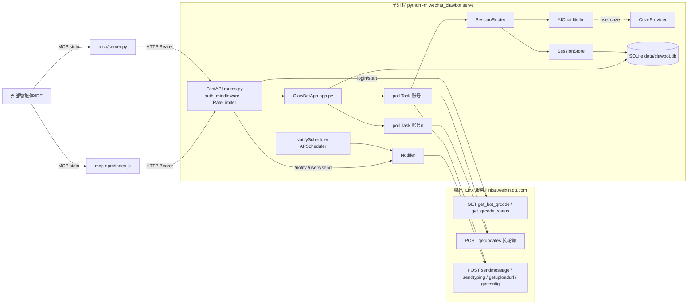
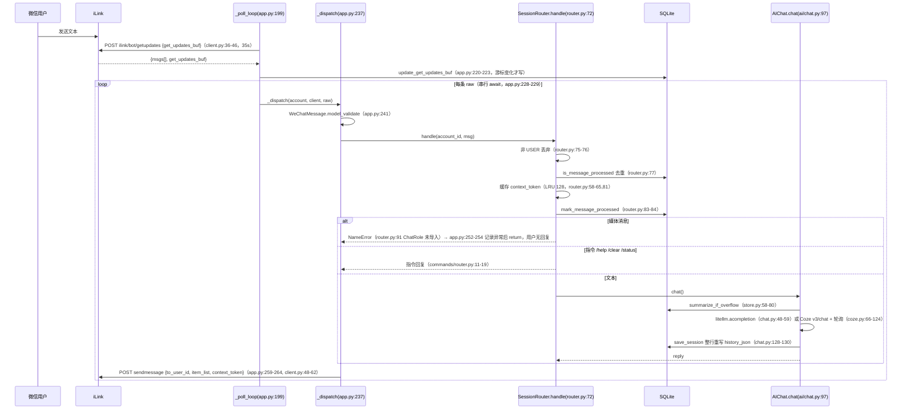
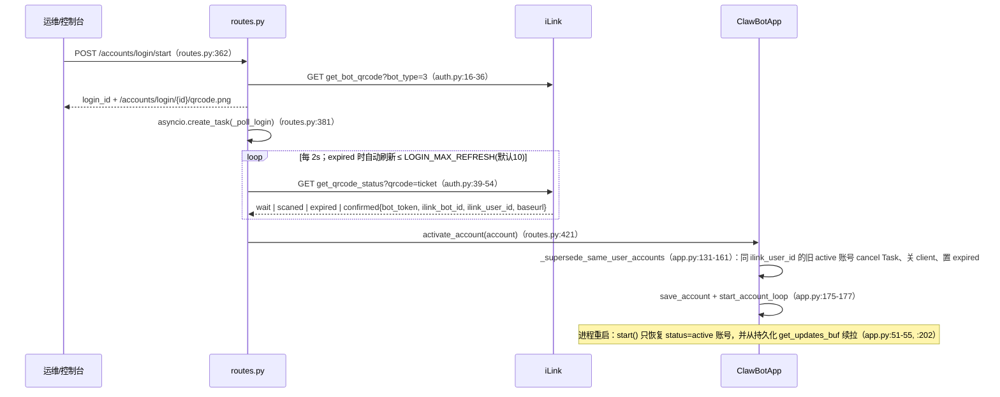
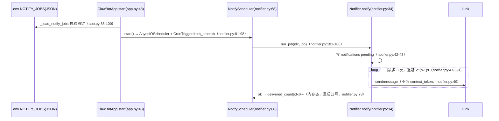
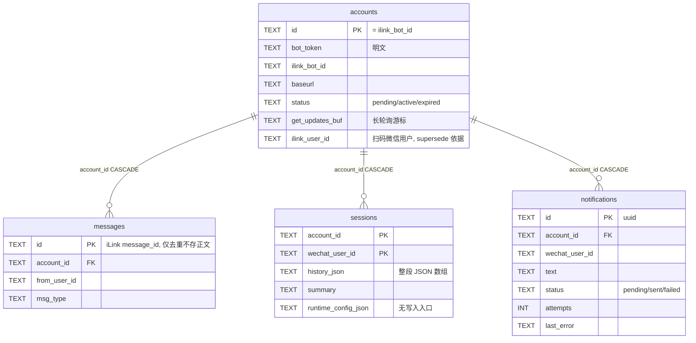
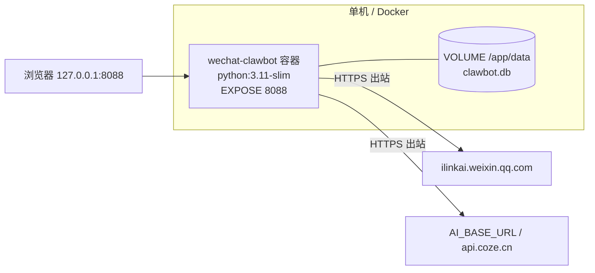

# 11 · WechatClawbot 技术架构与实现路线（WorkFleet V0.0.2 · 研究方法第 8 步）

> 分析对象：https://github.com/CodingHeader/WechatClawbot
> 分析版本：`main` @ `4ec3bbe8b7b35ff308715b03dfa4e93ecbaab6b5`（2026-09-04 09:49:30 +0800）
> V0.0.1 基线版本：`4ec3bbe8` → **上游无任何新提交**（`git ls-remote origin refs/heads/main` = `4ec3bbe8…`，2026-10-17 09:15 CST 复核）
> 本次新增：`git fetch --unshallow`，获得**完整 10 个提交**的历史（基线为 `--depth 1`），用于“实现路线”分析
> 本地路径：`/workspace/work/refs/WechatClawbot`
> 复跑证据（2026-10-17）：`pytest -q → 28 passed, 1 warning`（Python 3.12 venv `/tmp/wcv`，未装 litellm/mcp）；`/tmp/t_media.py → ERR NameError name 'ChatRole' is not defined`
> 证据标签：`已确认` · `部分确认` · `证据不足` · `存在缺陷` · `暂不执行`
> 所有 `file:line` 均指上述提交，路径相对 `src/wechat_clawbot/`（另注明者除外）。

---

## 0. 结论先行

| 问题 | 结论 | 标签 |
|---|---|---|
| 架构形态 | 单进程 asyncio 单体：FastAPI(uvicorn) + 每账号一个长轮询协程 + APScheduler + 同步 SQLite | 已确认 |
| 分层 | 接入层（iLink 协议）→ 编排层（ClawBotApp）→ 会话层（SessionRouter/Store）→ AI 层（litellm/Coze）→ 存储层（SQLite）；旁路：通知层、API/MCP 管理面 | 已确认 |
| 扩展机制 | 无插件系统；仅“AI 后端二选一”（`use_coze` 开关，懒加载 `ai/coze.py`）与“MCP 被外部智能体调用” | 已确认 |
| 实现路线 | 2026-07-31 ~ 08-02 三天内借助 AI 编码助手完成 10 个提交中的 9 个（仓库内有 `.workbuddy/memory/2026-07-31.md` 开发日志）；首提交即 46 文件 +5,148 行 | 已确认 |
| 对 WorkFleet 的价值 | **微信 ClawBot(iLink) 输出端适配器**的行为参考（7 个 HTTP 端点、扫码状态机、长轮询游标、context_token 回发、同用户重复扫码作废规则）；不宜作为底座 | 已确认（行为）/ 部分确认（真机） |
| 许可证 | 仓库根无 LICENSE（GitHub API `license: null`，2026-10-17 复核）；仅 `mcp-npm/package.json` 声明 MIT 且 `repository.url` 指向 `coze-clawbot` | 已确认 → **按协议行为自研重写，不拷贝源码** |

---

## 1. 分层架构

```
┌──────────────────────────────────────────────────────────────┐
│ L5 管理面    api/routes.py  FastAPI + 内嵌 HTML 控制台 + REST │
│              mcp/server.py（Python MCP stdio → 调本服务 HTTP）│
│              mcp-npm/index.js（Node MCP stdio → 调本服务 HTTP）│
├──────────────────────────────────────────────────────────────┤
│ L4 编排层    app.py ClawBotApp：账号生命周期、每账号 poll Task │
│              supersede 规则、purge 循环、NotifyScheduler 装配  │
├──────────────────────────────────────────────────────────────┤
│ L3 会话层    session/router.py SessionRouter（过滤/去重/       │
│              context_token LRU/媒体分支/指令分支）             │
│              session/store.py SessionStore（历史+摘要）        │
│              commands/router.py（/help /clear /status）        │
├──────────────────────────────────────────────────────────────┤
│ L2 AI 层     ai/chat.py AIChat（litellm）| ai/coze.py（Coze v3）│
│ L2' 通知层   notify/notifier.py Notifier + NotifyScheduler     │
├──────────────────────────────────────────────────────────────┤
│ L1 接入层    wechat/protocol.py 头部/随机 UIN                  │
│              wechat/auth.py 扫码状态机 + 二维码渲染            │
│              wechat/client.py iLink 五端点 HTTP 封装           │
├──────────────────────────────────────────────────────────────┤
│ L0 存储层    db.py 同步 sqlite3（WAL）四表；models.py Pydantic │
└──────────────────────────────────────────────────────────────┘
```

层间依赖证据：`app.py:12-20` 直接 import db、AIChat、Settings、models、Notifier、SessionRouter、SessionStore、login、WeChatClient——**编排层依赖具体类，未经接口抽象**（`已确认`）。全仓唯一的显式依赖倒置：摘要器作为回调注入会话层（`session/store.py:12-13 Summarizer`、`:58-80 summarize_if_overflow`）。

---

## 2. 组件图（Mermaid）



---

## 3. 关键时序图

### 3.1 消息入 → AI → 消息出（被动问答）



### 3.2 扫码绑定与“同用户重复扫码作废”（会话/绑定恢复）



要点：
- 本项目的“会话恢复”只有两层：① 账号级——重启后恢复 `active` 账号、游标续拉；② 用户级——`sessions(account_id, wechat_user_id)` 单行历史 + 摘要。**没有 session/resume ID 概念**（`已确认`）。
- `routes.py:407-412` 在 HTTP 登录路径中把账号 ID 取为 `ilink_bot_id or ilink_user_id or bot_id`；若 iLink 未返回 `ilink_bot_id`，会把**微信用户 ID 当作 bot ID**，与终端登录路径（`auth.py:142-143` 缺 bot_id 直接抛错）不一致 → `存在缺陷`（触发概率 `证据不足`）。
- `routes.py:381` 的 `create_task` 未保存引用，Task 理论上可能被 GC（Python 官方文档提示的已知风险）→ `部分确认`。

### 3.3 调度（cron 主动通知）



### 3.4 审批

**无审批流程**（全仓无 approval 相关代码，`已确认`）。唯一“人在回路”是 `POST /users/{aid}/{uid}/send`（`routes.py:569-578`）人工代发并写回历史。

---

## 4. 数据模型 / ER 图



证据：`db.py:44-86` DDL；`db.py:28-34` 每次调用新建连接并设 `journal_mode=WAL`、`foreign_keys=ON`。iLink 线协议模型：`models.py:33-56`（`MessageType USER=1/BOT=2`、`MessageState NEW=0/GENERATING=1/FINISH=2`、`MessageItemType TEXT=1…VIDEO=5`）、`models.py:89-103 WeChatMessage`（含 `context_token`、`session_id`、`seq` 等）。

---

## 5. 进程 / 线程 / 并发模型

| 维度 | 实现 | 证据 | 影响 |
|---|---|---|---|
| 进程 | 单进程；`asyncio.run(_serve())` | `__main__.py:14-38,61` | 无多实例、无水平扩展 |
| 事件循环 | 1 个 loop 承载 uvicorn + 全部 poll Task + AsyncIOScheduler + purge Task | `app.py:121-129`、`notifier.py:89` | 任一阻塞调用拖慢全部账号 |
| 每账号并发 | 1 个 `asyncio.Task` + 1 个 `httpx.AsyncClient`（read 40s） | `app.py:127-129`、`client.py:20-23` | 账号间并行 |
| 账号内并发 | **串行**：`for raw in msgs: await self._dispatch(...)` | `app.py:228-229` | 慢 AI（Coze 默认 60s）阻塞该账号后续拉取 |
| 存储 | 同步 `sqlite3` 在协程中直接调用，每次新连接 | `db.py:28-34` | 阻塞事件循环 |
| 重试/退避 | poll：≤5 次错 2s、>5 次 30s；401/403 → expired 停止；通知 3 次指数退避 | `app.py:206-235`、`notifier.py:47-59` | 简单可借鉴 |
| 关停 | `_stopping` Event + cancel Task + 关 client + scheduler.shutdown | `app.py:102-119` | 优雅 |

---

## 6. 技术栈与依赖清单（版本）

| 依赖 | 声明版本 | 用途 | 来源 |
|---|---|---|---|
| Python | `>=3.10`；镜像 `python:3.11-slim` | 运行时 | `pyproject.toml`、`Dockerfile:1` |
| fastapi | `>=0.115.0` | HTTP API + 控制台 | `pyproject.toml` / `requirements.txt` |
| uvicorn[standard] | `>=0.30.0` | ASGI | 同上 |
| httpx | `>=0.27.0` | iLink/Coze 异步 HTTP | 同上 |
| pydantic / pydantic-settings | `>=2.8.0` / `>=2.4.0` | 模型 / `.env` 配置 | 同上 |
| apscheduler | `>=3.10.4` | cron 通知 | 同上 |
| litellm | `>=1.50.0` | OpenAI 兼容 LLM | 同上 |
| qrcode[pil] | `>=7.4.2` | 二维码 | 同上 |
| python-dotenv | `>=1.0.1` | env | 同上 |
| mcp | `>=1.6.0` | Python MCP server | 同上 |
| dev：respx / pytest / pytest-asyncio | `>=0.21.1` / `>=8.3.0` / `>=0.24.0` | 测试 | 同上 |
| Node MCP 包 | Node `>=18`；`@modelcontextprotocol/sdk ^1.6.0`、`zod ^3.23.0` | `wechat-clawbot-mcp` | `mcp-npm/package.json` |

注：Python 依赖全部为下限约束且**无锁文件**；`requirements.txt` 还把 dev 依赖装进生产镜像（`已确认`）。

---

## 7. 配置体系

- 单一来源：`.env` → `Settings(BaseSettings)`（`config.py:12-65`），`extra="ignore"`，`lru_cache(maxsize=1)` 单例（`config.py:68-72`）。**无热更新、无 UI 编辑、无分层**。
- 关键项（默认）：`BASE_URL=https://ilinkai.weixin.qq.com`、`BOT_TYPE="3"`（`config.py:18`）、`LONG_POLL_TIMEOUT_MS=35000`、`DB_PATH=data/clawbot.db`、`AI_*`、`COZE_*`（PAT+BOT_ID 同时设置即启用 Coze，`config.py:41-45`）、`HOST=127.0.0.1`/`PORT=8088`（`config.py:47-48`）、`AUTH_TOKEN`（<16 字符拒绝启动，`config.py:62-65`、`__main__.py:24-28`）、`NOTIFY_JOBS`、`RATE_LIMIT_PER_MINUTE=60`、`SESSION_RETENTION_DAYS=30`、`LOGIN_MAX_REFRESH=10`。
- 会话级覆盖：`sessions.runtime_config_json` 可覆盖 `model/system_prompt`（`ai/chat.py:104-106`），但**无写入入口**（`session/store.py:50-55` 仅定义）。

---

## 8. 插件 / 扩展机制

| 扩展点 | 机制 | 证据 | 评价 |
|---|---|---|---|
| AI 后端 | `if settings.use_coze` 二选一，Coze 懒加载 | `ai/chat.py:27-42` | 硬编码分支，非注册表 |
| 指令 | `if text == "/help"…` 精确匹配 | `commands/router.py:11-19` | 无注册表 |
| 外部集成 | MCP（Python、Node 两套），6 个工具调用本服务 HTTP API | `mcp/server.py:51-105`、`mcp-npm/index.js` | **“智能体 → MCP → IM 推送”方向**值得借鉴 |
| 通道 | 无通道抽象；`WeChatClient` 被直接引用 | `app.py:20`、`notify/notifier.py:11` | 不可扩展到其他 IM |

---

## 9. 部署拓扑与资源



- `Dockerfile:1-14`：`pip install -r requirements.txt` → `CMD ["python","-m","wechat_clawbot","serve"]`；`VOLUME ["/app/data"]`、`EXPOSE 8088`。
- 只需出站 HTTPS（长轮询），不需公网入站——**对 WorkFleet“设备端运行”友好**（`已确认`）。
- 资源占用：未实测 → `证据不足`。

---

## 10. 设计模式

| 模式 | 位置 | 说明 |
|---|---|---|
| Long Polling + 游标持久化 | `app.py:199-229`、`client.py:36-46` | 断线续拉；ReadTimeout/ConnectTimeout 视为空包 |
| 状态机 | `auth.py:118-155`、`routes.py:389-452` | wait→scaned→confirmed / expired→refresh |
| Supersede（同主体新实例作废旧实例） | `app.py:131-161` | 平台约束下的业务规则 |
| 回调注入（依赖倒置） | `store.py:12-13,58-80` | 摘要器解耦 |
| Provider 工厂 | `app.py:40-46 _provide_client` | 通知复用在线连接 |
| Retry + 指数退避 | `notifier.py:47-59` | 投递可靠性 |
| Token Bucket 限流 | `routes.py:29-55 RateLimiter` | 按 IP、仅写方法 |
| Facade | `WeChatClient` | iLink 五端点 |

---

## 11. 实现路线（git 历史，完整 10 提交）

| # | 提交 | 时间(+0800) | 主题 | 规模 | 解读 |
|---|---|---|---|---|---|
| 1 | `88b3e07`（root） | 07-31 15:38 | 解耦 Coze 为可插拔 AI 后端；新增 npm MCP 包 | 46 文件 +5,148 | **首提交即近乎完整 MVP**（此前开发未入库） |
| 2 | `959e029` | 07-31 15:40 | 文档 | +25 | |
| 3 | `9da9ed8` | 07-31 16:10 | 修正 iLink 二维码协议（bot_type=3、GET 端点、渲染 qrcode_img_content）+ live 测试 | 10 文件 +152 | 协议靠试错校准 |
| 4 | `df3c0b9` | 07-31 18:00 | 二维码过期自动刷新、`/refresh`、`LOGIN_MAX_REFRESH` | 6 文件 +495 | |
| 5 | `f227ac4` | 07-31 19:52 | 公开 `GET /` HTML 控制台（显示 token） | +137 | **引入令牌泄露缺陷**（白名单 `/`） |
| 6 | `f8b36e9` | 07-31 21:34 | **iLink 枚举改整数、`msg_id`→`message_id`** | 7 文件 | 之前收到的消息被静默丢弃；据开发日志对照 `co-pine/wx-robot-ilink` 的 TS 类型修正 |
| 7 | `729cdcf` | 08-01 23:29 | 用户管理面板（`/users`、主动发送） | +186 | |
| 8 | `ed80fb5` | 08-02 00:07 | **同用户重复扫码自动作废旧 bot** | +156，含 3 测试 | 关键平台事实来源 |
| 9 | `a431613` | 08-02 00:21 | 聊天面板合并、发送写回历史、媒体支持 | 5 文件 +150 | **引入 `ChatRole` NameError**（`git blame session/router.py:86-95` → `a431613c`；import 行 L12 来自 root） |
| 10 | `4ec3bbe` | 09-04 09:49 | 同步本地状态后发布（二维码 URL 非图片兜底、新增开发日志条目） | 3 文件 +20 | 仓库公开日 |

路线特征（`已确认`，来自 git 与 `.workbuddy/memory/2026-07-31.md`）：
1. **AI 编码助手驱动的对话式迭代**：日志逐条记录“用户需求 → 实现 → pytest 数 → 重启 PID → commit”。
2. **协议知识来自逆向/对照**，非官方文档：第 3、6 次提交都是协议纠错。
3. **测试锁行为但覆盖有盲区**：用例数 23→25→28，但 mock 了 AI 与 iLink，未覆盖媒体分支，导致 #9 回归漏网。
4. **无重大重构**：模块划分自首提交起未变。

> 隐私提示（`已确认`）：`.workbuddy/memory/2026-07-31.md` 已随仓库公开，内含开发者本机代理端口、进程 PID 与一个真实 iLink 微信用户 ID（本报告不转载）。WorkFleet 仓库应把 AI 助手记忆目录加入 `.gitignore`。

---

## 12. 优缺点

| 优点 | 证据 |
|---|---|
| iLink 接入完整且小（协议层约 269 行） | `wechat/*` |
| 断线/过期/作废规则考虑周到 | `app.py:131-235` |
| 仅出站连接，易于设备端部署 | 长轮询 |
| MCP 双实现，智能体可主动推送 | `mcp/`、`mcp-npm/` |
| 28 个单测（复跑通过） | `tests/` |

| 缺点 | 证据 | 标签 |
|---|---|---|
| 账号内串行，不适合长任务 | `app.py:228-229` | 存在缺陷 |
| 同步 SQLite 阻塞事件循环 | `db.py:28-34` | 存在缺陷 |
| 媒体消息 NameError | `session/router.py:91` | 存在缺陷（2026-10-17 复跑确认） |
| `/` 泄露 AUTH_TOKEN | `routes.py:331,359` | 存在缺陷 |
| bot_token 明文 | `db.py:46` | 存在缺陷 |
| 无通道/输入抽象、无插件、无路由 | 全仓 | 已确认 |
| context_token 仅内存 LRU | `router.py:25,58-65` | 部分确认（影响待真机） |
| 无 LICENSE、零社区（0★/0 fork） | GitHub API 2026-10-17 | 已确认 |

---

## 13. 对 WorkFleet 的借鉴与迁移路线

### 13.1 移植清单

| 借鉴项 | WorkFleet 落点 | 方式 | 工作量（估算） | 约束 |
|---|---|---|---|---|
| iLink 端点：`get_bot_qrcode`、`get_qrcode_status`、`getupdates`、`sendmessage`、`sendtyping`、`getuploadurl`、`getconfig` | `channels/wechat-ilink` 适配器 | **按协议行为自研重写** | 2–3 人日 | 无 LICENSE |
| 请求头 `AuthorizationType: ilink_bot_token` + 随机 `X-WECHAT-UIN`（`wechat/protocol.py:12-29`） | 同上 | 行为复刻 | 含上 | 同上 |
| 扫码状态机 + 自动刷新 + 三种二维码渲染兜底（`auth.py:57-102`） | 管理后台“绑定通道”向导 | 重写 | 1–2 人日 | |
| `get_updates_buf` 游标持久化、401/403→expired、退避 | 通道健康管理 | 重写 | 0.5 人日 | |
| **同 `ilink_user_id` 只保留最新 bot** | 通道绑定规则 + UI 告警“请勿重复扫码” | 规则复刻 | 0.5 人日 | 需真机验证（`部分确认`） |
| context_token 回发 | 消息总线出站元数据，**持久化**而非 LRU | 改进后重写 | 0.5 人日 | 主动消息是否需要 token：`证据不足` |
| iLink 枚举常量 | 协议常量 | 重写（协议事实） | 0.2 人日 | |
| MCP 推送工具（6 个） | WorkFleet MCP Server：让 Claude Code 等主动推送到路由（加 route/tag 参数） | 思路借鉴、接口重设计 | 1 人日 | mcp-npm 声明 MIT |

### 13.2 必须规避的设计
1. 串行 `await` → WorkFleet 改为“入站持久化入队 + 立即回执 + 异步回发”。
2. 同步 sqlite → 异步驱动或独立写线程；消息原文 append-only 落库（满足按 session/resume ID 查记录）。
3. 凭证 → 加密存储；管理端独立登录，不在页面输出令牌。
4. 测试 → 覆盖媒体分支与真机回放用例。

### 13.3 迁移路线
- **P0（第 1 周）**：真机验证 3 个未决事实：同用户多 bot 路由、主动消息是否需 context_token、频控。
- **P1（第 2 周）**：在 WorkFleet `ChannelAdapter` 接口下实现 `wechat-ilink`（login/poll/send/typing/capabilities），复刻 supersede 规则。
- **P2**：MCP 推送工具接入路由表（管理模式 S1 闭环）。

### 13.4 许可证结论
无 LICENSE = 默认保留所有权利 → **只借鉴协议行为与业务规则，不拷贝源码**；直接复用代码须取得作者书面授权（`证据不足`，未联系作者）。iLink 服务条款对第三方网关的约束 `证据不足`。

---

## 14. 四轮方法收敛

- **5W1H**：What——单进程微信 iLink 问答/通知服务；Why——作者目标是“业务系统给用户发微信通知 + AI 问答”；Where/When——价值集中在 L1 接入层，应在 WorkFleet 通道层设计阶段引用；Who——个人作者 CodingHeader、腾讯 iLink；How——行为复刻；What if——iLink 字段变化（`MediaItem/MessageItem extra=allow` 有缓冲），iLink 关停则需企业微信/公众号备选。
- **苏格拉底追问**：“架构自首提交未变”凭什么？——10 个提交中 `app.py/db.py/models.py` 只有小改（`f8b36e9` 改枚举、`ed80fb5` 加 supersede），无模块增删；反证：首提交前的演进不可见 → 结论限定为“公开历史内”。
- **双向钢人**：支持“可作为微信适配器参考”——协议完整 + 测试 + 开发日志记录过真实运行；反对——无授权、本次未真机、代码量小自写成本低。裁决：**参考行为、重写代码**（`已确认`）。
- **最终判断**：允许以“微信通道行为参考”进入 WorkFleet 通道层设计；不允许作为代码依赖或底座。局限：未真机扫码；资源未测；iLink 条款未审。
