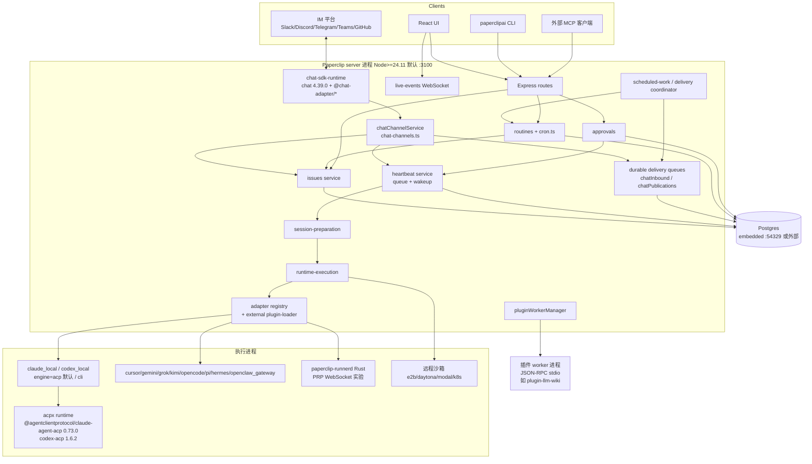
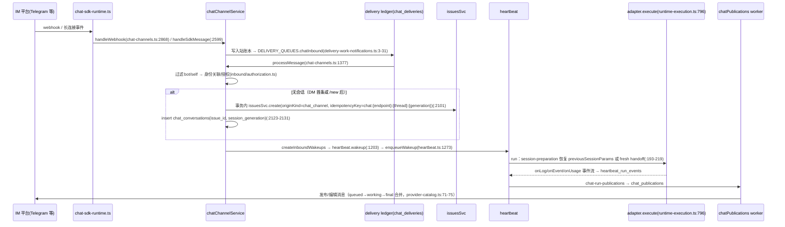
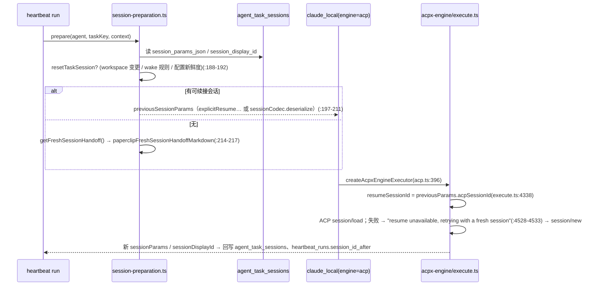
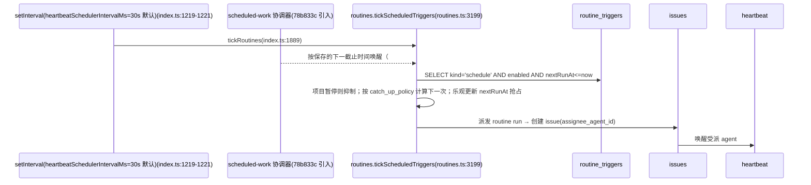
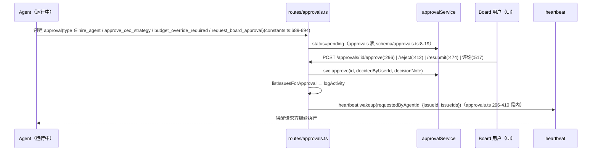
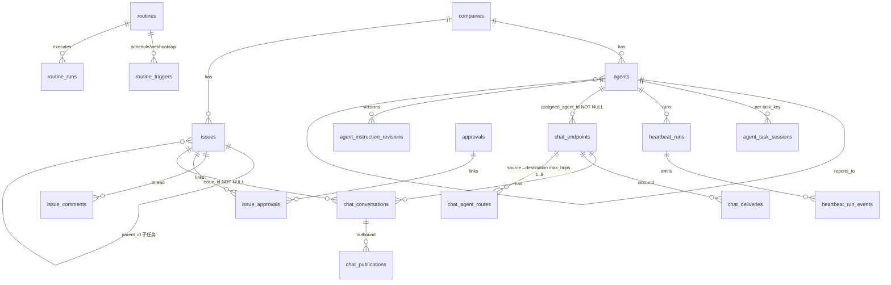
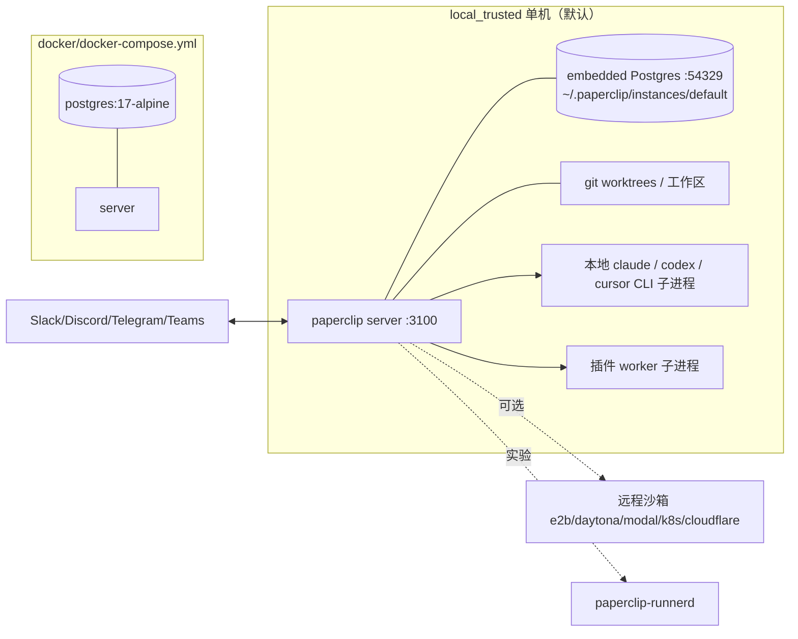

# 12 · Paperclip 技术架构与实现路线（WorkFleet V0.0.2 · 研究方法第 8 步）

> 分析对象：https://github.com/paperclipai/paperclip
> 分析版本：`master` @ `0528cc7ee0a00579cfa207d333085253accb6c4b`（2026-10-16 20:19:28 -0500 = 2026-10-17 09:19 +0800，“perf: overlap native GitHub and assigned-tool setup (#16620)”）
> V0.0.1 基线：`78b833c4`（2026-10-15 22:44 -0700）→ 新增 **27 个提交**，`git diff --shortstat 78b833c HEAD` = **296 文件，+21,284 / −2,509**（变更明细见 §11.3）
> 本次取数：先 `fetch --depth 400`，再 `fetch --filter=blob:none --unshallow`，得到**完整历史 5,330 个提交**（2026-02-16 ~ 2026-10-16）
> 本地路径：`/workspace/work/refs/paperclip`（10,651 个跟踪文件；`server/src/services` 753 项；`packages/db/src/schema` 170 文件；迁移 353 个）
> 方法：沿需求主线追调用链 + git 历史考古；**未安装依赖、未启动服务**（需 Node ≥ 24.11、pnpm 9.15.4、嵌入式 Postgres），运行期结论均标注
> 证据标签：`已确认` · `部分确认` · `证据不足` · `存在缺陷` · `暂不执行`
> 说明：基线报告中引用的关键文件（`chat-channels.ts`、`chat_channels.ts`、`provider-catalog.ts`、`adapter-utils/src/types.ts`、`adapters/registry.ts`、`routines.ts`、`index.ts`、`config.ts`、`session-preparation.ts`、`runtime-execution.ts`、`acpx-engine/execute.ts`、`claude-local/src/server/acp.ts`、`server/package.json`、`pnpm-workspace.yaml` 等）在 `78b833c..0528cc7` 间**均无改动**（`git diff --name-only` 输出为空，`已确认`），故沿用的 `file:line` 依然有效。

---

## 0. 结论先行

| 问题 | 结论 | 标签 |
|---|---|---|
| 架构形态 | **控制平面单体**（Express 5 + Postgres/Drizzle）+ **进程外执行**（本地 CLI 子进程 / ACP runtime / 远程沙箱 / 实验性 Rust `paperclip-runnerd`）+ 插件 worker 子进程（JSON-RPC over stdio） | 已确认 |
| 核心抽象 | Company → Goal/Project → Issue 树；Agent（`reports_to` 组织树、adapter）；Heartbeat Run（一次执行）；Routine（定时/触发）；Chat Endpoint/Conversation（IM 入口） | 已确认 |
| 并发模型 | Node 单线程事件循环 + `setInterval` 调度（默认 30s，`config.ts:413`）+ Postgres 持久化队列（`LISTEN/NOTIFY` 唤醒，行锁 + 幂等键）+ 子进程隔离 | 已确认（静态） |
| 扩展机制 | 两类：**Platform Module**（进程内，适配器/存储/密钥）与 **Plugin**（进程外 worker，manifest + capability 门控）；外部适配器包可热加载 | 已确认 |
| 实现路线 | 2026-02-16 一日内以 8 个“Add …”提交搭好 monorepo 骨架 → 3 月插件框架/routines → 4 月外部适配器/ACPX → 7 月 ACP 成为本地适配器默认引擎 → 8 月 Runner 协议 → 9 月聊天通道（opt-in）与模块化重构 → 10 月持久化投递队列、fast responses、primary agent、运行时同步钩子 | 已确认 |
| 对 WorkFleet | **移植接口与模型设计，依赖相同 ACP 官方包**；不 fork；可选“Paperclip 作为上游输入端”桥接 | 已确认（设计）/ 证据不足（运行） |
| 许可证 | MIT（`LICENSE`：Copyright (c) 2025 Paperclip AI） | 已确认 |

---

## 1. 分层架构

`server/src/modules/README.md`（2026-09-05 引入，`3ed5b7c5c`）规定了新代码的 `adapters → application → domain` 分层；存量代码仍以 `routes/` + `services/` 为主。综合仓库布局（`pnpm-workspace.yaml`）归纳为：

```
┌───────────────────────────────────────────────────────────────────────┐
│ L6 交互面   ui/（React 19 + Vite 8 + TanStack Query）· cli/（paperclipai）│
│             IM 通道（Slack/Discord/Telegram/Teams/GitHub/邮件/iMessage） │
│             MCP（packages/mcp-server、routes/public-mcp.ts）            │
├───────────────────────────────────────────────────────────────────────┤
│ L5 接入层   server/src/routes/*（约 100 个 Express 路由文件）            │
│             realtime/live-events-ws.ts（WebSocket 实时事件）           │
│             chat-sdk-runtime.ts（Vercel chat SDK 通道运行时）          │
├───────────────────────────────────────────────────────────────────────┤
│ L4 应用服务 server/src/services/*：issues、heartbeat、routines、        │
│             approvals、chat-channels、fast-responses、primary-agent、  │
│             scheduled-work、delivery-work-notifications、budgets…      │
├───────────────────────────────────────────────────────────────────────┤
│ L3 执行编排 heartbeat/{session-preparation, runtime-execution}.ts      │
│             adapters/registry.ts + plugin-loader.ts（适配器注册/加载） │
├───────────────────────────────────────────────────────────────────────┤
│ L2 执行适配 packages/adapters/*（12 个）· adapter-utils/acpx-engine    │
│             packages/paperclip-runner（Rust runnerd + PRP 协议，实验）  │
│             packages/plugins/sandbox-providers（e2b/daytona/modal/k8s…）│
├───────────────────────────────────────────────────────────────────────┤
│ L1 领域与契约 packages/shared（类型/常量/zod）· packages/db（Drizzle）  │
├───────────────────────────────────────────────────────────────────────┤
│ L0 基础设施 Postgres（嵌入式 embedded-postgres 或外部）· 文件存储 ·    │
│             git worktree 工作区 · 密钥提供方（本地/AWS）               │
└───────────────────────────────────────────────────────────────────────┘
```

---

## 2. 组件图（Mermaid）



---

## 3. 关键时序图

### 3.1 IM 消息入 → 智能体 → IM 消息出



### 3.2 会话续接（session / resume）



`/new`（IM 侧 `/clear` 的等价物）：`session_generation + 1` 并新建 issue（`chat-channels.ts:2098-2131`）；UI/API 侧 `POST /agents/:id/runtime-state/reset-session`（`routes/agents.ts:4180`）。

### 3.3 调度（routine）



### 3.4 审批



---

## 4. 数据模型 / ER 图（与 WorkFleet 相关子集）



关键字段（证据见基线 02 报告 §3.3，文件本次未变）：`agents.reports_to`（`packages/db/src/schema/agents.ts:34`）、`agent_task_sessions.session_params_json/session_display_id`（`agent_task_sessions.ts:23-25`）、`heartbeat_runs.session_id_before/after/native_session_id`（`heartbeat_runs.ts:63,72-73`）、`chat_endpoints.assigned_agent_id NOT NULL`（`chat_channels.ts:50`）、`chat_conversations.session_generation`（`chat_channels.ts:382`）、`chat_agent_routes`（`chat_channels.ts:706-746`）、`routine_triggers.cron_expression/timezone`（`routines.ts:118-119`）。

状态枚举（`packages/shared/src/constants.ts`）：Agent `active|paused|idle|running|error|pending_approval|terminated`（:16-24）；Issue `backlog|todo|in_progress|in_review|done|blocked|cancelled`（:189-197）；HeartbeatRun `queued|scheduled_retry|running|succeeded|interrupted|failed|cancelled|timed_out`（:919-928）；调用来源 `timer|assignment|on_demand|automation`（:896-901）。

【V0.0.2 新增表】`muse_runner.ts`（`2cc79923`/`93ab7bad`，2026-10-16）：`muse_agent_bindings`、`muse_credentials`、`muse_runner_assignments`、`muse_runner_operations`、`muse_mailbox_items`、`muse_input_deliveries`、`external_agent_holds`、`muse_idle_receipts`、`muse_receiver_contact_buckets`（`muse_runner.ts:10-89`）——外部 Runner 的邮箱/投递/占用模型；`resource_lifecycle_events`（`resource_lifecycle_events.ts:6`）——资源变更日志（agent_runtime 流）。迁移 `0347`–`0354`。

---

## 5. 进程 / 线程 / 并发模型

| 维度 | 实现 | 证据 | 标签 |
|---|---|---|---|
| 控制平面 | 单 Node 进程（事件循环）；`server.listen(listenPort, config.host)` | `server/src/index.ts:1027` | 已确认 |
| 数据库 | 嵌入式 Postgres 由同进程拉起并受 supervisor 守护（默认端口 54329） | `index.ts:430-602`；`config.ts:376` | 已确认 |
| 周期任务 | 多个 `setInterval`：执行控制对账、heartbeat 调度（≥10s，默认 30s）、技能源同步 5s、技能版本保留等；warm standby / idle drain 时跳过 | `index.ts:1215-1263`；`config.ts:413` | 已确认 |
| 持久化队列 | Postgres 表为权威，`LISTEN/NOTIFY` 仅作提交后唤醒；重连时扫描；无空轮询 | `delivery-work-notifications.ts:3-31`；`doc/plugins/AGENT_RUNTIME_SYNC.md` | 已确认（文档+代码） |
| 并发控制 | 行锁 `for("update")`、幂等键、乐观抢占 `nextRunAt`、endpoint 级 `burst/queue/debounce/drop/concurrent` | 基线 02 §3.5 | 已确认 |
| 智能体执行 | 每次 run 一个子进程/ACP runtime；ACP run 由 run coordinator 管 6 类资源（`acp_runtime`、`staged_runtime`、`control_bridge`、`agent_bridge`、`managed_home`、`staging_lease`），固定“启动→回合→结算→复现结果”顺序 | `doc/acp-run-lifecycle.md`；`acpx-engine/run-coordinator.ts`、`run-resource-ledger.ts`、`settlement-sequence.ts` | 已确认（结构） |
| 插件 | 每插件一个 `fork()` 子进程，JSON-RPC over stdio；崩溃有界退避重启；关停 10s→SIGTERM→5s→SIGKILL | `services/plugin-worker-manager.ts:21,2938`；`doc/plugins/PLUGIN_SPEC.md` §12 | 已确认 |
| 外部 Runner（实验） | Rust `paperclip-runnerd` 主动建立 PRP WebSocket，拥有 provider 进程组与持久传输状态；默认关闭 | `doc/architecture/paperclip-runner.md`（Status: Proposed，2026-08-24） | 已确认（文档） |
| 实时推送 | WebSocket live events | `index.ts:996 setupLiveEventsWebSocketServer` | 已确认 |

---

## 6. 技术栈与依赖清单（版本，来源 `package.json`）

| 层 | 依赖 | 版本 |
|---|---|---|
| 运行时 | Node / pnpm | `>=24.11.0` / `pnpm@9.15.4`（根 `package.json`） |
| Web | express | `^5.1.0` |
| ORM/DB | drizzle-orm / embedded-postgres | `^0.45.2` / `^18.1.0-beta.16` |
| 认证 | better-auth | `1.7.2` |
| 校验 | zod | `^4.4.3` |
| 实时 | ws | `^8.22.0` |
| 日志 | pino | `^10.0.0` |
| IM | chat（Vercel Chat SDK）+ `@chat-adapter/{discord,github,slack,teams,telegram}` | `4.39.0` |
| ACP | `@agentclientprotocol/claude-agent-acp` / `@agentclientprotocol/codex-acp` / `acpx` | `0.73.0` / `1.6.2` / `0.13.1`（均在 `pnpm-workspace.yaml` 打补丁） |
| MCP | `@modelcontextprotocol/sdk` | `^1.31.0` |
| 图像 | sharp | `^0.35.4` |
| UI | react / vite / tailwindcss / @tanstack/react-query / react-router-dom / typescript / vitest / lexical / @mdxeditor/editor | `^19.2.8` / `^8.2.2` / `^4.3.3` / `^5.102.8` / `^7.18.4` / `^7.0.2` / `^5.0.3` / `0.48.0` / `^4.2.3` |
| Runner | Rust（`packages/paperclip-runner/rust-toolchain.toml`）+ JSON Schema 生成契约 | 见包内 |
| 容器 | `node:24-trixie-slim` 多阶段（含 rust-toolchain / runner-build 阶段） | 根 `Dockerfile:2-164` |

未使用：Redis/BullMQ、node-cron/croner、dockerode（`server/package.json` 中均无，`已确认`）——队列与 cron 都是自研 + Postgres。

---

## 7. 配置体系

- 三层：环境变量 > 配置文件（`config-file.ts`）> 默认值，示例 `port: Number(process.env.PORT) || fileConfig?.server.port || 3100`（`config.ts:362`）；`embeddedPostgresPort ?? 54329`（`:376`）；`HEARTBEAT_SCHEDULER_INTERVAL_MS` 下限 10s、默认 30s（`:413`）。
- 部署模式：`local_trusted` | `authenticated`（`private` / `public` 两种暴露策略）（`doc/DEPLOYMENT-MODES.md:31-39,50`）。
- 运行时业务配置在 DB 并经 UI 编辑：agent `adapter_type/adapter_config/runtime_config`、chat endpoint、routine、company skills；适配器以 `getConfigSchema()` 声明表单（`adapter-utils/src/types.ts` `ServerAdapterModule`）。
- 密钥：`company_secrets*` 版本化 + 提供方（`doc/SECRETS-AWS-PROVIDER.md`）；插件配置只存 `secret_ref`（`PLUGIN_SPEC.md` §22）。

---

## 8. 插件 / 扩展机制

| 扩展类 | 机制 | 证据 | 对 WorkFleet |
|---|---|---|---|
| **适配器（Platform Module）** | `ServerAdapterModule`（`execute/testEnvironment/sessionCodec/listModels/listSkills/syncSkills/getConfigSchema…`）注册到 `adapters/registry.ts`；外部包 `loadExternalAdapterPackage`/`reloadExternalAdapter` | `adapter-utils/src/types.ts:504`；`plugin-loader.ts:181,221`（2026-03-31 `14d59da31` 引入） | ★★★★★ 输入端抽象蓝本 |
| **插件（out-of-process）** | manifest（capabilities、tools、jobs、webhooks、apiRoutes、managed agents/projects/routines/skills、UI slots）+ worker（`initialize/health/shutdown/onEvent/runJob/handleWebhook/getData/performAction/executeTool`） | `doc/plugins/PLUGIN_SPEC.md` §10-§13；`packages/plugins/sdk` | ★★★★ 能力门控、热插拔、at-least-once 事件 |
| **【V0.0.2】运行时同步钩子** | 插件 opt-in `resourceLifecycle: ["agent_runtime"]`；DB 变更边界写日志、提交后 NOTIFY 唤醒、按 agent 有序 at-least-once；`ctx.agents.getRuntime()` 返回配置/指令/技能/连接分配快照 | `doc/plugins/AGENT_RUNTIME_SYNC.md`（`9f4a956b`、`5fbece9d`、`5f5602bb`，2026-10-16） | ★★★ “配置变更→下游端点同步”可借鉴 |
| 沙箱提供方 | `environmentDrivers kind=sandbox_provider` | `packages/plugins/sandbox-providers` | ★ |
| 技能 | `skills/`、company skills、技能目录 | `packages/skills-catalog` | ★★★ 总控 skill 配置 |
| **聊天通道** | **不可由插件扩展**：provider 枚举写死在 TS 常量与 DB CHECK | `shared/types/chat-channels.ts:9-18`；`chat_channels.ts:123,289` | 中文 IM 必须自研（本次复核未变） |

---

## 9. 部署拓扑与资源



- 快速启动镜像：`docker/Dockerfile.onboard-smoke` 基于 `ubuntu:24.04`，`EXPOSE 3100`，`CMD npx paperclipai@… onboard --yes --bind lan`；`docker-compose.yml` 使用 `postgres:17-alpine`；另有 `quadlet`、`ecs-task-definition.json`。
- 资源：README 未给出硬件下限（本次未检索到），实际内存/CPU `证据不足`（未运行）。
- 端口：3100 / 54329 与 WorkFleet 约束 3000 / 3333 不冲突（`已确认` 默认值）。

---

## 10. 设计模式

| 模式 | 位置 | 说明 |
|---|---|---|
| Ports & Adapters（六边形） | `server/src/modules/README.md`、`adapter-utils/types.ts` | 适配器接口隔离执行引擎 |
| Registry + Tombstone | `adapters/registry.ts:185-198` | 退役的 `acpx_local` 保留墓碑，旧行明确失败而非静默回退 |
| Transactional Outbox / Durable Queue | `chat_deliveries`、`chat_publications`、`resource_lifecycle_events` + NOTIFY | 提交后唤醒、at-least-once |
| Idempotency Key | `chat:{endpoint}:{thread}:{generation}`（`chat-channels.ts:2101`） | 重复投递安全 |
| Generation Counter | `session_generation` | `/new` 后旧消息不污染 |
| Resource Ledger + Ordered Settlement | `acpx-engine/run-resource-ledger.ts`、`settlement-sequence.ts` | 资源必释放、结果在释放后返回 |
| Supervisor | `embedded-postgres-supervisor.ts`、plugin worker manager | 子进程守护与退避重启 |
| Capability-based Security | 插件 manifest capabilities | 宿主在 SDK 层拒绝越权 |
| Optimistic Claim | routines `nextRunAt` 乐观更新 | 多实例不重复触发 |
| Org-chart Delegation | `agents.reports_to` + 子 issue | 总控蓝本 |

---

## 11. 实现路线（git 历史，5,330 提交）

### 11.1 节奏
月度提交数：2026-02: 231 · 03: 1,548 · 04: 586 · 05: 182 · 06: 340 · 07: 496 · 08: 679 · 09: 627 · 10(至16日): 641。主要作者：Dotta 3,264、Devin Foley 759、Nicky Leach 306（`git shortlog -sn`）。发布：stable/beta/nightly/canary 多通道，标签 139 个（如 `canary/v2026.1015.0-canary.*`、`beta/v2026.1012.1-beta.0`、`nightly/v2026.1016.0-nightly.0`）。

### 11.2 里程碑（首次引入文件/特性的提交）

| 日期 | 提交 | 里程碑 |
|---|---|---|
| 2026-02-16 | `481b3a46d`…`09471314b` | 一天内 8 个 “Add …” 提交：脚手架、产品文档、shared 类型、Drizzle schema（`agents.ts`）、API server、React UI、任务模型规格、模块系统设计 |
| 2026-02-17/19 | `8c830eae7` / `4e3da4911` | `heartbeat_runs` / `agent_task_sessions`（会话续接从第 3 天就是一等公民） |
| 2026-02-18 | `cc2472209` | PGlite → embedded-postgres |
| 2026-03-07 | `a498c268c` | `openclaw_gateway` 适配器 |
| 2026-03-13 | `80cdbdbd4` | 插件框架 + 设置 UI；`cron.ts` |
| 2026-03-19 | `8f5196f7d` | Routines 自动化 |
| 2026-03-31 | `14d59da31` | 外部适配器插件系统 + 动态 UI 解析器 |
| 2026-04-06 | `8cdba3ce1` | `packages/mcp-server` |
| 2026-04-30 | `4272c1604` | ACPX 本地适配器运行时（#4893） |
| 2026-05-11 | `508355b8f` | `plugin-llm-wiki` |
| 2026-06-11 | `6f9801a46` | Board Chat（`routes/board-chat.ts`） |
| **2026-07-08** | `eedc7ddef` | **“Make ACP the default engine for local adapters” (#9238)**：`acpx-engine/execute.ts`、`claude-local/src/server/acp.ts` 诞生；`normalizeEngine` 缺省返回 `acp`（`acp.ts:86-88`）；`acpx_local` 随后退役为墓碑（`registry.ts:185-198`） |
| 2026-08-20 | `233c12f02` | kimi-local（CLI+ACP 双引擎） |
| 2026-08-24 | `fdbc69172` | Paperclip Runner Protocol (PRP) v1 schema（Runner ADR 同日） |
| 2026-09-05 | `3ed5b7c5c` | **重构**：把 active-run watchdog 抽成 feature module，确立 `modules/` 分层 |
| **2026-09-09** | `6abeb6733` | **opt-in 聊天 provider 与数据基础（#13100）**：`chat_channels.ts`、`chat-sdk-runtime.ts` 引入 |
| 2026-10-07 | `ae6f95ed7` | primary agent |
| 2026-10-09 | `835a02293` | 事务感知的投递队列唤醒（`delivery-work-notifications.ts`） |
| 2026-10-10 | `a7dd5284b` | fast responses |
| 2026-10-15 | `78b833c49` | scheduled-work：按保存的截止时间派发 routine/monitor（**V0.0.1 基线**） |
| 2026-10-16 | `2cc79923`、`93ab7bad`、`9f4a956b`、`5fbece9d`、`5f5602bb`、`6f8ad3d7` | **V0.0.2 增量**：外部 Runner 共享生命周期 + Muse 契约；运行时同步钩子；Runner session-local stdio MCP |

### 11.3 V0.0.1 → V0.0.2 增量（27 提交，`78b833c..0528cc7`）

| 类别 | 提交 | 要点 | 对 WorkFleet 影响 |
|---|---|---|---|
| 外部 Runner / Muse | `2cc79923`(#16444, 95 文件 +6,217)、`93ab7bad`(#16447, 37 文件 +6,825) | 共享外部 Runner 生命周期；Dot/Grok V6、home-mode V7、Muse V8 契约；Muse OAuth grant；新表 `muse_*` | 说明 Paperclip 正把执行面外移为独立 Runner 协议——印证“控制面/执行面分离”路线 |
| 运行时同步钩子 | `9f4a956b`(#16499)、`5fbece9d`(#16501)、`5f5602bb`(#16603) | agent_runtime 资源流、技能与连接分配同步；迁移 0348、0354 | “配置变更 → 外部端点同步”的可靠事件模式 |
| Runner MCP | `6f8ad3d7`(#16526) | session-local stdio MCP 传输（可执行文件摘要校验、Unix socket） | 设备端本地 MCP 工具接入参考 |
| 可靠性修复 | `d1463fb7`(#16589) 保存的投递截止时间跨时钟 tick 保持；`73659c6b`(#16586) Git 过期回收受管 checkout；`f5534717`(#16583) 租约清理保留未导出工作 | 调度精度、工作区回收 | 调度器实现细节参考 |
| 性能 | `b294abb9` run 事件单语句追加；`4de6335c` 认证时裁剪 run JSON；`3db33c13`/`f1d4bc16` Slack 准备/凭证读取收窄；`19008064` 目录分块发布；`0528cc7` 等 | 约 12 个 `perf` 提交 | 无架构变化 |
| 测试 | `564d4e1b`、`c0ac2772` | 稳定化 | — |

**未变（已确认）**：聊天通道 provider 列表与 DB CHECK、endpoint↔agent 1:1、conversation↔issue 必绑、能力矩阵、adapter 接口、routine/cron、`/new`、ACP 依赖版本。→ 基线 02 报告的全部核心结论**维持**。

---

## 12. 优缺点

| 优点 | 证据 |
|---|---|
| 输入侧最完整：12 个适配器，ACP 为本地默认引擎，含会话续接/失败回退 | `packages/adapters/*`、`acp.ts:86-88`、`execute.ts:4338-4533` |
| 可靠性工程强：持久化队列、幂等键、代数、资源账本、supervisor | §5、§10 |
| 治理完整：org chart、审批、预算、低信任预设、能力门控插件 | §3.4、§8 |
| MIT、社区极活跃（103,194★ / 17,264 fork，2026-10-17 GitHub API） | `LICENSE` |

| 缺点 | 证据 | 标签 |
|---|---|---|
| 中文 IM 全无，且插件不能扩展聊天通道 | `chat-channels.ts:9-18`、`chat_channels.ts:123,289` | 已确认 |
| 任务中心模型：1 endpoint = 1 agent、对话必须绑定 issue，不适合多对多消息路由/群发 | `chat_channels.ts:50,374`；能力矩阵 `proactiveDirectMessages` 多为 false | 已确认 |
| 体量与迭代速度极高（单日 27 提交、+21k 行），fork 维护成本高 | §11.3 | 已确认 |
| 依赖的 ACP 包需打补丁 | `pnpm-workspace.yaml patchedDependencies` | 已确认 |
| 运行资源、吞吐未验证 | 未运行 | 证据不足 |

---

## 13. 对 WorkFleet 的借鉴与迁移路线

### 13.1 移植清单

| # | 借鉴项 | Paperclip 来源 | WorkFleet 落点 | 方式 | 工作量（估算） | 许可 |
|---|---|---|---|---|---|---|
| 1 | 输入端接口形状 | `ServerAdapterModule`、`AdapterRuntime{sessionParams, sessionDisplayId, taskKey}`、`AdapterExecutionContext{signal, onLog/onEvent/onUsage}`（`types.ts:19-26,237,504`） | `InputAdapter` 接口 | 精简移植（去掉 workspace/sandbox/budget 耦合字段） | 2 人日 | MIT，保留版权声明 |
| 2 | ACP 执行 | 直接依赖 `acpx@0.13.1`、`claude-agent-acp@0.73.0`、`codex-acp@1.6.2`；参考 `execute.ts` 的 resume→fresh 回退 | Claude Code / Codex 输入端 | **依赖官方包 + 自写薄封装**，不搬 5,680 行引擎 | 3–5 人日 | 各包自身许可（`证据不足`，需逐个核查）；锁版本并评估补丁 |
| 3 | 会话模型 | `agent_task_sessions` + `heartbeat_runs.session_id_before/after` + `session_generation` | `sessions(input_id, native_session_id, display_id, generation)` + 按 resume ID 查询 API | 模型移植 | 1–2 人日 | MIT |
| 4 | 通道能力矩阵 | `provider-catalog.ts:17-105` 字段集 | `ChannelAdapter.capabilities` | 字段沿用 + 增加 `requiresContextToken`、`supersedeOnRescan` 等中文 IM 特性 | 0.5 人日 | MIT |
| 5 | 持久化投递队列 | `chat_deliveries`/`chat_publications` + NOTIFY 唤醒 | 入站/出站 outbox（SQLite 版可用轮询 + 内存信号） | 思路移植 | 3 人日 | MIT |
| 6 | 调度 | `routines`（cron+timezone+concurrency_policy+catch_up_policy）、`scheduled-work` 截止时间唤醒 | WorkFleet 调度器（另加 once、工作日/休息日、法定节假日） | 模型移植 + 扩展 | 3 人日 | MIT |
| 7 | 审批 | `approvals` + approve 后唤醒请求方 | 总控模式“重大决策/资源申请”上报到 IM 卡片按钮 | 流程移植 | 2 人日 | MIT |
| 8 | org chart 委派 | `reports_to` + 子 issue + skill 规则 | 总控“职业经理人 → 员工输入端”派工 | 设计借鉴 | — | MIT |
| 9 | 插件机制 | PLUGIN_SPEC：out-of-process worker、capabilities、at-least-once 事件 | WorkFleet 通道/输入端插件化 | 设计借鉴（简化） | 5 人日+ | MIT |
| 10 | 随时对话不打断 | endpoint `concurrency_policy`、fast responses（3s 回执） | 总控对话通道独立于执行队列 | 设计借鉴 | 1 人日 | MIT |

### 13.2 迁移路线
- **R1（主路线，推荐）**：自研轻量路由内核；按上表 #1–#7 选择性移植；依赖 ACP 官方包。
- **R2（可选桥接）**：S3“主项目+子项目总控开发”场景下，把 Paperclip 作为上游输入端，WorkFleet 通过 REST/MCP 读写 issue/comment，负责中文 IM 投递。
- **R3（不推荐）**：fork 并改造 `CHAT_PROVIDERS`/DB CHECK——上游单日即 +21k 行，冲突成本不可控。

### 13.3 许可证
MIT：可复制/修改/商用，须保留 `Copyright (c) 2025 Paperclip AI` 与许可文本。打补丁的第三方包与 `@chat-adapter/*` 的许可证 `证据不足`（未逐个核查）。

---

## 14. 四轮方法收敛

- **5W1H**：What——智能体公司控制平面；Why——“If OpenClaw is an employee, Paperclip is the company”，IM 只是任务入口；Where/When——借鉴点集中在 adapter-utils、adapters、heartbeat、routines、chat 能力矩阵，应在 WorkFleet 输入端/会话/调度层设计期引用；Who——Paperclip AI 团队（Dotta 等）；How——接口移植 + 官方 ACP 包；What if——上游继续把执行面外移到 Runner（§11.3），WorkFleet 借鉴的“直接适配器”接口可能被弱化 → 应以 ACP 协议本身而非 Paperclip 内部接口为长期契约。
- **苏格拉底追问**：“27 个新提交不改变结论”凭什么？——`git diff --name-only 78b833c HEAD` 对所有核心文件为空；新增表均为 Runner/Muse/资源日志；反证搜索：新增提交中无 `chat_providers`/`feishu`/`wechat` 改动 → 成立（`已确认`）。
- **双向钢人**：支持 fork——输入侧与治理最强；反对——中文 IM 硬约束、日更、体量。裁决：维持“选择性移植 + 可选桥接”。
- **最终判断**：允许以接口/模型借鉴进入 WorkFleet 架构设计；不允许 fork 作为既定方案。局限：未运行；补丁内容未审；资源未测。
