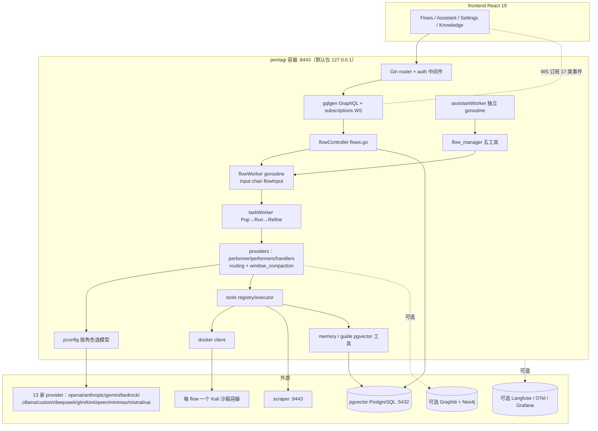
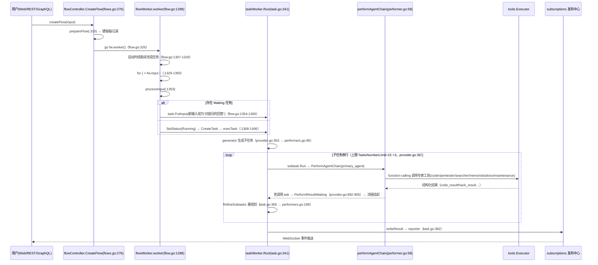
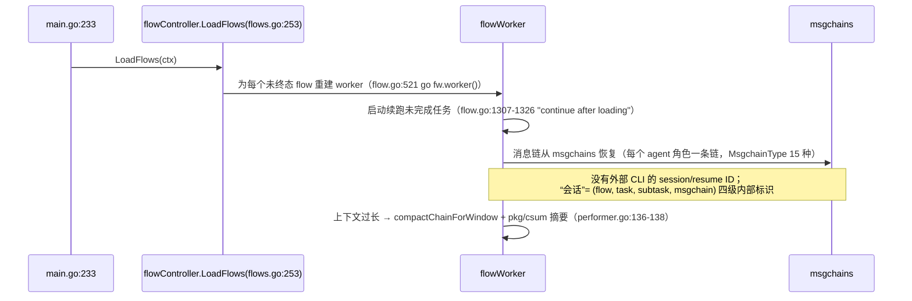
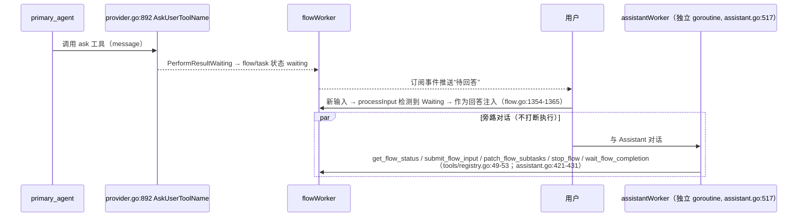
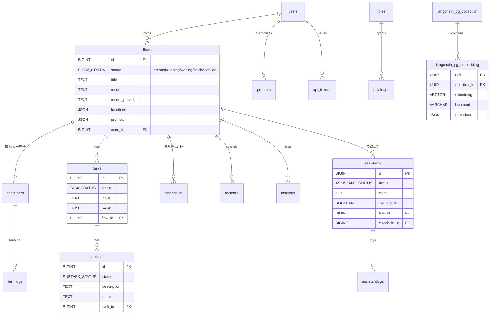
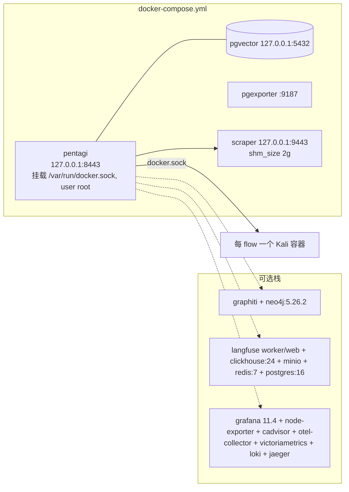

# 13 · PentAGI 技术架构与实现路线（WorkFleet V0.0.2 · 研究方法第 8 步）

> 分析对象：https://github.com/vxcontrol/pentagi
> 分析版本：`main` @ `843dfeb4bfc809c09d1bc5022e567c602d8fc9dd`（2026-10-10 03:53:25 +0700 = 2026-10-10 04:53 +0800）
> V0.0.1 基线：`843dfeb` → **上游无新提交**（`git ls-remote origin refs/heads/main` = `843dfeb4…`，2026-10-17 09:16 CST 复核；GitHub API `pushed_at` = 2026-10-10 04:54 +08:00）
> 本次新增：`git fetch --unshallow`，获得**完整 952 个提交 + 10 个 tag**（基线为 `--depth 1`），用于“实现路线”分析
> 本地路径：`/workspace/work/refs/pentagi`
> 方法：以仓库自带 `CLAUDE.md`（架构权威说明）为纲，沿 `cmd → controller → providers → tools → database/migrations` 读源码 + git 考古；**未编译、未运行**（需 Docker + PostgreSQL + LLM Key），运行期结论一律标注
> 证据标签：`已确认` · `部分确认` · `证据不足` · `存在缺陷` · `暂不执行`
> 路径相对 `backend/`（另注明者除外）。

---

## 0. 结论先行

| 问题 | 结论 | 标签 |
|---|---|---|
| 架构形态 | Go 单体后端（Gin + gqlgen GraphQL + sqlc + goose）+ React 前端 + PostgreSQL/pgvector；每个 flow 一个 Docker 沙箱容器 | 已确认 |
| 核心范式 | Flow（输入 channel + 单 worker goroutine）→ Task（generator 分解、primary_agent 执行、refiner 每步重规划、reporter 汇总）→ 专家子智能体（以“工具”形式委派）→ Docker 工具 | 已确认 |
| 总控相关价值 | ① Waiting/ask 屏障（上报等人）；② reflector/mentor/迭代上限三道护栏；③ Assistant 旁路对话 + `flow_manager` 五工具；④ 按角色配置模型 + 可编辑提示词模板 | 已确认（代码）/ 证据不足（效果） |
| 并发 | **单 flow 串行**：`CLAUDE.md:218` “there is no queue”；flow/assistant 各自一个 goroutine | 已确认 |
| 实现路线 | 2026-03-26 以单个 `repo final state`（936 文件 +414,095 行）落库 → v2.0.0(04-11) 前端/dashboard/运行时切换 provider → v2.1.0(05-29) assistant 工具、知识库、匿名化 → v2.2.0(10-04) 567 提交：多租户 schema、Graphiti、OpenCode/xAI/Bedrock/中国厂商 provider、routing doors、`6f3d29c` 大规模“port major fixes”（853 文件 ±16.8 万行） | 已确认 |
| 对 WorkFleet | **借鉴设计范式，不复用代码**（领域强耦合 + 串行模型 + Docker 依赖） | 已确认 |
| 许可 | `LICENSE` MIT（Copyright 2025 PentAGI Development Team）**并存** `EULA.md`：仅限“合法渗透测试用途”、禁止以其他形式再分发衍生品 | 已确认（文本）；对“仅借鉴设计/重写代码”的约束 → **证据不足，需法务** |

---

## 1. 分层架构

```
┌───────────────────────────────────────────────────────────────────┐
│ L5 交互面  frontend/（React 19 + Vite 8 + Tailwind 4 + Apollo 4 + │
│            graphql-ws + @xterm/xterm）；cmd/installer（TUI 向导）  │
├───────────────────────────────────────────────────────────────────┤
│ L4 接入层  pkg/server/router.go（Gin：REST + GraphQL + 鉴权中间件）│
│            pkg/graph（gqlgen）+ pkg/graph/subscriptions（WS 推送） │
├───────────────────────────────────────────────────────────────────┤
│ L3 编排层  pkg/controller/{flows,flow,task,subtask,assistant}.go   │
│            flowWorker（input chan + 单 goroutine）、taskWorker 循环 │
├───────────────────────────────────────────────────────────────────┤
│ L2 智能体层 pkg/providers/{performer,performers,handlers,assistant,│
│            helpers,routing,window_compaction}.go                   │
│            pkg/providers/pconfig（按角色配模型）、13 个 provider 包 │
│            pkg/templates/prompts/*.tmpl（可编辑 + 渲染校验）       │
├───────────────────────────────────────────────────────────────────┤
│ L1 工具层  pkg/tools/{registry,executor,terminal,browser,memory,   │
│            guide,search,flow_manager}.go（Tool 接口 Handle/IsAvailable）│
├───────────────────────────────────────────────────────────────────┤
│ L0 基础设施 pkg/database（sqlc + goose 37 迁移，含 tenant.go 多租户）│
│            pkg/docker（每 flow 一容器）· pgvector · 可选 Graphiti/  │
│            Langfuse/OTel · pkg/csum 摘要 · pkg/cast 链 AST          │
└───────────────────────────────────────────────────────────────────┘
```

启动编排（`cmd/pentagi/main.go`，282 行，`已确认`）：`config.NewConfig()`(:58) → Langfuse/OTel 观测器(:87-99) → `database.New`(:133) + gorm(:138) + pgxpool(:150) → **租户 schema 处理**(:168 注释指向 `pkg/database/tenant.go`) → goose 迁移 → 更新检查 goroutine(:214) → 可选 pprof(:218) → `docker.NewDockerClient`(:221) → `providers.NewProviderController`(:226) → `subscriptions.NewSubscriptionsController`(:230) → `controller.NewFlowController`(:231) → **`controller.LoadFlows(ctx)` 恢复未完成 flow**(:233) → `router.NewRouter`(:237) → HTTP serve(:241)。

---

## 2. 组件图（Mermaid）



---

## 3. 关键时序图

### 3.1 输入 → 智能体 → 输出



### 3.2 会话 / 恢复



### 3.3 调度

**无调度器**（`grep -rln "cron\|robfig"` 仅命中测试文件；`backend/go.mod` 无 cron 依赖，`已确认`）。定时能力需外部（cron/外部编排器）调 REST `createFlow`。仓库内有一份 RFC 提案 `examples/proposals/flow_concurrency.md`（`295e7d3`，2026-05-07）讨论**持久化 flow 队列 + 完成 webhook**：明确要求队列必须持久化、可见、可管理、显式晋升、at-least-once webhook，并记录 PR #268 的“内存队列”方案**因隐藏生命周期状态被拒**——这段设计评审对 WorkFleet 的调度/队列设计极有参考价值（`已确认` 为提案，非实现）。

### 3.4 审批 / 上报（ask 屏障 + Assistant 旁路）



护栏三道闸（`已确认` 代码，效果 `证据不足`）：
1. **格式闸 reflector**：模型返回文本而非工具调用时介入（`performer.go:611`），每链最多 3 次。
2. **行为闸 mentor/adviser**：同名工具连续调用或总调用超阈值触发（`helpers.go:174-175 shouldInvokeMentor`，阈值 `ExecutionMonitorSameToolLimit/TotalToolLimit`，可整体关闭）。
3. **预算闸**：agent 链迭代上限（通用 100 / 受限 20，`performer.go:36-38`）、子任务上限 15（`provider.go:36`）、`flow_manager` 输出截断与 `waitFlowMaxTimeout=1h`（`tools/flow_manager.go:46-60`）。

---

## 4. 数据模型 / ER 图



表清单（37 个迁移累计，`已确认`）：`roles, privileges, users, prompts, flows, containers, tasks, subtasks, toolcalls, msgchains, termlogs, msglogs, screenshots, searchlogs, vecstorelogs, assistants, assistantlogs, agentlogs, api_tokens, user_preferences, user_resources, flow_templates, providers, langchain_pg_collection, langchain_pg_embedding`。
`MsgchainType` 15 种角色（`pkg/database/models.go:195-211`）：primary_agent、reporter、generator、refiner、reflector、enricher、adviser、coder、memorist、searcher、installer、pentester、summarizer、tool_call_fixer、assistant。

【V0.0.2 复核·新增事实】
- 多租户：`pkg/database/tenant.go`（`ca48268`，2026-07-30）——`TENANT_ID` 非空时把租户 search_path 追加进 DSN，并用 advisory lock 做 bootstrap；要求 `vector` 扩展装在所有租户共享的 schema（`tenant.go:16-28,54,78`）。
- 会话注销：`users.session_generation`（迁移 `20260718_120000_user_session_generation.sql`）——cookie 携带签发时的 generation，中间件拒绝落后的 cookie，**无服务端会话表的注销方案**，对 WorkFleet 管理后台可借鉴。
- Provider 13 家（`pkg/providers/provider/provider.go:51-63`）：openai、anthropic、gemini、bedrock、ollama、custom、deepseek、glm、kimi、qwen、minimax、mistral、xai；枚举在 DB 中也是 enum（迁移 `20260227_120000_add_cn_providers.sql` 等逐个 ALTER TYPE）→ **新增 provider 要动迁移**，扩展成本高。

---

## 5. 进程 / 线程 / 并发模型

| 维度 | 实现 | 证据 |
|---|---|---|
| 进程 | 单 Go 进程 `pentagi`（容器），外加 pgvector、scraper 容器；每 flow 另起 Kali 沙箱容器 | `docker-compose.yml:25,241,290`；`pkg/docker` |
| flow 并发 | 每 flow 一个 `go fw.worker()`（`flow.go:326,521`）+ 无缓冲 `input chan flowInput`（`flow.go:75,293`）；`processInput` 串行处理 | 已确认 |
| flow 内任务 | 子任务**串行**，无队列（`CLAUDE.md:218`） | 已确认 |
| assistant | 独立 goroutine（`assistant.go:306,496`）与独立 msgchain/日志表，通过 `flow_manager` 工具与 flow 交互 | 已确认 |
| 互斥 | `flowController` 用 `sync.Mutex` + `flowEntry` 做生命周期互斥（`flows.go:129,156,174-253`）；`ErrFlowStateGuard` 防无意义重试（`flow_manager.go:22`） | 已确认 |
| 恢复 | 启动 `LoadFlows` + worker 内续跑 | 已确认 |
| 并发上限 | **无**：每个 `createFlow` 立刻起容器与 worker（RFC `flow_concurrency.md` 原文指出此现状） | 已确认 |
| 竞态验证 | assistant 与执行 worker 同时改同一子任务的竞态**未验证** | 证据不足 |

---

## 6. 技术栈与依赖清单（版本）

**后端**（`backend/go.mod`，Go `1.26.5`）：
| 依赖 | 版本 | 用途 |
|---|---|---|
| github.com/gin-gonic/gin（+ cors/gzip/sessions/static） | v1.10.0 | HTTP |
| github.com/99designs/gqlgen | v0.17.57 | GraphQL |
| github.com/gorilla/websocket | v1.5.3 | 订阅 |
| github.com/jackc/pgx/v5 | v5.9.2 | PG 驱动/pool |
| github.com/lib/pq · github.com/sqlc-dev/pqtype | v1.10.9 · v0.3.0 | sqlc |
| github.com/pressly/goose/v3 | v3.19.2 | 迁移（嵌入二进制） |
| github.com/jinzhu/gorm | v1.9.16 | 局部 ORM |
| github.com/vxcontrol/langchaingo | v0.1.14-update.8 | LLM/向量（自家 fork） |
| github.com/vxcontrol/cloud · graphiti-go-client | v1.0.1 · v0.9.0 | 云 API、知识图谱 |
| github.com/moby/moby/{api,client} | v1.55.0 / v0.5.1 | Docker 沙箱 |
| aws-sdk-go-v2 + bedrockruntime | v1.41.5 / v1.50.4 | Bedrock |
| golang-jwt/jwt/v5 · coreos/go-oidc/v3 | v5.2.2 · v3.11.0 | 认证/OAuth2 |
| go.opentelemetry.io/otel | v1.45.0 | 追踪 |
| charmbracelet/{bubbletea,bubbles,glamour,lipgloss} | v1.3.10 等 | installer TUI |
| creack/pty · hashicorp/golang-lru/v2 · invopop/jsonschema | v1.1.24 · v2.0.7 · v0.12.0 | 终端/缓存/schema |

**前端**（`frontend/package.json`）：react `^19.2.7`、react-dom `^19.2.7`、vite `^8.0.16`、tailwindcss `^4.3.3`、@apollo/client `^4.2.10`、graphql-ws `^6.0.8`、graphql `^16.14.2`、typescript `^6.0.3`、react-router-dom `^7.18.2`、zod `^4.4.3`、@xterm/xterm `^6.0.0`、@tanstack/react-table `^8.21.3`、vitest `^4.1.9`、@playwright/test `1.61.1`。

**无 cron / 无消息队列 / 无 Redis**（`已确认`）。

---

## 7. 配置体系

- 单一 env 结构体 `pkg/config/config.go`（175 个 `env:"…"` 标签，`已确认`）+ `.env.example`；`caarlos0/env/v10` + `joho/godotenv`。
- 分层能力：provider 既可来自 env（内置），也可由用户在 UI 创建（迁移 `providers` 表）；**用户自定义 provider 优先于内置**（`a12ffe9` fix #220，2026-04-05）。
- 按角色模型配置：`pkg/providers/pconfig/config.go:144-162 OptionsTypePrimaryAgent…`。
- 提示词模板：`pkg/templates/prompts/*.tmpl`，可由用户编辑并在保存前做渲染校验（`prompts` 表 + `pkg/templates`）。
- 密钥脱敏：`config.GetSecretPatterns()`（`config.go:491`）；匿名化 Replacer（单例化修复 `e909f40`，2026-06-25）。
- 多实例/多租户：`TENANT_ID` + schema（`34a9cd2`、`ca48268`，2026-07-29/30）。
- 安装向导：`cmd/installer`（Bubble Tea TUI），带更新检查协议（`2d39d1f`）。

---

## 8. 插件 / 扩展机制

**无插件系统**（`已确认`）。扩展靠“注册表 + 多点改动”：
- 新 LLM provider：`CLAUDE.md` 明确列出 **9 处改动**（含 `pkg/providers/registry.go` 的 `registryEntry{Type,Name,Enabled,NewConfig,New,BuildConfig}`、DB enum 迁移、前端设置页）。当前 11 个 registry 条目 / 13 个 ProviderType。
- 新搜索引擎：7 步（`CLAUDE.md`），迁移里能看到逐个加枚举（searxng、sploitus、firecrawl）。
- 工具：`tools.Tool` 接口仅两方法 `Handle(ctx,name,args)` / `IsAvailable()`（`pkg/tools/tools.go:76-79`），注册在 `pkg/tools/registry.go`（工具名常量 L13-53）。**接口极简，可被 WorkFleet 直接采纳为“员工/能力”抽象**。
- MCP 客户端：**未实现**，仅有 RFC `examples/proposals/mcp_client_integration.md`（明确声明不改变运行时）。同目录另有 K8s 部署、Vertex AI、无头爬虫、证据链等 9 份提案 → **提案驱动的扩展治理方式**值得借鉴。

---

## 9. 部署拓扑与资源



- 最小要求（README “System Requirements”）：**2 vCPU / 4 GB RAM / 20 GB 磁盘**（`已确认`，README:591-593）。可选栈会显著抬高资源需求（`证据不足`，未实测）。
- 默认全部端口绑定 `127.0.0.1`，适合单机自托管；但必须挂载 `docker.sock` 且容器 `user: root`（`docker-compose.yml:230,235`）——**对 WorkFleet“设备端总控”是重安全负担**。
- 上传限制：单文件 300 MB、单请求 1000 文件 / 2 GB（README:1138）；删除 flow 不清理磁盘目录（README:1141，`存在缺陷`：运维需手工回收）。

---

## 10. 设计模式

| 模式 | 位置 | 对 WorkFleet |
|---|---|---|
| Actor（worker + input channel） | `flow.go:75,293,1288-1350` | 总控 ManagerWorker 模型 |
| 屏障（ask → Waiting → 输入即回答） | `provider.go:892-905`、`flow.go:1354-1365` | “上报 → IM 回复 → 继续” |
| Plan-Execute-Replan | `task.go:341-382`、`performers.go:96,189` | 需求拆解-派工-复盘 |
| 工具化委派（专家 = function call） | `tools/registry.go:13-35`、`handlers.go` | 外部 CLI 会话包装成同构“员工工具” |
| 旁路控制面（Assistant + flow_manager） | `assistant.go:355-431`、`tools/flow_manager.go` | 与总控随时对话不打断任务 |
| 三道护栏 | §3.4 | 总控把关 |
| Registry（单一事实源） | `providers/registry.go:25-32` | 适配器注册；但其“9 处改动”反模式要避免 |
| Advisory Lock + schema 隔离 | `database/tenant.go:54,78` | 多实例启动安全 |
| 生成代码（sqlc + gqlgen）+ 嵌入式迁移 | `pkg/database`、`pkg/graph` | 类型安全数据层 |
| Session Generation（无状态注销） | 迁移 `20260718_120000` | 管理后台注销 |

---

## 11. 实现路线（git 历史，952 提交 / 10 tag）

### 11.1 节奏
月度提交：2026-03: 10（含一次性落库）· 04: 130 · 05: 233 · 06: 210 · 07: 330 · 08: 28 · 09: 3 · 10: 8。作者：Sergey Kozyrenko 615、Dmitry Ng 204、mason5052 91 等（`git shortlog -sn`）。
tag：v0.1.0–v1.2.0 **全部指向同一个提交 `b90ea47`**（即首次落库，历史被压扁）；v2.0.0=`87ac00f`(04-11)、v2.1.0=`a112db2`(05-29)、v2.2.0=`b611fbe`(10-04)。

### 11.2 里程碑

| 日期 | 提交/标签 | 里程碑 |
|---|---|---|
| 2026-03-26 | `b90ea47` “repo final state” | **936 文件 +414,095 行**一次性落库（v0.1.0–v1.2.0 均指此处）→ 真实早期演进不可见（`证据不足`） |
| 2026-03-29 | `600419b`、`c8cd0e6` | 许可合规报告工具；Docker host network + 终端执行改进 |
| 2026-04-08 | `7c25f35`（52 文件） | **运行时切换 provider** |
| 2026-04-08/09 | `089dcb3`（21 文件 +3,717）、`53ea23e` | flow 模板管理；dashboard |
| 2026-04-11 | **v2.0.0** `87ac00f` | 前端重做 + Graphiti/Langfuse 测试补齐（v1.2.0..v2.0.0 共 29 个非合并提交） |
| 2026-04-24 | `5067e8f`（21 文件 +2,864） | **Assistant flow 管理工具 + 摘要缓存**（`pkg/tools/flow_manager.go` 诞生） |
| 2026-05-03 | `b254ff6` | flow_manager 运行中任务的错误处理 |
| 2026-05-05 | `3a52079`（41 文件 +10,641） | **pgvector 知识库管理** |
| 2026-05-07 | `295e7d3` | RFC：持久化 flow 队列 + 完成 webhook（记录 PR #268 内存队列被拒） |
| 2026-05-12 / 05-17 | `2f4da11`、`3180363` | 匿名化 mutation + 知识文档“Anonymize”操作 |
| 2026-05-29 | **v2.1.0** `a112db2` | v2.0.0..v2.1.0 共 278 非合并提交 |
| 2026-06-25 | `e909f40` | 匿名化 Replacer 单例修复 |
| 2026-07-25 | `2d87a1f`、`5a4f1f5` | 瞬态错误重试 `callWithSetupRetries`；内部搜索分析引擎 |
| 2026-07-29/30 | `34a9cd2`、`ca48268` | **多实例 + 多租户 schema** |
| 2026-08-04 | `454569a`、`2da929d`、`db68cde` | OpenCode、xAI provider；provider 重命名/重置 |
| 2026-08-12 | `2d39d1f`、`17bc0e1` | installer 更新协议；compose 镜像变量 |
| **2026-09-25** | `6f3d29c` “port major fixes” | **853 文件 +96,371 / −72,219**：`providers/routing.go`、`routing_doors.go`、`window_compaction.go` 等诞生——**本仓库最大一次重构**（路由/门控与上下文窗口压缩） |
| 2026-10-02/03 | `3cfe5cb`、`55a063e` | 知识文档校验重构；Bedrock provider |
| 2026-10-04 | **v2.2.0** `b611fbe` | v2.1.0..v2.2.0 共 567 非合并提交；类型分布：docs 52、test(e2e) 34、markdown-editor 相关 50+、webui/ui 40+、providers 18、flows 9 |
| 2026-10-09/10 | `e7f3000`、`843dfeb` | README 重写（**V0.0.1 与 V0.0.2 共同基线**） |

### 11.3 路线特征
1. **先产品化后开源**：压扁的早期历史 + 一次性大提交，公开后才有细粒度演进（`已确认`）。
2. **Provider 广度优先**：198 个提交命中 “provider”，覆盖 13 家（含 deepseek/glm/kimi/qwen/minimax 等中国厂商）——WorkFleet 若需多模型可直接抄这份“覆盖清单”。
3. **总控能力分三步长出来**：工具委派（初始）→ Assistant + flow_manager（2026-04）→ 护栏与路由门控（2026-09 `6f3d29c`）。
4. **提案先行**：`examples/proposals/` 9 份 RFC 明确“本文不改运行时”，并记录被拒方案与理由——对 WorkFleet 的设计评审制度有直接借鉴价值。
5. **工程纪律严**：`CLAUDE.md` 用大篇幅规定注释密度（逻辑文件 0–2%）、测试纪律、密码策略双端一致。

---

## 12. 优缺点

| 优点 | 证据 |
|---|---|
| 总控状态机完整（分解/重规划/屏障/护栏/旁路） | §3 |
| 工具接口极简（2 方法），角色提示词可编辑并校验 | `tools/tools.go:76-79`、`pkg/templates` |
| 13 家 provider，按角色选模型 | `provider.go:51-63`、`pconfig:144-162` |
| 安全：权限点、OAuth2/JWT/API token、密钥脱敏、匿名化、登录限流、默认仅本机绑定 | `pkg/server/router.go`、`config.go:491` |
| 知识库 pgvector + 可选 Graphiti | `20260501_120000_knowledge.sql`、`pkg/graphiti` |
| 工程纪律与 RFC 治理 | `CLAUDE.md`、`examples/proposals/` |

| 缺点 | 证据 | 标签 |
|---|---|---|
| 无外部 CLI/ACP 输入端、无 IM 输出端、无路由模式 | `tools/registry.go` 全部工具名；grep 无 IM | 已确认 |
| 无调度器、无 flow 并发上限与队列 | 无 cron 依赖；RFC 原文 | 已确认 |
| 子任务串行，不满足“多输入端并发会议” | `CLAUDE.md:218` | 已确认 |
| 领域强耦合（39 个渗透测试提示词模板） | `pkg/templates/prompts` | 已确认 |
| 扩展成本高（新 provider 9 处改动 + DB enum 迁移） | `CLAUDE.md`、迁移文件 | 已确认 |
| 必须 Docker socket + root | `docker-compose.yml:230,235` | 已确认（安全负担） |
| 删除 flow 不回收磁盘 | README:1141 | 存在缺陷 |
| EULA 限定用途并禁止其他形式再分发衍生品 | `EULA.md:15,21` | 已确认（文本）/ 法务待定 |

---

## 13. 对 WorkFleet 的借鉴与迁移路线

### 13.1 移植清单（**一律设计移植 / 重写，零代码拷贝**）

| # | 借鉴项 | PentAGI 来源 | WorkFleet 落点 | 工作量（估算） | 备注 |
|---|---|---|---|---|---|
| 1 | Manager worker（input chan + 单 goroutine + Waiting 语义） | `flow.go:1288-1406` | 总控 `ManagerWorker`：有待答问题时新消息即回答 | 3 人日 | 需改为可并发多员工 |
| 2 | Plan-Execute-Replan 循环 | `task.go:341-382`、`performers.go:96,189` | 需求澄清 → 派工 → 每步复盘 | 3 人日 | 子任务改为“向某 ACP 会话派发 prompt” |
| 3 | 三道护栏（格式/行为/预算） | `performer.go:36-38,611`；`helpers.go:174-191` | 总控把关 + 成本闸（需可开关） | 2 人日 | PentAGI 已有 `ExecutionMonitorEnabled` 开关 |
| 4 | ask 屏障 → IM 上报 | `provider.go:892-905` | “重大决策/资源申请”推送到 IM，回复即继续 | 2 人日 | 配合分级分类器（PentAGI 无分级） |
| 5 | Assistant + flow_manager 五工具 | `assistant.go:421-431`；`tools/registry.go:49-53` | “与总控随时对话不打断任务”：status / send_input / patch_tasks / stop / wait | 3 人日 | 含状态守卫与输出截断 |
| 6 | 按角色模型 + 可编辑模板 + 渲染校验 | `pconfig/config.go:144-162`；`pkg/templates` | 总控/会议主持/摘要/分类各自选模型；skill 可编辑 | 2 人日 | |
| 7 | 工具接口 `Handle/IsAvailable` | `tools/tools.go:76-79` | 员工/能力统一抽象 | 0.5 人日 | |
| 8 | 持久化队列 RFC 的四条原则 | `examples/proposals/flow_concurrency.md` | WorkFleet 任务队列设计准则（持久化/可见/可管理/显式晋升/at-least-once） | — | **直接写进设计文档** |
| 9 | 密钥脱敏 + 匿名化（外发前） | `config.go:491`；anonymizer | 出站 IM 消息脱敏 | 1 人日 | 合规刚需 |
| 10 | 无状态注销 session_generation | 迁移 `20260718_120000` | 管理后台登出 | 0.5 人日 | |
| 11 | 多租户 schema + advisory lock bootstrap | `database/tenant.go` | 多团队隔离（若需要） | 2 人日 | |
| 12 | 13 家 provider 覆盖清单（含国内） | `provider/provider.go:51-63` | 模型选型参考 | — | |
| 不复用 | Docker 沙箱、searchers、渗透测试模板、installer | — | — | — | 领域无关 |

### 13.2 必须规避
1. **串行**：WorkFleet 总控需并发派工多个输入端（DAG/邮箱模型，参考 Orca，见基线 04 报告）。
2. **无并发上限**：按 RFC 的四原则实现持久化队列。
3. **扩展要改 9 处 + DB enum**：WorkFleet 用注册表 + 配置表，避免枚举入库。
4. **Docker socket + root**：WorkFleet 设备端总控不应要求特权。

### 13.3 迁移路线
- **P0**：法务结论——EULA 是否约束“仅借鉴设计、独立实现”。在此之前**零代码拷贝**（当前即按此执行）。
- **P1**：把 §13.1 的 #1/#2/#4/#5 写入 WorkFleet《总控模式设计》，与 Orca 的 Run/Task/Dispatch/Mailbox 模型合并为统一状态机。
- **P2**：最小闭环 PoC：单经理 + 串行派工 + ask 上报到微信，再扩到并发。

### 13.4 许可证
MIT + EULA 并存：EULA 第 15 行把使用限定为“合法渗透测试用途”，第 21 行禁止以本协议之外的形式再分发软件或其衍生品（同时又说“修改与再分发按 MIT 条件允许”）——**两段文本自身存在张力**，因此：代码零拷贝、仅借鉴公开可见的设计思想；商业使用前需法务确认（`证据不足`）。

---

## 14. 四轮方法收敛

- **5W1H**：What——渗透测试自动化平台，具备完整“经理人+专家团队”引擎；Why——WorkFleet 总控的难点在状态机/护栏/旁路对话，PentAGI 恰覆盖这三点；Where/When——借鉴点在 `pkg/controller/*`、`pkg/providers/{performer,performers,assistant,helpers}`、`pkg/tools/{registry,flow_manager}`，应在总控模块设计期引入；Who——vxcontrol（Sergey Kozyrenko 主导）；How——设计移植 + 本语言重写；What if——若需并发多员工则串行模型不适用；若只用便宜模型，reflector/mentor 会放大成本（已有开关）；若 Docker 不可用则整体不可运行。
- **苏格拉底追问**：“上游无新提交”凭什么？——`git ls-remote` 与 GitHub API `pushed_at`（2026-10-10）双证据；“最大重构是 `6f3d29c`”凭什么？——按 `--stat` 行数排序确认 853 文件 ±16.8 万行，且 `routing*.go`、`window_compaction.go` 的首次出现提交即是它。反证：压扁的早期历史使 2026-03 之前的演进不可见 → 路线分析**限定于公开历史**。
- **双向钢人**：支持 fork 作总控底座——状态机/护栏/旁路/provider/记忆全现成、工程质量高；反对——EULA、员工是内部 LLM 而非外部 ACP 会话（替换需重写 performer/handlers/tools 三层）、串行、Docker 重、模板全为渗透域。裁决：**反对意见成立，fork 不可行；设计借鉴成立**（`已确认`）。
- **最终判断**：允许作为设计参考进入 WorkFleet 总控架构设计；不允许作为代码依赖进入实现，直至法务确认。局限：未部署、未验证护栏效果与并发竞态、资源未实测。
