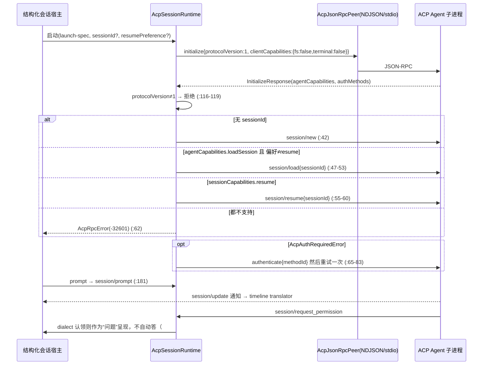
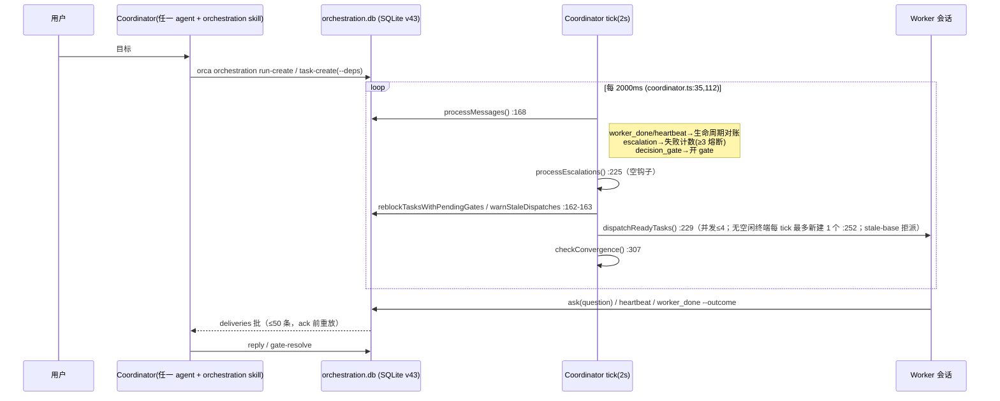
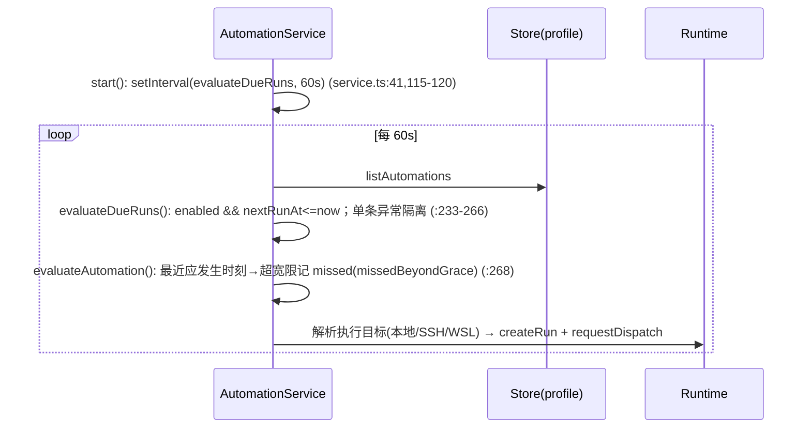
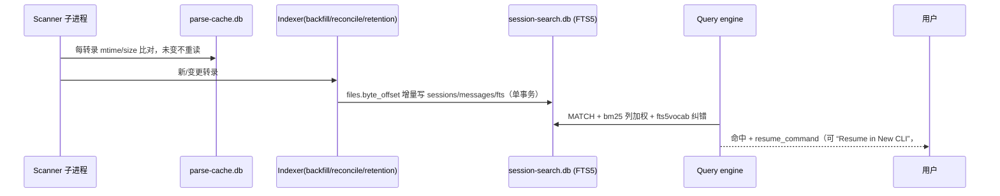
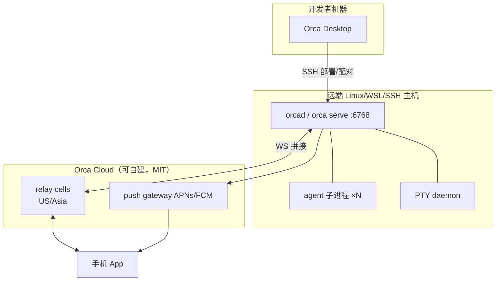

# 14 · Orca 技术架构与实现路线（AideanFleet V0.0.2 · 研究方法第 8 步）

> 分析对象：https://github.com/stablyai/orca（MIT，Copyright (c) 2026 Lovecast Inc.）
> **最新版本**：`main` @ `fd1c6a592cc98f4ae6348f2bb101337a4b6f90a6`（2026-10-16 18:15 -0700 = **2026-10-17 09:15 +08:00**，“fix(orcad): never claim or reclaim another machine's server… (#29902)”），`package.json` 版本仍为 `1.4.214`
> **V0.0.1 基线**：`a8e3734e`（2026-10-15 22:58 -0700，#29399）。经全历史无树克隆核实 `a8e3734e` 是 HEAD 的祖先（`git merge-base --is-ancestor` 通过）；基线→HEAD **330 个提交**，`git diff --shortstat`：2,342 files，+99,839 / −26,971。
> 本地代码：`/workspace/work/refs/orca`（工作树，`git fetch --depth 300` 后检出最新）；演进分析用 `/workspace/work/refs/_hist/orca.git`（`--bare --filter=tree:0` 全历史，**14,712 个提交**，2026-03-16 “Initial commit” 起）。
> 方法：沿 `src/main/{acp,runtime/orchestration,automations,ai-vault,ai-vault-search,orcad,notifications,server}`、`src/shared/automation-*`、`src/cli/specs/*`、`skill-guides/orchestration*` 读源码；演进路线来自提交标题统计（不读每个 diff）。**未构建、未运行**（Electron + node-pty 原生模块）。
> 证据标签：`已确认`（读到当前代码）· `部分确认` · `证据不足` · `存在缺陷` · `暂不执行`
> 交叉引用：`04-Orca深度分析.md`（同目录，V0.0.2 修订版）、`15-Hindsight技术架构与实现路线.md`。

---

## 0. 结论先行

1. **Orca 的架构本质**：一个“**多智能体运行时内核**（`OrcaRuntimeService` + 结构化会话宿主 + PTY 守护进程）”被三种宿主外壳承载——Electron 桌面、`orca serve`（Electron 无窗口）、`orcad`（纯 Node 24 守护进程）；其上叠加 **编排（SQLite 邮箱 + DAG + 熔断 + gate）**、**自动化调度（60s tick）**、**会话转录索引（FTS5）**；对外经 **本地 RPC（默认 6768）→ 云中继 → 手机 App** 暴露。`已确认`
2. **输入端接入是三通路**：ACP（Grok/OpenCode/OMP，2026-10-05 起才独立成层）/ 厂商 SDK 结构化流（Claude Agent SDK、Codex app-server）/ PTY+hooks 兜底（其余 TUI agent）。`已确认`
3. **基线以来最相关的变化**（§11 详述）：① ACP 层新增“托管运行时（managed runtime）只在用户要求时安装”“每进程私有临时目录”“每个 chat 自己的权限模式”；② 编排邮件提示对结构化会话改为**立即投递（delivery:'now'）并在有待答权限请求时“held”**；③ 会话解析缓存改为**每转录一行的 SQLite**；④ `orcad` 大量健壮性修复（跨机锁、端口 6768 回退、重启保活）。**核心 schema（编排 v43、会话检索 v6）与调度器未变**。`已确认`
4. **对 AideanFleet 的定位不变**：首选“按模块移植（MIT）”——ACP 客户端（peer + session setup + launch-spec 表 + dialect）、编排 schema/状态机、调度解析、会话索引；不整体 fork。新增两条可借鉴：**托管运行时安装器** 与 **“权限请求挂起时延迟投递”** 的 IM 侧等价策略。`部分确认`

---

## 1. 分层架构（What）

| 层 | 职责 | 代表路径 | 标签 |
|---|---|---|---|
| L0 宿主外壳 | 桌面 Electron；`orca serve`（Electron 无窗口）；`orcad`（纯 Node） | `src/main/index*`、`src/cli/specs/serve.ts`、`src/main/orcad/main.ts:1`（“Executable entry for `orcad`”） | 已确认 |
| L1 进程与终端 | 子进程统一执行/取消/终止；PTY 守护进程（可比宿主活得久） | `src/packages/process-host`（`package.json` “host subprocess execution, cancellation, and termination”）、`src/main/daemon/`、`src/main/pty/` | 已确认 |
| L2 智能体接入 | ACP 客户端、Claude Agent SDK、Codex app-server、TUI+hooks | `src/main/acp/`（51 个非测试文件）、`src/main/claude/`、`src/main/codex/`、`src/main/agent-hooks/` | 已确认 |
| L3 结构化会话宿主 | 统一 journal、时间线、mid-turn 队列、`/clear` `/compact` rewind | `src/main/native-chat/`、`runtime/orchestration/structured-session-lineage.ts:24` | 已确认 |
| L4 编排 | Run/Task/Dispatch/Mailbox/Gate/Federation | `src/main/runtime/orchestration/`（90 个非测试项）、`db/schema/*` | 已确认 |
| L5 自动化 | 定时 prompt 派发、外部作业管理 | `src/main/automations/`、`src/shared/automation-*`、`src/main/orcad/orcad-automations.ts` | 已确认 |
| L6 会话库 | 转录扫描（按文件名统计 18 个 agent 专用 parser/sources，另有 claude/openclaw/omp 等由 primary/graph 等通用解析器覆盖）+ FTS5 检索 + resume_command | `src/main/ai-vault/`、`src/main/ai-vault-search/` | 已确认 |
| L7 对外接口 | CLI（agent 也用）、本地 RPC、配对、手机/云 | `src/cli/`、`src/main/runtime/rpc/`、`src/main/server/serve-*`、`cloud/apps/{relay,push,relay-fence-broker,relay-ops}`、`mobile/` | 已确认 |
| L8 UI | React 19 渲染进程 | `src/renderer/` | 已确认（未深读） |

### 1.1 组件图

```mermaid
flowchart LR
  subgraph Hosts[宿主外壳]
    E[Electron 桌面]
    S[orca serve<br/>Electron 无窗口]
    D[orcad<br/>纯 Node 24]
  end
  subgraph Core[OrcaRuntimeService 运行时内核]
    PH[@orca/process-host]
    PTY[PTY daemon<br/>可独立存活]
    subgraph Agents[智能体接入 三通路]
      ACP[ACP Client<br/>peer+setup+launch-spec+dialect]
      SDK[Claude Agent SDK /<br/>Codex app-server]
      TUI[TUI + agent-hooks]
    end
    SSH[结构化会话宿主<br/>journal/queue/lineage]
    ORCH[编排<br/>coordinator tick 2s<br/>SQLite v43]
    AUTO[自动化<br/>tick 60s]
    VAULT[AI Vault 扫描<br/>parse-cache SQLite]
    FTS[Session Search<br/>FTS5 v6]
    NOTI[通知扇出]
  end
  CLI[orca CLI<br/>人与 agent 共用]
  RPC[本地 RPC :6768]
  RELAY[cloud relay]
  PUSH[cloud push<br/>APNs/FCM]
  MOB[手机 App<br/>Expo + OTA web bundle]
  E & S & D --> Core
  ACP & SDK & TUI --> SSH
  SSH --> ORCH
  AUTO --> SSH
  VAULT --> FTS
  ORCH --> NOTI
  CLI --> RPC --> Core
  RPC <--> RELAY <--> MOB
  NOTI --> PUSH --> MOB
  PH -.-> ACP & SDK & TUI
  PTY -.-> TUI
```

---

## 2. 关键时序

### 2.1 ACP 会话 new / load / resume（`已确认`）

证据：`acp-session-runtime.ts:107-119`（initialize 与协议版本校验）、`:161`（调用 setup）、`:181/201/206/223`（prompt/cancel/set_mode/set_model）、`acp-session-setup.ts:34-84`、`generated/acp-protocol.generated.ts:200`（`ACP_PROTOCOL_VERSION = 1`）。



要点：
- **Orca 不向 ACP agent 暴露 fs/terminal 能力**（`acp-session-runtime.ts:110`）——agent 自己读写文件，Orca 只做会话/权限/时间线。`已确认`
- Peer 有硬上限：单行 16 MiB、写队列 32 MiB、并发请求各 128（`acp-peer-limits.ts:13-21`）。`已确认`
- launch-spec 是数据行：`GROK_LAUNCH_SPEC`(`acp-launch-specs.ts:112`)、`OPENCODE`(`:156`)、`OMP`(`:188`)、汇总 `ACP_LAUNCH_SPECS`(`:216`)；字段含 `dialect / loginCommand / authMethod / account / supportsVersion / installDirectories / managedRuntime / compaction / modelDiscovery / transcriptImport / sessionHistory / privateTempDirectory`（`:64-110`）。`已确认`

### 2.2 编排：Run / Task / Dispatch / Mailbox / Escalation（`已确认`）



- 熔断阈值：`DISPATCH_CIRCUIT_BREAK_FAILURES = 3`（`db/dispatch-context/dispatch-circuit-breaker.ts:2`），在 `dispatch-completion.ts:168` 判定。`已确认`
- 邮箱批：`messaging-and-gates.md:18`（“up to 50 messages, and replays that exact batch until acknowledged”）。`已确认`
- **AI 自动分解仍未实现**：`coordinator.ts:146`。外发策略仍为空钩子：`coordinator.ts:226`。`已确认`
- 【V0.0.2 新】结构化会话的邮件提示：`structured-mailbox-pointer-host.ts` 由 `delivery:'queue'` 改为 `delivery:'now'`，并在 `beforeRun` 中若会话存在“可操作的提示”（如待答权限）则抛 `StructuredMailHeldError` → `held`；`structured-mailbox-pointer-delivery.ts` 改为循环：投递成功后重新派生新到邮件，`held` 时等提示消失再试（提交 #28540 “native-chat agents get their mail notice right away”）。`已确认`

### 2.3 调度（`已确认`）


- 预设：hourly/daily/weekdays/weekly/custom（`src/shared/automation-schedules.ts:10-26`）。错过策略只有 `run_once_within_grace`（`automations-types.ts:8`）。
- **RRULE 解析只接受 `FREQ=HOURLY|DAILY|WEEKLY`，只读 BYHOUR/BYMINUTE/BYDAY，`COUNT/UNTIL` 被忽略**（`automation-schedule-parsing.ts:39-68`）→ 基线“RRULE COUNT=1 能否实现单次”的疑问 **已确认：不能**。每月只能用 5 段 cron（`:70-` `parseCronExpression`）。`已确认`
- `orcad` 也运行调度：`orcad/orcad-automations.ts:1-24`（“orcad executes the profile's schedules, as `orca serve` on Electron does”）。

### 2.4 会话检索（`已确认`）

`ai-vault` 按文件名统计 18 个 agent 专用解析器（antigravity/cline/codebuddy/codex/copilot/cursor/devin/droid/gemini/grok/hermes/jcode/kimi/kiro/muse/opencode/qoder/zcode…，`ls src/main/ai-vault/session-scanner-*-parser.ts`）→ 解析缓存 `session-parse-cache-database.ts`（【V0.0.2 新】每转录一行 SQLite，`SESSION_PARSE_CACHE_SCHEMA_VERSION = 4`，`:14`）→ 索引器 → `session-search-schema.ts`：`sessions(agent, session_id, file_path, title, cwd, branch, message_count, resume_command, content_hash…)`(`:25-51`)、`files`(`:55`)、`messages`(`:77`)、`messages_fts USING fts5(user_text, assistant_text, tool_text, identifiers, unicode61 tokenchars '_.-/+', detail=full)`(`:21,89-91`)，schema v6（`:15`）。打开/重建逻辑【V0.0.2】抽到共享 `sqlite/versioned-cache-database`（`:94-106`）。



### 2.5 `/clear` 谱系

`clearedInto(record)`：`conversationCommand.command==='clear' && phase==='committed'` → `replacementSessionId`（`structured-session-lineage.ts:24-29`）；`runs.coordinator_orca_session_id` 对 `/clear` 过的 chat 记录谱系根（`create-core-tables-sql.ts:10-11`）。结构化 `/clear` `/compact` 命令始于 #19164（2026-09-06）。`已确认`

---

## 3. 数据模型 / ER

```mermaid
erDiagram
  runs ||--o{ messages : run_id
  runs ||--o{ tasks : run_id
  runs ||--o{ deliveries : run_id
  tasks ||--o{ dispatch_contexts : task_id
  tasks ||--o{ decision_gates : task_id
  tasks ||--o{ tasks : parent_id
  dispatch_contexts ||--o{ worker_dispatches : ""
  runs { text id PK; text objective; text coordinator_handle; text coordinator_orca_session_id; int consumer_generation }
  messages { int sequence PK; text id UK; text from_handle; text to_handle; text type; text priority; text thread_id; text payload; int read; text delivered_at }
  deliveries { text id PK; text mailbox_handle; int consumer_generation; text message_ids; text status }
  tasks { text id PK; text spec; text status; text deps_json; text result }
  dispatch_contexts { text id PK; text assignee_handle; text assignee_orca_session_id; text status; int failure_count; int depth; text last_heartbeat_at }
  decision_gates { text id PK; text question; text options; text status; text resolution }
  coordinator_runs { text id PK; text spec; text status; int poll_interval_ms }
```
- 证据：`runs`(`create-core-tables-sql.ts:5`)、`messages`(`:23`，type 9 种、priority 3 级，`:31-37`)、`deliveries`(`:90`，status outstanding/acknowledged/fenced)、`worker_dispatches`(`:144`)、`structured_pointer_operations`(`:212`)；`tasks`(`create-graph-tables-sql.ts:115`)、`dispatch_contexts`(`:140`)、`decision_gates`(`:188`)、`coordinator_runs`(`:208`)；联邦表 `federated_dispatches/remote_questions/federation_relay_items`(`:25,84,101`)。`已确认`
- 迁移：`SCHEMA_VERSION = 43`（`db/contract-constants.ts:23`），`migrate()` 单事务 BEGIN IMMEDIATE、成功才写 `user_version`（`db/schema/migrate.ts:18-52`），v2→v43 分步函数；有版本偏斜处理 `orchestration-schema-version-skew`。`已确认`
- 其他库：会话检索库（v6）、解析缓存库（v4）、结构化 chat journal 库（“one structured-chat journal database per host, owned by one process”，#23613）、profile store。**多个独立 SQLite，按职责隔离、按“缓存可丢弃”与“状态需迁移”区分**。`已确认`

---

## 4. 进程与并发模型

| 主题 | 事实 | 证据 | 标签 |
|---|---|---|---|
| 进程拓扑 | 宿主（Electron/serve/orcad）+ PTY 守护进程（独立 PID 记录，可比宿主活得久）+ 每 agent 一个子进程 + 会话扫描子进程 | `orcad/orcad-instance-lock.ts:1-13`（锁只管“谁是 runtime”，不管 daemon）；`session-search-child-service.ts` | 已确认 |
| 单实例 | `orcad` 启动前对数据根取锁；跨机器不抢锁、陈旧锁可回收（#29902） | `orcad-instance-lock.ts`、`orcad-instance-lock-reclaim.ts` | 已确认 |
| 编排并发 | 单线程 tick（2s），派工并发默认 4，每 tick 最多新建 1 终端 | `coordinator.ts:35-36,252` | 已确认 |
| 投递语义 | durable enqueue + 尽力唤醒；批 ≤50 + ack；同邮箱 in-flight 去重 | `messaging-and-gates.md:18`；`structured-mailbox-pointer-delivery.ts`（`inFlight`） | 已确认 |
| 调度 | 单 setInterval 60s，单条异常隔离 | `service.ts:41,120,233-266` | 已确认 |
| SQLite | Node 内置 `node:sqlite`（`DatabaseSync`），WAL | `sqlite/sync-database.ts:2`；检索库 pragma 见 `versioned-cache-database` | 已确认 |
| 资源上限 | 可选每终端进程数上限 `ORCA_TERMINAL_PROCESS_CEILING`，【V0.0.2 新】可选每终端内存上限 `ORCA_TERMINAL_MEMORY_MAX` / `_SWAP_MAX`（Linux systemd user scope） | `src/cli/specs/serve.ts` notes | 已确认 |

---

## 5. 技术栈与依赖版本（HEAD）

| 类别 | 版本 | 证据 |
|---|---|---|
| Node 引擎 | `engines.node: 24`；服务端运行时钉在 Node 24.21.0（#24087） | `package.json` |
| 包管理 | pnpm 12.8.1；`minimumReleaseAge: 4320`（3 天）防供应链 | `package.json`、`pnpm-workspace.yaml` |
| Electron / 构建 | electron 43.7.8、electron-vite ^6.0.0、TypeScript ^7.0.2 | `package.json` |
| UI | react ~19.2.8、zustand ^5.0.15、tailwindcss ^4.3.3、monaco-editor ^0.55.1、@xterm/xterm 6.1.0-beta.304（打补丁） | 同上 |
| 终端/网络 | node-pty ^1.1.0（打补丁）、ws ^8.22.0、ssh2 ^1.17.0 | 同上 |
| 校验 | zod ~4.6.5（ACP 更新编译校验，#27735） | 同上 |
| 智能体 SDK | @anthropic-ai/claude-agent-sdk 0.3.284（禁止安装其内置 CLI 二进制，`pnpm-workspace.yaml` ignoredOptionalDependencies） | 同上 |
| 新增依赖 | 【V0.0.2】fflate 0.8.3 | `git diff a8e3734e HEAD -- package.json` |
| 测试 | vitest 5.0.5 | 同上 |
| 云端 | 独立 pnpm workspace，TS ^5.9.3、vitest ^4.1.11、Terraform 运维脚本 | `cloud/package.json` |

---

## 6. 配置

- 工作区级：`orca.yaml`（仓库自身只配 `scripts.setup`），per-workspace env 由 skill `orca-per-workspace-env` 指导。`已确认`
- 运行时环境变量：`ORCA_TERMINAL_PROCESS_CEILING`、`ORCA_TERMINAL_MEMORY_MAX`、`ORCA_TERMINAL_MEMORY_SWAP_MAX`（`serve.ts` notes）。`已确认`
- `orca serve`：`--port`（显式端口被占即报错退出；默认 6768，被占则换端口，#29432/#29522）、`--pairing-address`、`--mobile-pairing`、`--supervise`（6 次/15 分钟失败后放弃）、`--recipe-json`。`已确认`
- Agent 级：launch-spec 字段（§2.1），结构化 chat 的权限模式【V0.0.2】改为 **每个 chat 自己的 Full access 模式**（`acp-launch-specs.ts:68` 注释、`acp-structured-session-adapter-deps.ts` 新增 `permissionMode`）。`已确认`
- 自动化记录字段：`name, prompt, precheck, agentId, extraAgentArgs, runContext, executionTargetType/Id, schedulerOwner, workspaceMode, missedRunPolicy…`（`src/shared/automations-types.ts`）。`已确认`

---

## 7. 插件 / 扩展机制

| 扩展点 | 方式 | 证据 |
|---|---|---|
| 新 ACP agent | 加一行 `AcpLaunchSpec` + 一个 `AcpDialect`（可声明 request 认领、子 agent、后台任务、模型目录） | `acp-launch-specs.ts:64-110,216`；`acp-dialects/acp-dialect.ts`；`grok-*`、`opencode-dialect.ts`、`omp-dialect.ts` |
| 托管运行时 | spec 声明 `managedRuntime`：用户要求时安装到数据目录，启动绝不安装；有回收原语只留当前版本 | `acp-launch-specs.ts:93-95`；#28460/#28507/#29023 |
| 新 TUI agent | display-name 表（45 项）+ hooks 安装器 + 屏幕规则 | `src/shared/tui-agent-display-names.ts`；`src/main/agent-hooks/installer-utils*.ts`；`AGENTS.md` |
| 转录源 | 新增 `session-scanner-<agent>-parser.ts` + agent-sources 表项 | `ai-vault/session-scanner-agent-sources.ts:77-102` |
| Skills | `skills/<name>/SKILL.md` 随包分发，`skill-guides/*.md` 为 agent 可读契约 | `skills/`（10 个）、`src/cli/bundled-skill-guides.ts` |
| 外部自动化 | external automation manager（发现/探测/变更外部作业） | `automations/external-manager*.ts`（#1976） |
| 集成 | Jira/Linear/GitHub（非 IM） | `src/main/{jira,linear,github}` |

**仍无 IM 通道扩展点**（无 Telegram/飞书/钉钉/微信等，见 04 报告 §5.2，HEAD 复核同结论，`部分确认`：仅复核基线后改动文件，未全量 grep）。

---

## 8. 部署拓扑与资源


- 部署形态：桌面三平台；`orcad` 可经 SSH 部署、更新、回滚、停止（#16741 系列，2026-10-01）；WSL lane；relay 有地区 cell（如“declare US cells c32 and c33 at the 3,000-host shape”，#24444）。`已确认（提交标题）`
- 资源：Electron 桌面重；`orcad` 无 Electron，但需 Node 24 + node-pty 原生模块（有 glibc 2.17 兼容 rung，#24148）。**具体内存/CPU 数据 `证据不足`**（未运行）。
- 端口：本地 RPC 默认 6768（`serve.ts` notes；`mobile/README.md:7`），与 AideanFleet 3000/3333 不冲突。`已确认`

---

## 9. 设计模式

| 模式 | 在 Orca 中 | 证据 |
|---|---|---|
| 表驱动注册（Data-driven registry） | ACP launch-spec、agent-sources、display-names | §7 |
| 方言/策略（Strategy） | `AcpDialect` 适配各家 ACP 偏差 | `acp-dialects/` |
| 能力协商 + 降级 | load→resume→报错；auth 失败按 authMethods 重试 | `acp-session-setup.ts:44-83` |
| 监督者 / tick 循环 | Coordinator 2s tick | `coordinator.ts:94-165` |
| 持久化邮箱 + At-least-once + ack 批 | messages + deliveries | `create-core-tables-sql.ts:23,90` |
| 熔断器 | 3 次失败 circuit_broken | `dispatch-circuit-breaker.ts:2` |
| 栅栏/代际（Fencing token） | `consumer_generation`、`expectedRuntimeFence`、`capability_revoked_at` | `create-core-tables-sql.ts:14-17`；`send-agent-turn.ts` |
| 幂等操作账本 | `mutation_receipts`、`operationId` 重放同结论 | `create-core-tables-sql.ts:106`；`structured-mailbox-pointer-delivery.ts`（“resending under its id replays this verdict”） |
| 可丢弃缓存库 | 版本不符直接删库重建 | `versioned-cache-database`（【V0.0.2】抽取复用） |
| 单实例锁 + 陈旧锁回收 | orcad 数据根锁 | `orcad-instance-lock.ts` |
| CLI 即协议 | agent 通过 `orca orchestration …` 与总控交互 | `src/cli/specs/orchestration*.ts` |

---

## 10. 实现路线（git 演进，全历史 14,712 提交）

月度提交：2026-03 345 · 04 1,010 · 05 2,762 · 06 1,635 · 07 1,981 · 08 2,007 · 09 2,510 · 10（至 16 日）2,462（`git log --date=format:%Y-%m`）。

| 阶段 | 时间 | 里程碑（提交） |
|---|---|---|
| P0 桌面 worktree IDE | 2026-03-16 ~ 04-13 | Initial commit（224ab0b1）；worktree 卡片（#10）；headless autosave（#330）；WSL（#375）；GitHub issue 自动化（#441，首个 automation）；SSH beta（#590） |
| P1 多 agent 状态 + 编排诞生 | 04-22 ~ 05-25 | relay 根（#946）；agent-hooks 统一（#1019）；**orchestration 系统（#1188，04-28）+ orchestration skill（#1227）**；coordinator check-wait/stale-base/ask（#1403）；Expo 手机伴侣（#1245）；CLI automation 原语（#1396）；外部自动化作业（#1976）；Grok（05-15）、OMP（05-25） |
| P2 会话库 + 原生 chat | 06-10 ~ 08-03 | AI Vault 会话历史（06-10）；原生 chat 视图（06-28）→ 跨移动/桌面/web（#5824）；coordinator 释放空闲 worker（#12355） |
| P3 无头化 + 联邦 | 08-10 ~ 09-07 | 联邦派工（08-10 起）；**orcad 纯 Node 启动（#15968，08-22）**；拆分 orchestration CLI handlers（refactor #16139）；Codex 结构化 chat（#16729）；**Claude Agent SDK（#18560，09-04）**；真后台推送（#18554）；编排纳管原生结构化会话（#18827）；结构化 `/clear` `/compact`（#19164）；历史行恢复为新 chat（#19176）；rewind（#19235） |
| P4 会话检索 + 编排统一 | 09-10 ~ 09-29 | ai-vault-search 系列（#19687→#20516，09-10~14）；delivery eligibility 由消息派生（refactor #19837）；orchestration party 统一按 Orca session id（refactor #22522/#22555）；结构化 chat 自身当 coordinator（#22568）、worker 结果回送（#22631）；每主机单 journal 库（#23613）；宿主持有 mid-turn 队列（#23726） |
| P5 运行时钉版 + SSH 托管服务器 | 09-30 ~ 10-03 | Node 24.21 钉版（#24087）；orcad 由 Bun 改 Node（#24110）；SSH 托管 orcad 部署/回滚/退役（#16741 T*，10-01 一天数十个 PR）；告知 agent 自己的编排地址（#22636）；六种发送合一（refactor #24901） |
| P6 独立 ACP 层 | 10-05 ~ 10-16 | **ACP 客户端层（#24990，10-05）**；连接拥有进程（#25810）；ACP→统一时间线（#25090）；Grok/OpenCode/OMP 走 ACP（#25225/#25845/#26401）；Zod 4.6（#27735）；权限请求作为问题（#28449）；托管运行时（#28460/#28507/#29023）；私有 temp（#28462）；邮件提示立即投递（#28540）；chat 级权限模式（#29335） |

**演进规律（判断，`部分确认`）**：
1. **先 PTY 后结构化**：agent 接入从“终端屏幕+hooks”逐步迁到“结构化会话”（Codex app-server → Claude SDK → ACP），ACP 是最后才抽象出来的通用层——说明 ACP 生态成熟度晚于厂商私有协议。
2. **先单机后无头再联邦**：桌面→`orca serve`→`orcad`→SSH 托管→联邦派工。
3. **编排的重构集中在“身份”**：handle → pane key → Orca session id 统一 party；schema 从 v2 迁到 v43。AideanFleet 应**一开始就用稳定的会话主键作为编排地址**，避免同样的迁移成本。
4. **节奏极快**（日均 ~70 提交，10-16 单日数百），移植件需锁定版本、按契约（schema/skill-guide）而非按文件跟进。

---

## 11. 基线（a8e3734）→ HEAD（fd1c6a5）变化摘要

| 区域 | 变化 | 对需求影响 | 标签 |
|---|---|---|---|
| `src/main/acp`（10 文件 +105/−30） | 权限模式随 chat（#29335）；托管运行时“仅在要求时安装，带进度与取消”（#29023）；mail admission 测试 | ACP 适配器设计应把“权限模式”放在会话级而非全局 | 已确认 |
| `runtime/orchestration`（11 文件 +280/−105） | 结构化会话邮件提示立即投递、待答提示时 held、循环重派生；远端 worker 存活判定（#29276）；SSH relay 时代 coordinator 绑定主机、收件箱读取上限（#29596） | “总控↔员工”消息不应打断员工的权限确认；IM 侧同理 | 已确认 |
| `ai-vault` / `ai-vault-search` | 解析缓存改每转录一行 SQLite（#29401）；超 4,096 文件不再重读（#28821）；手机端“在新 CLI 中恢复”（#29783）；检索库打开逻辑抽到共享模块 | 远程按 resume ID 续聊的产品形态被验证 | 已确认 |
| `src/cli`（24 文件 +1048） | `automations runs` 分页（#29446）；serve PID1 init reaper；`terminal switch` 显示配对服务器终端（#28023） | 调度历史需分页，IM 回复长度有限时尤需 | 已确认 |
| `orcad`/`ssh`/`serve` | 跨机锁、6768 回退、重启保留 agent 归属（#29885）、Keychain 锁说明等 ~40 个 fix | 设备端常驻进程的健壮性清单可借鉴 | 已确认 |
| 调度器、编排 schema、通知、检索 schema | **未变**（diff 为空或仅抽取重构） | 基线结论保持 | 已确认 |

---

## 12. 优势与不足

**优势**：输入端覆盖最广（45 个 agent 名、18+ 类转录解析、三通路接入）；编排可靠性设计成熟（持久邮箱、ack 批、熔断、gate、栅栏、联邦）；调度与 missed-run 处理完整；会话检索带 resume_command；无头 `orcad` 已具备 SSH 托管与监督；MIT。
**不足**：无任何 IM 输出；通知仅本人设备；AI 分解与外发策略为空（`coordinator.ts:146,226`）；调度无单次/休息日/节假日/每月预设，RRULE 仅三种频率；FTS5 `unicode61` 对中文按字切分（`证据不足`于实效）；代码体量与变更速度巨大，内部 RPC 无稳定对外契约（`证据不足`）。

---

## 13. 对 AideanFleet 的借鉴与迁移路线

| # | 移植项 | 源（HEAD） | 迁移方式 | 估算工作量* | 优先级 |
|---|---|---|---|---|---|
| M1 | ACP JSON-RPC peer（NDJSON、上限、超时、写队列） | `acp-json-rpc-peer.ts`(297 行) + `acp-peer-limits.ts`、`acp-write-queue.ts`、`acp-rpc-envelope.ts`、`shared/main-process-ndjson-framer` | 近乎原样复制，去 Electron 依赖 | 2–3 人日 | P0 |
| M2 | Session setup（new/load/resume/auth） | `acp-session-setup.ts`(85 行) + `generated/acp-protocol.generated.ts` | 原样；生成文件可改用官方 `agent-client-protocol` schema 再生成 | 1 人日 | P0 |
| M3 | Launch-spec 表 + Dialect 接口 + 托管运行时 | `acp-launch-specs.ts`、`acp-dialects/acp-dialect.ts` | 重写为 AideanFleet `InputAdapterSpec`（保留字段语义：account、authMethod、modelDiscovery、managedRuntime、privateTempDirectory） | 3–5 人日 | P0 |
| M4 | 编排 schema（runs/messages/deliveries/tasks/dispatch_contexts/decision_gates） | `db/schema/create-*-tables-sql.ts` | 取 v43 终态 DDL 作为 V1 初始 schema，**`to_handle` 扩展为 `party_uri`（agent:/im:/user:）**；不移植 v2–v42 迁移 | 3 人日 | P0 |
| M5 | Coordinator tick 状态机 + 熔断 + gate | `coordinator.ts`、`coordinator-*`、`db/dispatch-context/*` | 移植并补 `decompose()`（总控 LLM 产出 Task DAG）与 `processEscalations()`（分级外发到 IM） | 8–12 人日 | P1 |
| M6 | 邮件投递“held when actionable prompt” | `structured-mailbox-pointer-*.ts` | 不移植代码，移植策略：员工有待答权限/问题时，总控消息延迟；IM 侧用户有待决 gate 时合并推送 | 2 人日 | P1 |
| M7 | 调度解析 + tick | `shared/automation-schedules.ts`、`automation-schedule-parsing.ts`、`automation-cron-field-parsing.ts`、`automations/service.ts` | 移植 cron 解析与 missed-grace；**新增 once/weekends/monthly/workday_cn**；RRULE 换成完整库（如 rrule.js）或自研 COUNT/UNTIL | 4–6 人日 | P1 |
| M8 | 会话索引 + FTS5 | `ai-vault-search/session-search-schema.ts` 等 + 选定 agent 解析器 | 移植 schema v6 与索引器；**中文分词改 trigram 或 jieba 预分词列**；先接 claude/codex/opencode/cursor/zcode 5 个解析器 | 6–10 人日 | P1 |
| M9 | `/clear` 谱系 | `structured-session-lineage.ts` | 移植思路：`sessions.replaced_by` + 谱系根，IM `/clear` 写入 | 1 人日 | P1 |
| M10 | 单实例锁/监督 | `orcad-instance-lock*.ts`、`serve --supervise` 语义 | 参考实现设备端总控守护进程 | 2–3 人日 | P2 |

\* 估算为单名熟悉 TS 的工程师，含单测，不含联调；`部分确认`（主观）。
**许可**：MIT，复制代码需在 AideanFleet `THIRD_PARTY_NOTICES` 保留 “Copyright (c) 2026 Lovecast Inc.” 与许可全文。`已确认`

**迁移路线**：
1. **V0.0.2 设计期**：以 M1–M4 为输入端适配层与总控持久层的蓝本，形成 AideanFleet ER（与 Hindsight bank 规范对齐）。
2. **V0.1 原型**：M1–M3 接 OpenCode/Grok 等原生 ACP agent，Claude Code/Codex 走官方 ACP 适配器（`claude-code-acp`、`codex-acp`，见 30-协议与端点）而非移植 Orca 的 SDK 通路；M7 上线管理/通知模式定时推送。
3. **V0.2**：M4–M6 总控；M8–M9 历史检索与 `/clear`。
4. **持续**：每月对照 Orca `db/contract-constants.ts` 的 `SCHEMA_VERSION` 与 `skill-guides/orchestration*.md` 契约差异，选择性吸收。

---

## 14. 四轮方法收敛（摘要）

- **5W1H**：What=§1–§9；Why=AideanFleet 输入侧与 Orca 问题域一致、输出侧不同；Where/When=设计期优先引入 M1–M4；Who=输入适配/总控/调度三模块负责人；How=按契约移植；What if=见下。
- **苏格拉底追问**：
  - “ACP 层可直接移植？”——证据：`acp-session-setup.ts` 仅依赖 zod 与生成类型（`:1-11`），peer 仅依赖 node:stream 与本目录模块（`acp-json-rpc-peer.ts:1-19`）。反证：`acp-structured-*` 深度依赖 native-chat 宿主 → **只移植 peer/setup/spec/dialect 接口，不移植 structured-* 层**。`已确认`
  - “RRULE 可做单次？”——`automation-schedule-parsing.ts:47-49` 只接受三种 FREQ，COUNT 不读。`已确认：不可`
  - “基线说 40 种 agent / Cursor、Zcode 转录未见”——HEAD 与基线的 `tui-agent-display-names.ts` 均为 45 项；基线提交中已有 `session-scanner-cursor-*`、`session-scanner-zcode-*`（`git ls-tree a8e3734e`）。**基线这两处表述有误，已在 04 报告修订**。`已确认`
- **双向钢人**：主张“移植 ACP 层而非直接用官方 SDK”。支持：Orca 的 peer 有生产级上限/超时/大行处理、auth 重试、dialect 机制；反对：官方 `agent-client-protocol` TS 库更贴近规范、维护方更中立。裁决：**协议类型用官方 schema 生成，连接健壮性逻辑参考 Orca**（两者结合）。`部分确认`
- **最终判断**：允许进入“输入端适配层 + 总控持久层”详细设计；前提为 MIT 合规与版本锁定；局限为未运行、资源数据缺失；风险为上游快速变更；下一步为 M1–M4 的 PoC（接 1 个原生 ACP agent，验证 new/load/resume 与 `/clear` 谱系）。
