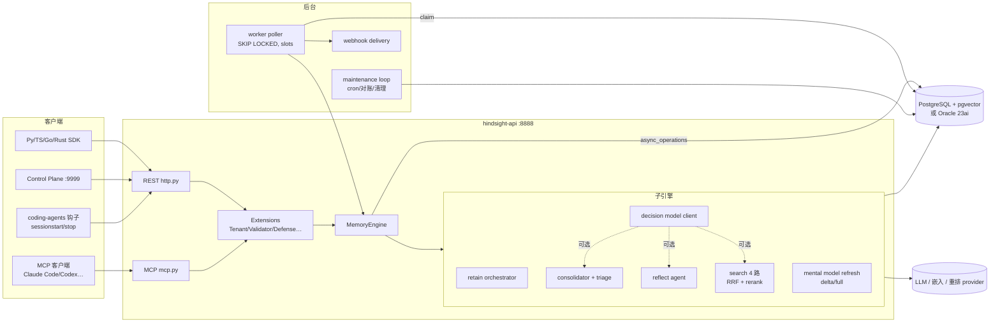
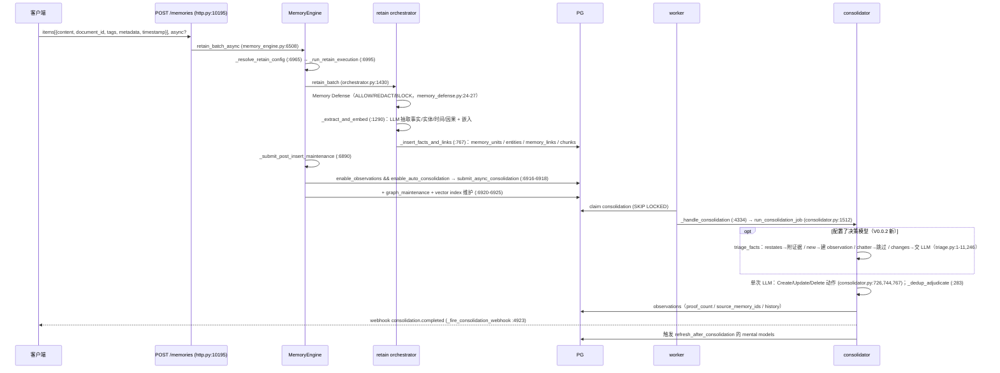
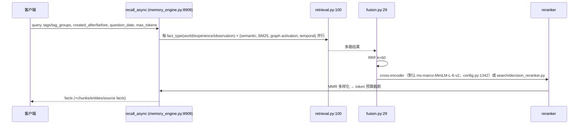
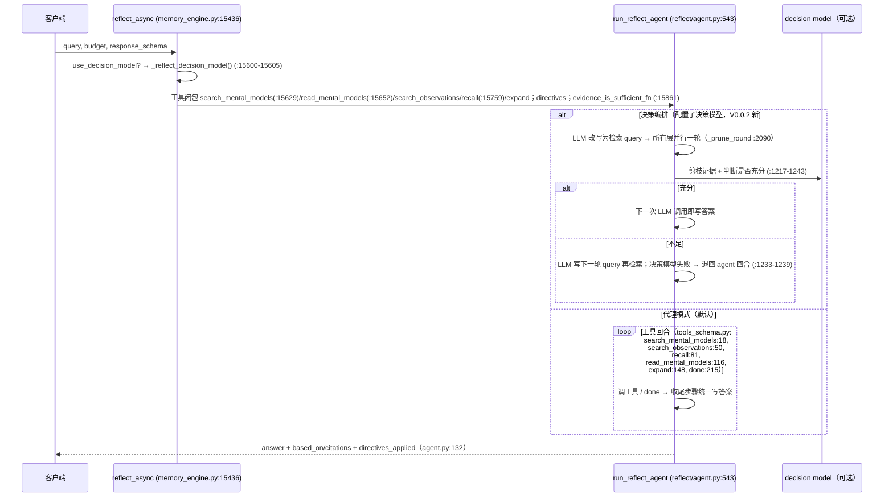
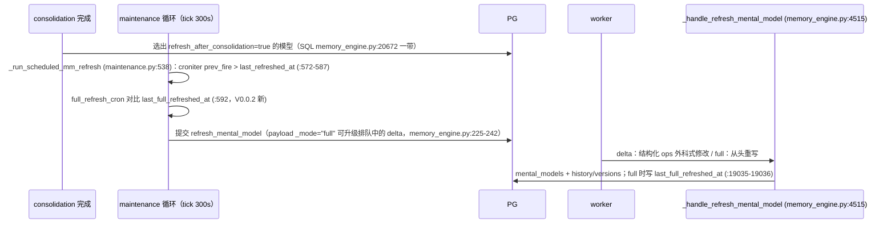
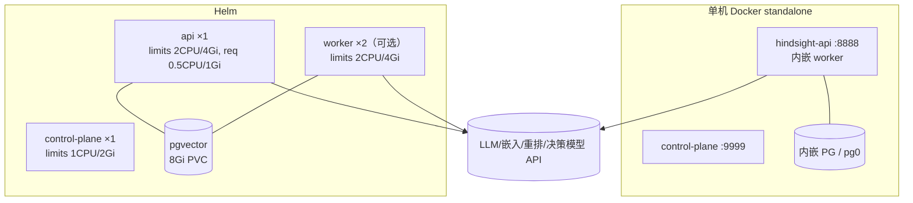

# 15 · Hindsight 技术架构与实现路线（WorkFleet V0.0.2 · 研究方法第 8 步）

> 分析对象：https://github.com/vectorize-io/hindsight（MIT，Copyright (c) 2025 Vectorize AI, Inc.）
> **最新版本**：`main` @ `5331da2f4db369528bb122075341a7de9c3df6df`（2026-10-16 15:58 -0400 = **2026-10-17 03:58 +08:00**，“blog: four things to build with Vercel Eve and Hindsight (#5699)”）；`hindsight-api-slim/pyproject.toml` `version = "1.0.0"`（`v1.0.0` 标签 2026-10-13，GitHub Releases 页确认 https://github.com/vectorize-io/hindsight/releases/tag/v1.0.0）
> **V0.0.1 基线**：`9a499b1`（#5632）。基线→HEAD **52 个提交**（全部合入于 2026-10-16），`git diff --shortstat`：339 files，+19,765 / −2,718；其中 `hindsight_api/` 非测试 70 文件 +6,136/−1,499，新增 2 个 alembic 迁移（共 113 个）。
> 本地代码：`/workspace/work/refs/hindsight`（`git fetch --depth 300 --filter=blob:limit=2m` 后检出最新）；演进分析：`/workspace/work/refs/_hist/hindsight.git`（`--bare --filter=tree:0` 全历史 **3,700 个提交**，2025-10-30 “initial commit” 起，305 个标签）。
> **未部署运行**（需 LLM Key + PostgreSQL/pg0 + 本地模型）。证据标签：`已确认` · `部分确认` · `证据不足` · `存在缺陷` · `暂不执行`
> 交叉引用：`05-Hindsight深度分析.md`（V0.0.2 修订版）、`14-Orca技术架构与实现路线.md`。

---

## 0. 结论先行

1. **架构本质**：一个 **“PostgreSQL 即一切”的记忆服务**——FastAPI（REST + MCP）接请求，**同一 PG 既存记忆（pgvector + BM25 + 图边表）又当任务队列（`async_operations` + `FOR UPDATE SKIP LOCKED`）**，worker（内嵌或独立）跑 retain / consolidation / mental-model refresh / 图维护等 12 类任务，maintenance 循环做 cron 刷新与对账。`已确认`
2. **核心管线**：retain（LLM 抽取事实/实体/时间/因果 → 嵌入 → 入库）→ 自动 consolidation（事实合成为带证据的 observations）→ mental model / knowledge page 刷新（delta 或 full）；读侧 recall（4 路并行 + RRF + 重排）与 reflect（工具调用代理）。`已确认`
3. **基线以来的关键变化**：**“决策模型（decision model）”成为横切新层**——回答类型化问题的亚秒级小模型（provider: typesafe/cloudflare/openai，默认 `none`，`config.py:1538`），用于 recall 排序（基线已有）、**consolidation 预分诊（#5664）**、**reflect 决策编排（#5382）**；另有 **delta 模型的定时全量刷新 `full_refresh_cron`（#5674）**、ChatGPT 登录态 LLM provider（#5688）、NVIDIA NIM 嵌入/重排（#5697）。`已确认`
4. **对 WorkFleet 的定位不变**：作为“知识库 + 分身 loop”的外部服务（REST/MCP），不 fork；新增价值：`full_refresh_cron` 正好解决“分身画像长期 delta 漂移”，决策模型可降低 consolidation 的 LLM 调用（需额外部署决策模型服务，默认关闭，降幅 `证据不足`）。`部分确认`

---

## 1. 分层架构

| 层 | 职责 | 代表路径（`hindsight-api-slim/hindsight_api/` 下） | 标签 |
|---|---|---|---|
| L0 接入 | REST（`/v1/default/banks/{bank_id}/…`）、MCP（多 bank 根 / 单 bank `/mcp/{bank_id}/`）、本地 MCP | `api/http.py`、`api/mcp.py:114 create_mcp_server`、`:352-359`、`mcp_tools.py` | 已确认 |
| L1 扩展钩子 | Tenant / Http / MCP / LLMRequest / OperationValidator / MemoryDefense | `extensions/{tenant,http,mcp,llm_request,operation_validator,memory_defense}.py`；装载 `extensions/loader.py:72` | 已确认 |
| L2 引擎门面 | `MemoryEngine`（23,784 行单文件）：retain/recall/reflect/MM/directives/webhooks/任务执行 | `engine/memory_engine.py`；`execute_task :4666`，任务分派 `:4731-4753` | 已确认 |
| L3 子引擎 | retain 管线、search、reflect 代理、consolidation、mental_model_refresh、directives、decision_model | `engine/{retain,search,reflect,consolidation,directives}/`、`engine/mental_model_refresh.py`、`engine/decision_model.py` | 已确认 |
| L4 模型提供方 | LLM（openai/anthropic/gemini/litellm/claude-code/codex/copilot/cursor/**chatgpt**…）、嵌入、重排 | `engine/providers/`、`engine/embeddings.py`、`engine/cross_encoder.py` | 已确认 |
| L5 存储 | PG（pgvector；pg_search/pg_textsearch/pgroonga/vchord 可选）、Oracle 23ai；对象存储（obstore） | `engine/db/`、`engine/memories/pg/*`、`engine/sql/`、`docker/docker-compose/*` | 已确认 |
| L6 后台 | worker poller、maintenance 循环、webhook 投递 | `worker/poller.py:320`、`engine/maintenance.py`、`webhooks/` | 已确认 |
| L7 外围 | Next.js 控制台、Rust CLI、多语言 SDK、56 个集成、Helm | `hindsight-control-plane/`、`hindsight-cli/`、`hindsight-clients/`、`hindsight-integrations/`、`helm/` | 已确认 |

### 1.1 组件图



---

## 2. 关键时序

### 2.1 retain → extract → consolidate（`已确认`）



- 默认值：`DEFAULT_ENABLE_OBSERVATIONS = True`、`DEFAULT_ENABLE_AUTO_CONSOLIDATION = True`（`config.py:1832-1833`）——基线“auto consolidation 默认是否开启 `部分确认`”现由代码默认值 **已确认**（bank 级仍可覆盖）。
- 分诊接入点：`consolidator.py:2498-2512`（有决策模型才 triage，已结算事实不进 LLM），`:2533 _apply_triage`，`:2893-2894`（chatter 记 `skipped`）。
- 支持 delta retain（同 document 未变 chunk 跳过 LLM，`orchestrator.py:3694 _try_delta_retain`，#701）、append、流式会话 retain（`:883`）。【V0.0.2】超大文档分片续写（#5676）、async append 无 document_id 提交即拒（#5651）。

### 2.2 4 路 recall（`已确认`）


- 【V0.0.2】MCP recall 工具可返回 source chunks / entities / source facts（#5678）；tag 过滤统一规则、未知 `tags_match` 直接拒绝（#5653/#5656）。

### 2.3 reflect（`已确认`）



### 2.4 mental model 刷新 / 分身 persona loop（`已确认`）


- 触发器合并：`_merge_trigger`（`memory_engine.py:19443-19484`）——客户端只发设置过的字段并与当前触发器合并；`refresh_after_consolidation` 与 `refresh_cron` 互斥（同给即 `ValueError`，`:19474-19478`）。知识页默认 `{mode:delta, fact_types:[observation], exclude_mental_models:true, refresh_after_consolidation:true}`（`:19436-19441`）；普通 MM 插入默认 `{"refresh_after_consolidation": false}`（`:17334`）。
- maintenance tick 默认 300 秒（`config.py:2138`），故 cron 实际粒度 ≥5 分钟。`已确认`
- **persona 含义**：画像页用 delta + `refresh_after_consolidation` 获得近实时增量，另设每周 `full_refresh_cron` 清除累积漂移（迁移 `d4f7a2c9e1b5_scheduled_full_refresh.py:1-30` 头注释，#4340/#5674）。

---

## 3. 数据模型 / ER

```mermaid
erDiagram
  banks ||--o{ documents : bank_id
  banks ||--o{ memory_units : bank_id
  documents ||--o{ chunks : document_id
  documents ||--o{ memory_units : document_id
  memory_units ||--o{ unit_entities : ""
  entities ||--o{ unit_entities : ""
  memory_units ||--o{ memory_links : "from/to"
  memory_units ||--o{ observation_sources : observation
  banks ||--o{ mental_models : bank_id
  mental_models ||--o{ mental_model_history : ""
  mental_models ||--o{ mental_model_versions : ""
  banks ||--o{ directives : bank_id
  banks ||--o{ webhooks : bank_id
  banks ||--o{ async_operations : bank_id
  banks { text bank_id PK; text name; jsonb disposition; text mission; jsonb config }
  memory_units { uuid id PK; text text; vector embedding; text fact_type; ts event_date; ts occurred_start; ts occurred_end; jsonb tags; jsonb metadata; int proof_count; jsonb history }
  mental_models { uuid id PK; text name; jsonb trigger; ts last_refreshed_at; ts last_full_refreshed_at; text content }
  async_operations { uuid id PK; text operation_type; text status; jsonb task_payload }
```
- 初始表（`alembic/versions/5a366d414dce_initial_schema.py:184-486`）：`banks(bank_id,name,background…)`、`documents(id,bank_id,original_text,content_hash…)`、`async_operations(bank_id,operation_type,status…)`、`entities(canonical_name,mention_count…)`、`memory_units(document_id,text,embedding,event_date,occurred_start/end,mentioned_at,fact_type,confidence_score…)` 等；后续迁移加入 `chunks`、`memory_links`、`unit_entities`、`entity_cooccurrences`、`mental_models(+history/versions)`、`directives`、`knowledge_pages`、`observation_history`、`observation_sources`、`webhooks`、`audit_log`、`llm_requests`、`file_storage`、`attachments/document_attachments`、`bank_aliases`、`bank_stats_cache`、`graph_maintenance_queue`、`entity_maintenance_queue` 等（对 113 个迁移 grep `op.create_table`/`CREATE TABLE`）。ER 图中字段为归纳，列名精确性以迁移为准（`部分确认`）。
- 【V0.0.2】新增迁移：`b2429c65cc20_banks_needing_consolidation_hybrid_probe.py`（探测待合成 bank 不再全表扫 memory_units，#5672）、`d4f7a2c9e1b5_scheduled_full_refresh.py`（`mental_models.last_full_refreshed_at` + 部分索引 `idx_mental_models_full_refresh_cron` + 重建 `mental_models_with_cron()`；Oracle 仅加列）。`已确认`

---

## 4. 进程与并发模型

| 主题 | 事实 | 证据 | 标签 |
|---|---|---|---|
| 进程入口 | `hindsight-api`、`hindsight-worker`、`hindsight-local-mcp`、`hindsight-admin` | `pyproject.toml [project.scripts]` | 已确认 |
| API 进程数 | `HINDSIGHT_API_WORKERS` 默认 1 | `config.py:726,1626` | 已确认 |
| 内嵌 worker | API 默认内嵌（standalone）；Helm 开独立 worker 时禁用内嵌 | `DEFAULT_WORKER_ENABLED = True`（`config.py:1983`）；`helm/hindsight/values.yaml:136-139` | 已确认 |
| 队列 | PG 表即队列，`FOR UPDATE SKIP LOCKED`；轮询 500ms；重试 3 次、退避 60s | `worker/poller.py:5,320-324,568`；`config.py:1985-1987` | 已确认 |
| 槽位 | 每 worker 总槽 10；consolidation 预留 2，其余共享 | `config.py:1989,1004-1016` | 已确认 |
| 任务类型 | batch_retain、file_convert_retain、import/export_documents、export/import/clone_bank、consolidation、graph_maintenance、vector_index_maintenance、refresh_mental_model、webhook_delivery | `memory_engine.py:4731-4753` | 已确认 |
| 后台循环 | maintenance 按配置间隔跑对账/保留清理/操作清理/MM cron | `maintenance.py:170-179,216,234-235` | 已确认 |
| 事件循环 | asyncio + uvloop（非 Windows）/ winloop | `pyproject.toml` | 已确认 |
| 决策模型并发 | 默认并发 24、超时 60s、请求上限 26,000 tokens | `config.py:1539-1546` | 已确认 |
| TaskBackend | Sync / Worker / Broker | `engine/task_backend.py:95,126,153` | 已确认 |

---

## 5. 技术栈与依赖版本（HEAD）

| 类别 | 版本 | 证据 |
|---|---|---|
| 语言 | Python ≥3.11 | `hindsight-api-slim/pyproject.toml` |
| Web | fastapi[standard] ≥0.120.3、uvicorn ≥0.38.0、fastmcp ≥3.2.0 | 同上 |
| DB | asyncpg ≥0.30.0、SQLAlchemy ≥2.0.44,<2.1、alembic ≥1.17.1、pgvector ≥0.4.1、psycopg2-binary；可选 oracledb ≥2.5.0、pg0-embedded ≥0.15.2 | 同上 |
| LLM | openai ≥1.66.0、anthropic ≥0.99.0、google-genai ≥1.72.0、litellm ≥1.95.1、cohere、claude-agent-sdk ≥0.2.82、github-copilot-sdk ≥1.0.11、boto3；【V0.0.2】pyjwt 注释标明用于 ChatGPT 登录 ID token 校验 | 同上 |
| 文本/工具 | toktok-rs、markitdown、obstore、croniter ≥2.0.0、json-repair、orjson、dateparser、numpy | 同上 |
| 可选本地 ML | local-ml：sentence-transformers ≥5、transformers ≥5.5、torch ≥2.11、flashrank、mlx（Apple）；local-onnx：onnxruntime ≥1.17；local-llm：llama-cpp-python | 同上 |
| 可观测 | opentelemetry ≥1.44（Prometheus/OTLP） | 同上 |
| 控制台 | Next ^16.3.8、React ^19.2.0（package 1.0.0） | `hindsight-control-plane/package.json` |
| CLI | Rust，clap 4.5（1.0.0） | `hindsight-cli/Cargo.toml` |
| 默认模型 | LLM provider `openai`、fallback `gpt-4o-mini`；嵌入本地 `BAAI/bge-small-en-v1.5`（ONNX 默认 `intfloat/multilingual-e5-small`）；重排 `cross-encoder/ms-marco-MiniLM-L-6-v2` | `config.py:1154,1190,1279,1282,1342` |

---

## 6. 配置

- 三层：环境变量（全局）→ tenant → bank config（`/v1/default/banks/{bank_id}/config`，`http.py:9755`）；`HINDSIGHT_API_DEFAULT_BANK_TEMPLATE` 给新 bank 套模板（`config.py:741,1650`）。`已确认`
- 【V0.0.2 新】决策模型：`HINDSIGHT_API_DECISION_MODEL_{PROVIDER,API_KEY,MODEL,BASE_URL,TIMEOUT,MAX_CONCURRENT,MAX_REQUEST_TOKENS}`（`config.py:702-708`），可按操作覆盖 `HINDSIGHT_API_{RECALL,REFLECT,CONSOLIDATION}_DECISION_MODEL_*`（`:701,1520,1551`）；开关 `…_CONSOLIDATION_USE_DECISION_MODEL`、`…_REFLECT_USE_DECISION_MODEL`、`…_MENTAL_MODEL_REFRESH_USE_DECISION_MODEL`（`:918,1063-1064`）；provider 默认 `none`（`:1538`）。客户端协议：typesafe System One、Cloudflare Workers AI、OpenAI Decisions API（`engine/decision_model.py:1-20`）。`已确认`
- worker：`HINDSIGHT_API_WORKER_{ENABLED,ID,POLL_INTERVAL_MS,MAX_RETRIES,HTTP_PORT(默认 8889),MAX_SLOTS}` 与 `…_<TYPE>_RESERVED_SLOTS`（`config.py:982-1030,1988`）。`已确认`
- 【V0.0.2】MM 刷新 delta/retraction 调用单独 temperature（#5683）；`_` 前缀 bank id 保留（#5673）。`已确认（提交标题）`

---

## 7. 插件 / 扩展机制

| 扩展点 | 方式 | 证据 |
|---|---|---|
| 服务端扩展 | `HINDSIGHT_API_<PREFIX>_EXTENSION=module.path:ClassName`，同前缀其余环境变量作为配置 | `extensions/loader.py:72-97` |
| 扩展基类 | `Extension`(base.py:10)、`HttpExtension`(http.py:19)、`MCPExtension`(mcp.py:21)、`LLMRequestExtension`(llm_request.py:112)、`MemoryDefenseExtension`(memory_defense.py:336)、`OperationValidatorExtension`(operation_validator.py:678)、`TenantExtension`(tenant.py:54) | 同左 |
| 扩展自带表 | `extensions/bank_tables.py` | 已确认 |
| 【V0.0.2】计量 | metering 扩展可看到并拦截 transfer-archive 导入（#5579，`operation_validator.py` +60 行） | 已确认 |
| Webhook | `consolidation.completed`、`retain.completed`、`memory_defense.triggered` | `webhooks/models.py:10-13` |
| Provider | `engine/providers/` 新文件即新 provider（【V0.0.2】`chatgpt_auth.py` 1,128 行 + `chatgpt_llm.py` 276 行；NVIDIA NIM） | 已确认 |
| 外部集成 | 56 个目录：coding-agents(0.8.1)、openclaw(1.0.0)、paperclip(0.4.2)、claude-code、codex、cursor、zcode、chat、hermes… | `ls hindsight-integrations`；各 `package.json` |

---

## 8. 部署拓扑与资源


- Docker：`-p 8888:8888 -p 9999:9999`（`README.md:73-80`）；`docker/standalone/{Dockerfile,start-all.sh}`；compose 变体 15 种（alloydb、claude-code、cuda、cuda-onnx、custom-models、external-pg、local-llm、nginx、pg_search、pg_textsearch、pgroonga、s3-file-storage、tei、timescale、vchord）。`已确认`
- Helm 默认资源：api limits 2000m/4Gi、requests 500m/1Gi（`values.yaml:32-38`）；worker 同（`:151-157`，默认 disabled）；control-plane limits 1000m/2Gi（`:269-272`）；内置 PG 镜像 `ankane/pgvector`、PVC 8Gi（`:330-344`）。【V0.0.2】Helm 增 `revisionHistoryLimit`、Gateway API HTTPRoute、extraObjects（#5695/#5687）。`已确认`
- 设备端：`hindsight-all`/`hindsight-embed`（pg0 嵌入式）；本地 torch 模型实际内存 `证据不足`（未实测）。

---

## 9. 设计模式

| 模式 | 体现 | 证据 |
|---|---|---|
| Facade | `MemoryEngine` 单一门面 | `memory_engine.py` |
| Pipeline | retain：defense → extract → embed → store → post-maintenance | §2.1 |
| DB-as-queue | `async_operations` + SKIP LOCKED | `worker/poller.py` |
| 请求折叠（fold） | 同 MM 的刷新请求折叠进已排队任务，full 升级 delta | `memory_engine.py:225-242` |
| RRF + 级联重排 | 4 路 → RRF → cross-encoder/decision → MMR | `fusion.py:29` |
| 工具调用代理 | reflect 工具集 + done | `reflect/tools_schema.py` |
| System 1 / System 2 分工 | 决策模型做类型化判断，LLM 只写文本 | `decision_model.py:1-20`、`consolidation/triage.py:1-11` |
| 证据溯源 | observation 的 `source_memory_ids/proof_count/history` | 05 报告 |
| 环境变量插件 | 扩展装载 | `extensions/loader.py:72` |
| 轻量事件溯源 | MM history/versions、observation_history | 迁移表 |

---

## 10. 实现路线（git 演进，全历史 3,700 提交）

月度提交：2025-10 6 · 11 61 · 12 159 · 2026-01 160 · 02 149 · 03 308 · 04 376 · 05 312 · 06 458 · 07 311 · 08 443 · 09 586 · 10（至 16 日）371。

| 阶段 | 时间 | 里程碑 |
|---|---|---|
| P0 检索内核 | 2025-10-30 ~ 11-14 | initial commit（6d7223b）；BM25 与 re-rankers（fcc5250，11-07）；MCP server（e0a33f5）+ CLI + Helm（5880651）；**v0.0.1（11-11）**；temporal（11-14） |
| P1 控制台 + 嵌入式 | 12-02 ~ 12-22 | control plane（12-02）；retain 性能、graph（12-08）；**v0.1.0（12-09）**；pg0 嵌入（#28）；**extensions（#54，12-22）** |
| P3 生态 + 批量合成 | 02 ~ 03 | codex/claude-code 当 LLM（#276）；MM CRUD MCP（#337）；**批量 observation consolidation（#430）**；`observation_scopes`（#447）；**webhooks（#487）**；observation/MM 历史 diff（#513/#516）；命名 retain 策略（#593）；**delta retain（#701）**；claude-code 全会话 retain（#695） |
| P4 结构化增量 + 多后端 | 04 ~ 06 | paperclip（#773）；proof_count 加权（#821）；**v0.5.0（04-08）**；**structured-ops delta refresh（#1101）**；DeferOperation（#1105）；**Oracle 23ai（#1307，04-29）**；v0.6.0（05-05）/v0.7.0（05-27）/v0.8.0（06-08）；**cron MM 刷新（#2377，06-25）** |
| P5 知识库 + 编码 agent | 07 ~ 09 | **knowledge pages + `hindsight fs`（#2455，07-30）**；**hindsight-coding-agents（#2522，07-31）**；v0.9.0（08-07）；v0.10.0（09-14）；coding-agents 0.1→0.8 |
| P6 决策模型 + 1.0 | 10 | **v1.0.0（10-13）**；决策模型统一配置（#5607，10-15）；recall 决策排序（#5632，即基线）；**consolidation 分诊（#5664）、决策编排 reflect（#5382）、full_refresh_cron（#5674）**（10-16） |

**演进规律（判断，`部分确认`）**：
1. 从“检索库”→“会学习的记忆”（observations → mental models → knowledge pages）→“成本优化”（delta retain、structured-ops delta、决策模型分诊）。WorkFleet 若自研记忆层将重走这一年路线，进一步佐证“外部集成”结论。
2. 增量与全量并存是长期主题：delta retain（#701）→ delta refresh（#1101）→ full_refresh_cron 纠偏（#5674）。
3. 0.x 约每 3–6 周一版；1.0 后大量修复同日合入（10-16 一天 52 个）→ 集成必须锁镜像 tag。
4. 未逐条统计 refactor 类提交与 `memory_engine.py` 体量演变，`证据不足`。

---

## 11. 基线（9a499b1）→ HEAD（5331da2）变化摘要

| 区域 | 变化 | 对 WorkFleet 影响 | 标签 |
|---|---|---|---|
| consolidation | 决策模型预分诊（`consolidation/triage.py` 新 320 行，`consolidator.py:2498-2533` 接入）；consolidation evals 驱动的提示规则与安全网（#5627） | 配了决策模型时，“重复/新增/闲聊”事实不再调 LLM | 已确认 |
| reflect | 决策编排模式（`agent.py` +655 行）；“nothing found”需先 recall（#5641）；expand 读到的事实保留引用（#5677） | 总控“查历史决策”更准；默认仍是代理模式 | 已确认 |
| mental models | `full_refresh_cron`（迁移 d4f7…）；delta 刷新同值处处更新（#5680）；单独 temperature（#5683） | **画像周期全量重写**获官方支持 | 已确认 |
| providers | ChatGPT 登录态 provider（#5688）、Anthropic Workload Identity（#5690）、NVIDIA NIM（#5697）、Codex 默认模型修正（#5658）、真实 token 用量（#5693） | 可用订阅账号跑抽取（条款合规 `证据不足`） | 已确认 |
| documents/transfer | 文档全文检索与匹配字段（#5633）、PATCH observation_scopes（#5668）、导入流式不占内存（#5696）、导入 bank id 校验（#5673） | 知识库导入/迁移更稳 | 已确认 |
| 性能 | 启动不加载未用重模块（#5686）、consolidation 探测不全表扫（#5672） | 设备端冷启动改善（幅度 `证据不足`） | 已确认 |
| 控制台/Helm | 上传重试（#5689）、知识页/MM 导出 PDF/MD（#5679）、HTTPRoute | 运维便利 | 已确认 |
| 未变 | 4 路检索/RRF、worker SKIP LOCKED、扩展装载、webhook 事件集、默认嵌入/重排 | 基线结论保持 | 已确认 |

---

## 12. 优势与不足

**优势**：记忆闭环完整（retain→observations→MM/knowledge pages→reflect）且带证据与版本；PG 一体化，部署简单（单容器/pg0/Helm）；扩展点齐全（7 类扩展 + webhook + provider）；56 个集成含主流编码 CLI；中文时间表达解析；MIT；1.0 已发布。
**不足**：引擎单文件 23,784 行，可维护性风险；retain 依赖 LLM 抽取（成本/延迟主项）；默认英文嵌入（`config.py:1279`）与默认 BM25 分词对中文不友好；决策模型需额外服务且默认关闭；不做逐条原始会话日志；无网关/路由/用户任务调度。

---

## 13. 对 WorkFleet 的借鉴与迁移路线

| # | 项 | 方式 | 工作量* | 优先级 |
|---|---|---|---|---|
| H1 | 部署 Hindsight 记忆服务（Docker standalone 或 pg0 嵌入） | 锁定 `v1.0.0` 镜像 tag；`hindsight.base_url` 入配置中心；端口 8888/9999（worker 8889）固定 | 1 人日 | P0 |
| H2 | Bank 规范：`project:<id>`、`persona:<user>`、`manager:<fleet>`（可选 `channel:<im>`） | 启动时幂等创建；`DEFAULT_BANK_TEMPLATE` 统一配置 | 1 人日 | P0 |
| H3 | 消息总线 retain 钩子 | IM 入站指令/审批/纠正 + 会话结束/`/clear` 转录 → `POST /memories`（`async=true`，`document_id`=session/resume ID，tags=route/mode） | 3 人日 | P0 |
| H4 | 分身 persona loop | `persona:<user>` 建 3–5 个 MM：delta + `refresh_after_consolidation=true`，另设 `full_refresh_cron`（如每周日 03:00） | 2 人日 | P1 |
| H5 | 总控决策上下文 | 同步路径只读 MM / `recall`；`reflect` 放后台；directives 存规范与审批红线 | 3 人日 | P1 |
| H6 | 画像更新通知 | 订阅 `consolidation.completed` → 低优先级 IM 摘要 | 1 人日 | P2 |
| H7 | 输入端 CLI 共享记忆 | Claude Code/Codex 配 `/mcp/{bank_id}/`；**与 coding-agents stop 钩子二选一**，避免重复 retain | 1 人日 | P2 |
| H8 | 成本优化 PoC | 评估决策模型 provider 与延迟，对比开/关时 consolidation 的 LLM 调用数 | 2–3 人日 | P2 |
| H9 | 中文 | 嵌入改 ONNX `multilingual-e5-small` 或远程 bge-m3；BM25 选 pgroonga/pg_search 并配 CJK 分词；50 条中英样本评测 | 3 人日 | P0（PoC 门槛） |
| H10 | 设计借鉴 | PG SKIP LOCKED 队列 + 槽位预留 → WorkFleet 群发/定时推送队列；ALLOW/REDACT/BLOCK → IM 外发脱敏 | 3–5 人日 | P1 |

\* 主观估算，`部分确认`。**许可**：MIT；作为外部服务使用无需改源码；复制代码片段需保留版权声明。ChatGPT/Claude Code 登录态 provider 的服务条款合规 `证据不足`，生产默认用 API Key。

**迁移路线**：PoC（H1+H2+H3+H9）→ 通过中文召回与成本门槛后上 H4/H5 → 运营期 H6–H8；Hindsight 不可用时降级为“只记 Orca 式会话日志 + FTS”，记忆功能不得阻断消息路由。

---

## 14. 四轮方法收敛（摘要）

- **5W1H**：What=§1–§9；Why=知识库/分身 loop 难点在合成与版本化，Hindsight 已解决；Where/When=总控同机部署、消息总线两处钩子；Who=记忆层集成负责人，隐私口径由产品负责人定；How=REST/MCP 黑盒集成；What if=服务不可用降级、LLM 费用敏感时用决策模型/采样、字段变化用生成 SDK 隔离。
- **苏格拉底追问**：
  - “分身会自动更新？”——`config.py:1832-1833` 默认开启 auto consolidation；MM 需显式 `refresh_after_consolidation` 或 cron（`memory_engine.py:17334`）。`已确认`
  - “决策模型能直接降本？”——代码路径存在（`consolidator.py:2498-2533`），但默认 provider=`none`，需外部决策模型 API；无本地降幅数据。`部分确认`
  - “full_refresh_cron 能与 refresh_after_consolidation 共存？”——迁移头注释写明只带 `full_refresh_cron` 的 delta+refresh_after_consolidation 模型也会被扫描（`d4f7a2c9e1b5…:1-30`）；互斥只针对 `refresh_cron` 与 `refresh_after_consolidation`（`memory_engine.py:19474-19478`）。`已确认`
- **双向钢人**：主张“采用 Hindsight”。支持：功能最全、1.0、MIT、PG 一体；反对：Python/torch 重、LLM 成本、中文未验证、单文件引擎。裁决：**PoC 通过前不设为硬依赖**（与基线一致）。
- **最终判断**：允许进入“记忆层集成设计 + PoC”；前提为版本锁定与隐私授权；局限为未运行；下一步为 H1/H2/H3/H9 PoC，记录 token 成本与资源占用。
