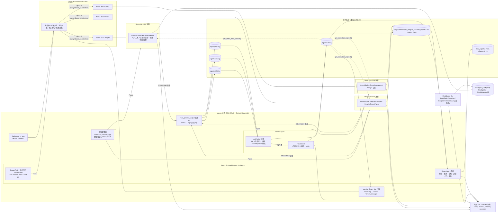
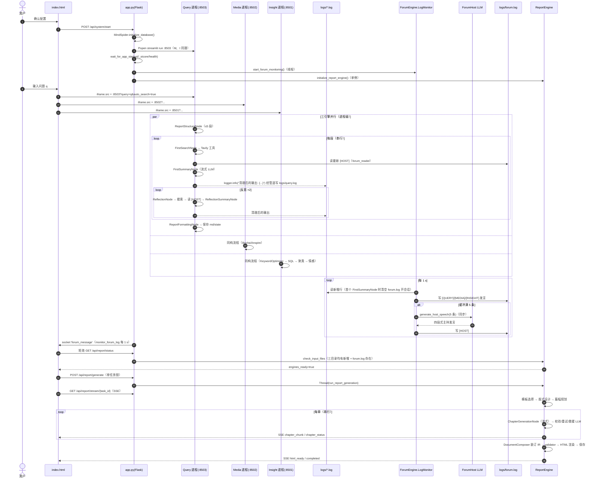
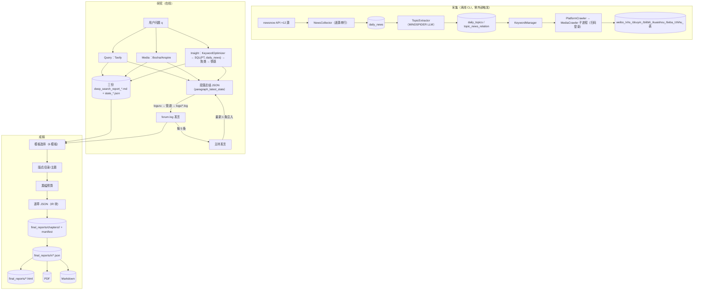
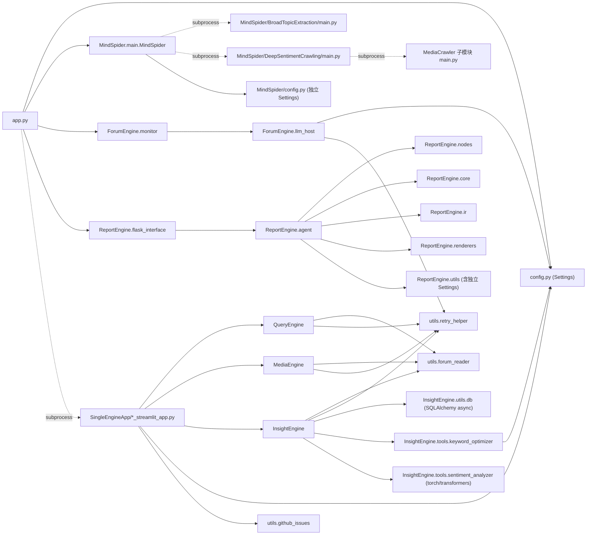
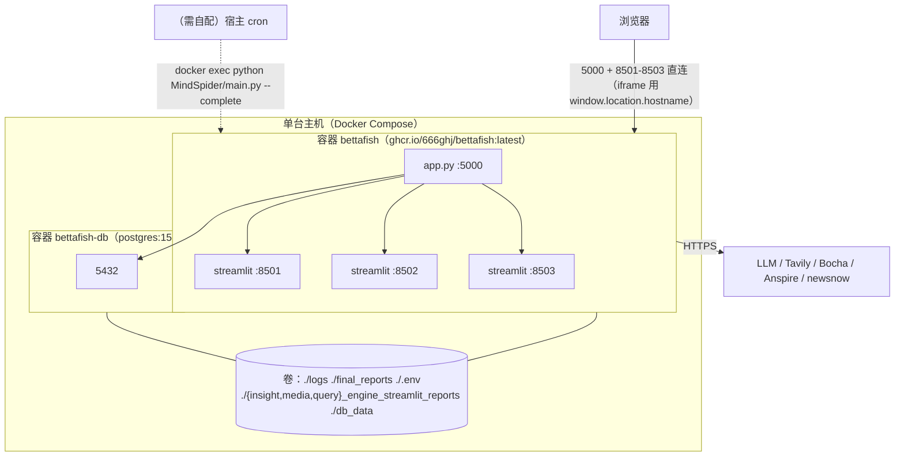
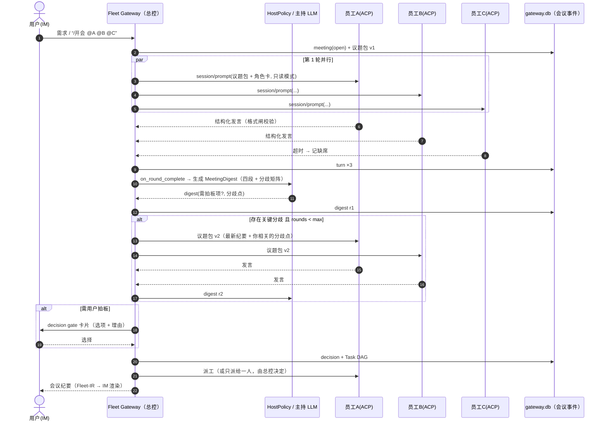
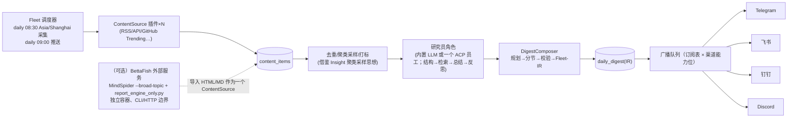

# 16 · BettaFish（微舆）技术架构与实现路线（WorkFleet V0.0.2 · 研究方法第 8 步）

> 分析对象：https://github.com/666ghj/BettaFish（**GPL-2.0**；`MindSpider/` 另含 MediaCrawler **非商业学习许可 1.1**）
> 版本：`main` @ `b67928ff1ce515dd7672408221fb1e9500d0972d`（2026-10-02 02:18 +08:00，star-history 机器人提交）；最近人工代码提交 `e5a15651`（2026-08-25）。
> 本地代码：`/workspace/work/refs/BettaFish`（codeload tarball 解包；`git clone` 因 192 MB 仓库持续 HTTP 502 失败）。演进分析：GitHub API 全量 1,041 条提交 → `/workspace/work/refs/BettaFish-meta/bf_commits.tsv`（提交标题级统计，不读每个 diff）。论坛机制复现脚本：`/workspace/work/refs/BettaFish-meta/forum_sim.py`。
> 方法：沿 `app.py → SingleEngineApp → {Query,Media,Insight}Engine → ForumEngine → ReportEngine → MindSpider` 读源码；`pytest tests/test_monitor.py tests/test_retry_helper.py`（45 passed）；ForumEngine 桩主持人实测。完整系统**未运行**（需多组 LLM/搜索 Key 与 PostgreSQL，`暂不执行`）。
> 证据标签：`已确认` · `部分确认` · `证据不足` · `存在缺陷` · `暂不执行`
> 交叉引用：`06-BettaFish深度分析.md`（同目录，需求匹配、维度表、四轮论证）；V0.0.1 `40-综合/04-自研架构设计.md`、`05-总控模式设计.md`。

---

## 0. 结论先行

1. **架构本质**：一个 **“Flask 进程管理器 + 3 个 Streamlit 研究子进程 + 日志总线 + 单例报告引擎”** 的单机系统。进程间**没有 RPC/消息队列**：控制面靠 **iframe URL 参数**（前端 → 引擎）、数据面靠 **文件**（stdout→`logs/*.log`→`forum.log`；报告→`*_streamlit_reports/*.md`→ReportEngine）。`已确认`
2. **ForumEngine = 文件黑板 + 计数触发的主持人**：`LogMonitor` 线程每秒尾随三份日志，抽取 SummaryNode 的 JSON 输出写入 `forum.log`，每满 5 条调用一次主持 LLM 写 `[HOST]`；Agent 在总结节点读取最新 `[HOST]` 注入提示词。`已确认`（实测）
3. **ReportEngine 是全仓工程化程度最高的部分**：门控 → 后台任务 → SSE（含 `Last-Event-ID` 补发）→ 模板选择/版式/篇幅/逐章 JSON → IR 装订与校验 → HTML/PDF/MD 多渲染 → 跨引擎救援 LLM。`已确认`
4. **演进路线**：2024-07 课程式 Flask 舆情系统（原名 `Weibo_PublicOpinion_AnalysisSystem`）→ 2025-08 推倒重来为多 Agent（两周内完成 引擎→论坛→报告→爬虫）→ 2025-10 LLM 接入统一与 Docker → 2025-11/12 ReportEngine IR 化重写（v2/v3）→ GraphRAG 合入后于 2026-02/03 撤销 → 2026 年低频维护。`已确认`（提交标题）
5. **对 WorkFleet**：架构**不可整体迁移**（单任务全局单例、文件耦合、GPL）；可迁移的是 **四个模式**：①主持人归纳与纪要注入；②多阶段 IR 汇报生成；③任务事件流 + SSE 补发；④每日“采集→提炼→入库→成稿”内容流水线（§10）。

---

## 1. 技术栈（`requirements.txt`、`Dockerfile`、`docker-compose.yml`）

| 层 | 选型（版本） | 用途 | 证据 |
|---|---|---|---|
| 运行时 | Python 3.11（镜像）；源码要求见 README | 全部 | `Dockerfile` |
| 主控 Web | Flask 2.3.3、Flask-SocketIO 5.3.6、eventlet 0.33.3、python-socketio 5.8.0 | 进程管理、配置 API、Socket.IO 推送、ReportEngine Blueprint | `app.py:18-37` |
| 引擎 UI | Streamlit 1.28.1（Pillow<11 兼容，提交 `974dbe2e`） | 三个研究引擎页面 | `SingleEngineApp/*` |
| LLM | `openai>=1.3.0`（统一 OpenAI 兼容） | 7 个 LLM 角色：Insight/Media/Query/Report/MindSpider/ForumHost/KeywordOptimizer | `config.py` LLM 段 |
| 搜索 | tavily-python；Bocha AI Search；Anspire | Query / Media | `QueryEngine/tools/search.py`、`MediaEngine/tools/search.py:100-370` |
| 数据库 | SQLAlchemy 2.0.35 async、asyncpg、aiomysql、pymysql、psycopg；PostgreSQL 15（compose） | 私有舆情库 + MindSpider 表 | `InsightEngine/utils/db.py:93-105`、`docker-compose.yml` |
| ML | torch、transformers、sentence-transformers、scikit-learn、xgboost、jieba | 情感分析、聚类采样、话题模型 | `InsightEngine/tools/sentiment_analyzer.py`、`InsightEngine/agent.py:95-188` |
| 爬虫 | playwright 1.45.0（chromium）、httpx 0.28.1、parsel、pyexecjs、xhshow | newsnow 拉取、MediaCrawler | `MindSpider/*` |
| 报告渲染 | weasyprint（Pango）、内置 chart.js/sankey/mathjax/wordcloud2/html2canvas/jspdf、28 MB 字体 | HTML/PDF/MD | `ReportEngine/renderers/*` |
| 配置/日志 | pydantic 2.5.2、pydantic-settings 2.2.1、loguru、json-repair 0.53.0 | `.env` 驱动；日志即总线 | `config.py`、`ReportEngine/utils/json_parser.py` |
| 测试/CI | pytest；GitHub Actions `docker_ci.yml`（镜像 `ghcr.io/666ghj/bettafish`）、`update-star-history.yml` | — | `.github/workflows/` |

---

## 2. 组件图



---

## 3. 一次完整运行的时序图



证据：步骤 1–7 `app.py:1249-1274, 268-341`；8–11 `templates/index.html:3045-3090`；12–22 `QueryEngine/agent.py:141-447`、`QueryEngine/nodes/summary_node.py:81-134, 249-302`；23–29 `ForumEngine/monitor.py:584-702, 524-559`；30 `app.py:432-496`；31–36 `ReportEngine/flask_interface.py:407-703, 750-868`、`templates/index.html:4446-4470`；37–41 `ReportEngine/agent.py:405-776`。`已确认`（代码阅读）；整条链未端到端运行。

---

## 4. 数据流图



要点：
- **研究阶段与采集阶段只通过数据库表耦合**（Insight 查 `PT` 与 `daily_news`，`InsightEngine/tools/search.py:207` 的 `search_configs` 含 `daily_news`）。`已确认`
- **论坛只进不出持久层**：`forum.log` 是进程间“共享黑板”，新会话即清空（`ForumEngine/monitor.py:78-104`）；ReportEngine 读取的是“当时”的 forum.log 全文（`ReportEngine/agent.py:1493-1531`）。`已确认`

---

## 5. 模块依赖图



| 依赖关系 | 类型 | 耦合度 | 说明 / 证据 |
|---|---|---|---|
| app → Streamlit 引擎 | 子进程 + URL 参数 | 低（代码）/高（约定） | `app.py:634-706`、`index.html:3045-3090` |
| 引擎 → ForumEngine | **日志格式约定**（无 import） | **隐式高** | `monitor.py:58-67` 模式表；`summary_node.py:134` 日志措辞 |
| ForumEngine → 引擎 | `forum.log` 文件 + `utils/forum_reader` | 隐式高 | `forum_reader.py:35, 118` 正则 |
| 引擎 → ReportEngine | 目录 + 文件数基线 | 中 | `ReportEngine/agent.py:47-172`、`flask_interface.py:415-419` |
| 三引擎内部 | 复制粘贴同构包 | — | 06 报告 §3.3 md5 比对 |
| 配置 | 根 `config.py` + 各引擎 `utils/config.py` + `ReportEngine/utils/config.py` + `MindSpider/config.py` | 多源 | 06 报告 §3.8 |
| MindSpider → MediaCrawler | 子进程 + 改写其 `db_config` | 中（版本漂移风险） | `platform_crawler.py:239-330`；提交 `94af6334/cb64ac36` 修补改写逻辑 |

---

## 6. 启动与部署拓扑

### 6.1 端口与进程

| 进程 | 端口 | 启动者 | 说明 |
|---|---|---|---|
| `python app.py`（Flask + Socket.IO） | 5000（`PORT`，默认 `HOST=0.0.0.0`） | 用户 / 容器 CMD | `config.py`、`Dockerfile CMD ["python","app.py"]` |
| Insight Streamlit | 8501 | app.py `Popen` | `app.py:499-510` |
| Media Streamlit | 8502 | 同上 | 同上 |
| Query Streamlit | 8503 | 同上 | 同上 |
| PostgreSQL 15 | 容器 5432 → 主机 `${POSTGRES_PORT:-5444}` | docker compose | `docker-compose.yml` |
| MindSpider / report_engine_only | 无端口（CLI） | 用户 / 外部 cron | `MindSpider/main.py`、`report_engine_only.py` |

与 Aidean（3000）、AideanBot（3333）、WorkFleet 段（3100–3200）**无端口冲突**（`已确认`：配置文件）。

### 6.2 部署拓扑



- 浏览器必须能直接访问 8501–8503（iframe 指向 `window.location.hostname:<port>`，提交 `f6d52b90`“使用动态主机地址支持局域网内后端服务访问”）→ 远程部署要暴露 4 个端口，且**全部无鉴权**（`存在缺陷`，安全）。
- 镜像体积大：torch + transformers + playwright chromium + ffmpeg + GTK/Pango（`Dockerfile` apt 列表）；CI 需要“磁盘空间清理步骤”（提交 `e4172145`）佐证镜像之大（`部分确认`）。
- 关停：`POST /api/system/shutdown` → 并发停止子进程（`cleanup_processes_concurrent`，`app.py:834-886`）+ 强制退出定时器（`app.py:901-924`）。

### 6.3 源码启动

`uv/conda 建环境 → pip/uv 安装 requirements → playwright install chromium →（可选）Pango → 复制 .env.example 为 .env 填 Key → python app.py → 浏览器确认配置 → 系统拉起引擎`（README “源码启动指南”；`app.py:1336-1345`）。

---

## 7. 实现路线（git 演进，1,041 提交）

### 7.1 阶段划分（按提交标题；时间为 +08:00）

| 阶段 | 时间 | 代表提交 | 发生了什么 |
|---|---|---|---|
| P0 课程式原型 | 2024-07（189 提交） | `82127815`【app.py】项目入口文件，helloFlask！；`7235f7a2`【整体架构设计】；`c7e84110/30e9c5ac` 登录/注册接口；`1e93ed69`【spiderNav.py】；`a94d2cdf` jieba 词频 | 多人分工的 Flask + ECharts 微博舆情系统；合并信息显示原仓库名 `Weibo_PublicOpinion_AnalysisSystem` |
| P1 沉寂期 | 2024-09 → 2025-07（共约 145 提交，月均个位数到 30） | — | 零星维护 |
| P2 模型准备 | 2025-08-03 → 08-16 | `14d8ac6e` “Completed fine-tuning for several models and prepared the foundational components for an upcoming refactor.”；`c4af1eff` Qwen3 情感模型；`d88d5edd` LLM 话题识别；`c5c53077` BERTopic | 情感/话题模型微调（今 `SentimentAnalysisModel/`） |
| P3 **推倒重来：多 Agent** | 2025-08-20 → 08-27（约两周） | 08-20 `047bbf8c` 系统爬虫；**08-22 `0c31be42` “The framework has been restructured again, and the Flask framework has been abandoned.”、`862cf7c5` Reinitialize、`7ae863a7` Reconfiguration of the basic multi-agent architecture、`431cf6a1` 多模态 Agent**；08-23 `c35a6baf/4e332246` 私有库 Agent / Insight Engine、`92537703` Initial setup of web app；08-24 `6244d116` single-multi-agent framework、`04de3410` 错误重传、**`f65387f9` forum recording**；08-25 `34c7179a` Forum function completed；08-26 `f0788b64` final report agent、`e5e32ff6` “The entire system has been largely completed.”；08-27 `587e709e` 上传 MindSpider | 现架构骨架在 8 天内成型：先引擎、再论坛、再报告、最后爬虫。注：08-22 说“放弃 Flask”，但现 `app.py` 仍是 Flask——推断是放弃旧 Flask 业务应用、Flask 退化为进程管理外壳（`部分确认`） |
| P4 主持人与论坛打磨 | 2025-09 | 09-10 `05a0eeb3` “Updating LLM-host for ForumEngine”（YYL469）；09-16 `ba48e77c` “Remove forum host asynchronous strategy and simplify the process.”、`cec8ed38` 改进 Agent 间论坛通信 | 主持人从异步改为**同步触发**（即现 `_trigger_host_speech`） |
| P5 LLM 接入统一 + 容器化 | 2025-10 | 10-08 `960608ce` Forum Host/关键词优化迁移到 OpenAI client、`49d48937` 统一 LLM 客户端；10-09 `154b29c0` “Completely refactor the LLM integration method…”、`04f18dfa` 初始 Docker；10-30 `1d714d44` 改用 uv | 形成“每角色 Key/BaseURL/Model 三元组” |
| P6 社区涌入 + 配置/稳定性 | 2025-11 上旬 | `bda4343c/6fd897d8` 停止跟踪 config.py（改 `.env` + pydantic-settings）；`62fac9ee` LLM 超时 1800 s；`dce63714/f91cf6a2/e4d075cf` 修复论坛通信（日志块容错）；`34d4eeba` “Refactor LLM Interface to Byte Stream”；`3a96bd41` 增大论坛超时 | 论坛“日志抓取”脆弱点集中暴露并打补丁 |
| P7 **ReportEngine IR 化重写** | 2025-11-13 → 12-16（MaYiding 主导） | `4798424f` Allow LLM Repair；`fd1a23c7` IR Binding；`dffe1618` 导出 PDF；`5b001bf1` Support Using Only Report Engine；`147edbe8` 公式；`a371cdf7` 重设计图表修复；`8467fcb3` SWOT Block；发布 v2.0.0（11-28）、v2.1.0（12-09） | 报告从“单次 LLM 写 HTML”演进为“IR + 校验 + 多渲染器” |
| P8 GraphRAG 试验 | 2025-12-18 → 12-20 合入（PR #503 `21a11211`），v3.0.0（12-23） | `8e4e8cfa` GraphRAG；`b3b0ff16` 前端展示 GraphRAG；`d71073ad` 可配 `GRAPHRAG_ENABLED` | 知识图谱检索进入主线 |
| P9 回撤与收敛 | 2026-01 → 03 | 01-12 / 02-10 `947879fe` / PR #547 MediaCrawler 改为 git 子模块；**02-28 `579e41d1` Revert GraphRAG，03-05 PR #592 合入**；03-07 DoiiarX 一组 MindSpider 自动化修复；03-13 `2990ae84` cancel_task 404 修复 | 主线回到无知识库形态；撤销原因未在提交中说明（`证据不足`） |
| P10 低频维护 | 2026-04 → 10 | 04-24 `e192e534` PG 端口默认值；07-20 `1e6a2b52/e38467a3/f976cf85` 测试加固、`4f11ba5b` 移除硬编码路径（#684）；08-25 `e5a15651` 赞助链接；09-19 PR #720 Redis Streams 消息总线（**未合并**） | 进入维护期；作者主力转向 MiroFish（README 2025-12-22 起宣传） |

### 7.2 月度提交分布（API 全量）

```
2024-07 ██████████████████▉ 189     2025-08 ████████▉ 89
2024-09 █▋ 17                       2025-09 █▏ 12
2024-10 ██▋ 27                      2025-10 ███▊ 38
2024-12 ███ 30                      2025-11 ████████████████████████████████▎ 323
2025-01 █▍ 14                       2025-12 ████████████████▏ 162
2025-02 █▋ 16                       2026-01 █ 10
2025-03 ██▊ 28                      2026-02 ▍ 4
2025-04 ▋ 7                         2026-03 ██▋ 27
2025-05 ▎ 3                         2026-04 ▏ 2
2025-06 ▏ 1                         2026-05 ▌ 5
2025-07 ▏ 2                         2026-07 ██▏ 22
                                    2026-08 ▋ 7  · 2026-09 ▍ 4 · 2026-10 ▏ 2
```

### 7.3 演进规律（对 WorkFleet 的启示）

1. **先跑通“多 Agent 各干各的 + 汇总”，再加“讨论”**：论坛是在引擎完成后第 2 天加入的（08-24），且以“旁听日志”零侵入方式加入 → 低成本但留下长期脆弱性（P6 多次修补）。WorkFleet 应在会议协议**第一版就用结构化事件**。
2. **主持人从异步改同步**（09-16）：说明异步主持带来的并发/一致性问题比延迟更难受；WorkFleet 用“轮次完成触发 + 单写者”可同时拿到一致性与可控延迟。
3. **报告链路的工程化（IR + 校验 + 修复 + 救援）占后期一半以上提交**：LLM 生成结构化长文的主要成本在“修 JSON/修图表/修排版”，WorkFleet 的统一汇报应**先定小而稳的 IR 子集**。
4. **知识库试验被撤**：功能边界膨胀后回撤，提醒 WorkFleet 知识库走外部组件（Hindsight）而非内嵌。

---

## 8. 设计模式

| 模式 | BettaFish 中的体现 | 证据 | 评价 |
|---|---|---|---|
| 模板方法（Template Method） | `BaseNode.run/validate_input/process_output` + `StateMutationNode.mutate_state` | `QueryEngine/nodes/base_node.py:13-90` | 节点可组合；但三引擎各一份 |
| 状态对象 / 备忘录 | `State → Paragraph → Research → Search`，`to_dict/from_json/save_to_file` | `QueryEngine/state/state.py:13-258` | 可序列化恢复（`load_state`），但无断点续跑入口 |
| 管道 / 流水线 | 结构 → 首搜 → 首总结 → 反思×N → 格式化 | `QueryEngine/agent.py:141-424` | 清晰；段落串行 |
| 策略（Strategy） | 搜索工具按名分派；Media 按 `SEARCH_TOOL_TYPE` 换 Agent 子类 | `QueryEngine/agent.py:100-139`；`MediaEngine/agent.py:439-449` | if-elif 分派，非注册表 |
| 黑板（Blackboard） | `forum.log` 作为共享黑板，Agent 写、主持人写、Agent 读 | `ForumEngine/monitor.py`、`utils/forum_reader.py` | 零侵入；脆弱、不可审计 |
| 观察者 / 尾随（tail -f） | `LogMonitor` 轮询文件增长；`monitor_forum_log` 推 Socket.IO | `monitor.py:584-702`；`app.py:432-496` | 轮询 1 s，且每秒全量计行 |
| 单例 | `get_monitor()`、`get_forum_host()`、`report_agent`、`current_task` | `monitor.py:839-859`；`llm_host.py:250-262`；`flask_interface.py:29-31` | 导致单任务、单会议 |
| 装饰器 | `with_retry` / `with_graceful_retry` 分级重试 | `utils/retry_helper.py:82-119, 148-166` | 可复用的思想 |
| 监督者（Supervisor） | Flask 进程拉起/健康检查/回滚/并发停机子进程 | `app.py:268-341, 634-924` | 最小可用的进程托管 |
| 中间表示 + 多渲染器 | Document IR（16 块）→ HTML / PDF / Markdown 渲染器 | `ReportEngine/ir/schema.py`；`renderers/*` | 高价值，适合 IM 降级渲染 |
| 责任链 / 回退链 | 章节生成救援 LLM：Report → Forum → Insight → Media | `ReportEngine/agent.py:344-382` | 适合模型池 fallback |
| 门控（Gate） | 文件数基线门控报告生成 | `ReportEngine/agent.py:47-172, 1432-1491` | 思想可借，信号要换成事件 |
| 发布订阅 + 事件溯源（轻量） | `ReportTask.publish_event` → 有界历史 + 订阅队列 → SSE 补发 | `flask_interface.py:125-215, 313-405, 750-868` | 可直接作为实时流协议参考 |

---

## 9. 优势与不足

| 优势 | 不足 |
|---|---|
| 两周内跑通“多视角研究 + 讨论 + 成稿”的完整闭环，证明模式可行 | 进程间无 API，控制靠 iframe URL、数据靠文件 |
| 主持人提示词结构化（四段）、可独立配置模型 | 论坛依赖日志措辞；FIFO 不分来源；主持同步阻塞；单例 |
| ReportEngine：IR、校验、修复、救援链、SSE 补发，工程化强 | 单任务全局锁；章节串行 |
| 每角色独立模型，OpenAI 兼容即插即用 | 4 份配置源 + 页面硬编码 |
| SQL 参数化；情感模型可降级 | 无鉴权、CORS `*`、配置 API 明文回显 Key、默认 0.0.0.0 |
| Docker 一键部署，测试覆盖关键解析逻辑 | 三引擎复制粘贴；README 与代码不一致（7x24、/api/search） |

---

## 10. 迁移到 WorkFleet 的实现路线

> 原则：**GPL-2.0 → clean-room**。以下给出的是**行为规格与接口设计**（WorkFleet 自有，Python 3.12 asyncio，与 V0.0.1 `04-自研架构设计.md §3-§4` 一致），不包含 BettaFish 代码或提示词原文。

### 10.1 映射总表

| BettaFish 机制 | WorkFleet 对应物 | 关键改造 |
|---|---|---|
| 三个固定研究引擎 | 总控会议的**参与者 = 外部 ACP 会话**（Claude/Codex/Cursor…，V0.0.1 `05 §0 D1`） | 参与者数据驱动（会议参与者表），不再硬编码 |
| SummaryNode 日志行 = 发言 | 员工对“议题包”的**结构化回复**（V0.0.1 `05 §3.2` 的 stance/proposal/risks… JSON），从 ACP `session/update` 收集 | 由网关主动发问、主动收齐；格式闸校验 |
| `forum.log` 黑板 | `gateway.db` 中的会议事件表（会议、轮次、发言、纪要、决策），单写者 `DbWriter` | 持久、带日期时间与序号、可检索（FTS5） |
| 每 5 条触发主持 | `HostPolicy`：默认 `on_round_complete`（全部提交或超时）；可选 `every_n_turns(n)`、`on_conflict`；**按参与者轮转取样** | 修正 FIFO 失衡；主持期间该会议加 `asyncio.Lock`，不阻塞其他会议 |
| 主持人四段式发言 | `MeetingDigest` 模板（开发语境）：①需求与共识；②方案对比与分歧矩阵；③风险/依赖/资源需求；④待决问题、分工建议、是否需用户拍板 | 输出结构化 JSON + 人读摘要；“需用户拍板”项直接生成 decision gate（V0.0.1 `05 §5`） |
| 最新 HOST 注入总结提示 | 下一轮议题包携带“最新纪要 + 针对你的分歧点”，而非全量历史 | 每参与者定制（只发与其相关的分歧），控制上下文 |
| 主持人只影响“写总结” | 纪要同时约束“下一步做什么”：会议结束产出 Task DAG 与派工 | 补齐 BettaFish 缺失的“分配” |
| FileCountBaseline 门控 | “收齐判定”：`submitted == participants or timeout` | 事件驱动，无轮询 |
| ReportEngine 多阶段 + IR | `DigestComposer`：规划 → 分节 → 校验/修复 → 装订为 **Fleet-IR 子集**（heading/paragraph/list/table/callout/kpi）→ 渲染器：飞书卡片 / 钉钉卡片 / Telegram Markdown / 微信纯文本 / HTML 附件 | IM 能力位决定渲染器；长内容分段 + “查看全文”链接 |
| SSE + Last-Event-ID | 后台 `/api/meetings/{id}/stream`（序号化事件、补发、心跳） | 与 IM 旁听模式共用事件源 |
| 救援 LLM 链 | 总控模型池 fallback（按角色配置顺序） | 与 V0.0.1 `05 §6.1` 合并 |
| 分级重试 | 适配器/模型/IM 发送三类重试策略表；IM 交互类初始延迟 ≤2 s | 避免 60 s 起步的“假死” |
| MindSpider 每日采集 | 场景 4 `ContentSource` 插件（RSS/官方博客/论文/GitHub Trending 等 AI 源）→ `content_items` → LLM 去重/打标/摘要 → `daily_digest` | 不用 MediaCrawler；源需逐个确认条款 |
| （无调度器） | WorkFleet 调度器：`daily 09:00 Asia/Shanghai`，工作日/节假日规则（V0.0.1 `04 §4` holiday-cn） | 场景 4 主触发 |
| （无推送） | 订阅表 + 广播队列 + 限速 + 回执（V0.0.1 `04 §8`） | 场景 4 分发 |

### 10.2 总控会议（借鉴 ForumEngine）时序（目标形态）



### 10.3 场景 4（每日 9 点 AI 资讯）目标数据流



- 采集提前于推送（示例 08:30 采集、09:00 推送），保证 9 点准时；时间均以 Asia/Shanghai 记录。
- **可选 BettaFish 接入**仅限“舆情日报”类需求，且：独立容器；不分发其代码；不启用 MediaCrawler 深度爬取于商业场景（`部分确认`：需法务）。

### 10.4 分阶段计划与验收

| 阶段 | 内容 | 依赖 | 验收（可复现证据） |
|---|---|---|---|
| M1 会议数据模型 | `meeting / meeting_participant / meeting_round / meeting_turn / meeting_digest / meeting_decision` 表（并入 V0.0.1 `05 §7` 数据模型），单写者 | V0.0.1 gateway.db 设计 | 迁移脚本 + 单测：发言乱序/重复/超时入库正确 |
| M2 HostPolicy + MeetingDigest | 三种触发策略；公平取样；主持锁；四段式结构化纪要 schema + 格式闸 | M1、模型池 | 单测：3 员工×2 轮模拟（桩 LLM，等价于本次 `forum_sim.py` 的思路），断言触发次数、取样均衡、超时处理 |
| M3 纪要注入与分歧轮 | 议题包 v(n+1) 生成；只发相关分歧 | M2、ACP 适配器 | 集成测试：2 个真实 ACP 会话（只读模式）完成两轮会议 |
| M4 决策与派工 | decision gate、Task DAG、派工 | V0.0.1 `05 §4-§5` | 端到端：IM 发需求 → 会议 → 拍板 → 派工 → 回报 |
| M5 实时流 | `/stream` SSE（序号、补发、心跳）+ IM 旁听简报 | M1 | 断线重连后事件不丢不重（Last-Event-ID 测试） |
| M6 Fleet-IR + 渲染器 | IR 子集 schema + 校验/修复 + 4 种 IM 渲染器 | 通道能力位 | 同一 IR 在飞书/Telegram/钉钉/微信文本的快照测试 |
| M7 场景 4 流水线 | ContentSource×3（首批）+ 去重摘要 + DigestComposer + 调度 + 广播 | M6、调度器、订阅表 | 连续 3 个工作日 09:00（Asia/Shanghai）准时送达测试订阅者，延迟与失败率记录 |
| M8（可选）BettaFish 外部源 | 独立容器 + CLI 包装 → ContentSource | 法务确认 | 一次舆情日报导入成功；许可证审查记录 |
| PoC-8 质量评估 | 黑板式（BettaFish 风格）vs 轮次式会议 A/B | M3 | 3 个真实需求的返工率/用户评分/成本对比 |

### 10.5 迁移风险与对策

| 风险 | 对策 |
|---|---|
| GPL 传染 | clean-room：实现者以本报告行为规格为输入，不复制代码/提示词原文；代码评审检查相似度 |
| 会议成本失控（BettaFish 一次运行推算 120–150 次 LLM 调用） | 会议预算（人数 ≤5、轮数 ≤2–4、token/时长上限，V0.0.1 `05 §3.1`）；低复杂度需求不开会 |
| 主持人“看起来在工作”但无实效 | 纪要必须产出可执行项（分工/决策/待拍板），否则判定会议无效并降级为单员工执行 |
| 结构化发言解析失败 | 格式闸重答一次；仍失败则记为自由文本并在纪要中标注 |
| 场景 4 源不可用（BettaFish 的 newsnow 有前车之鉴） | 多源冗余 + 源健康度监控 + 当日降级为“昨日精选/少量条目”并告知 |

---

## 11. 四轮方法收敛（摘要）

- **5W1H**：What——单机多进程 + 文件总线 + 单例报告引擎（§0–§6）；Why——单用户研究工具定位，最小侵入地“旁听”Agent；Where/When——借鉴点集中在 `ForumEngine/`、`ReportEngine/`、`MindSpider/BroadTopicExtraction/`，在 WorkFleet 总控（S3）与场景 4（S4）设计期引入；Who——666ghj/MaYiding/DoiiarX；How——tarball@SHA + API 历史 + 单测 + 桩实测；What if——日志措辞变化即论坛断链、主持 Key 缺失静默降级、单任务锁阻塞并发（06 §5.1）。
- **苏格拉底追问**：“架构可迁移吗？”——进程/文件耦合与单例决定了**不可整体迁移**（§5 依赖表证据）；“演进路线可信吗？”——仅基于提交标题，个别标题与现状矛盾（08-22“放弃 Flask”）已标 `部分确认`。
- **双向钢人**：支持“借模式”——模式在 42k★ 项目中被大量用户实际运行；反对——质量增益无量化证据、模式本身有 FIFO 失衡/同步阻塞等缺陷 → 已在 §10.1 改造项中逐一修正，质量问题交 PoC-8。
- **最终判断**：架构层面 `部分确认` 可作参考；**允许**按 §10 路线进入 WorkFleet 总控会议（M1–M5）与场景 4（M6–M7）设计；M8 需法务确认后才可执行（`暂不执行`）。
