# 依赖 DAG

## 1. 环检测
结果：**无环**（拓扑分层成功，84 个节点，140 条边，16 层）。

## 2. 关键路径
TASK-001(中) → TASK-002(中) → TASK-007(大) → TASK-011(小) → TASK-021(大) → TASK-023(中) → TASK-063(大) → TASK-161(大) → TASK-162(中) → TASK-163(大) → TASK-164(中) → TASK-181(大) → TASK-183(中) → TASK-184(中) → TASK-210(大) → TASK-211(小)

合计 22.0 个理想人日（单线程顺序执行关键路径所需；并行不能缩短）。

## 3. 拓扑层级
| 层 | 任务 |
|---|---|
| L0 | TASK-001 |
| L1 | TASK-002, TASK-003 |
| L2 | TASK-004, TASK-007, TASK-008, TASK-009, TASK-014 |
| L3 | TASK-005, TASK-011, TASK-209 |
| L4 | TASK-006, TASK-021, TASK-061 |
| L5 | TASK-010, TASK-022, TASK-023, TASK-026, TASK-064, TASK-085, TASK-086, TASK-141 |
| L6 | TASK-012, TASK-024, TASK-025, TASK-042, TASK-063, TASK-081, TASK-082, TASK-083, TASK-084 |
| L7 | TASK-013, TASK-027, TASK-028, TASK-041, TASK-043, TASK-045, TASK-066, TASK-087, TASK-144, TASK-161 |
| L8 | TASK-029, TASK-044, TASK-101, TASK-121, TASK-122, TASK-125, TASK-143, TASK-162, TASK-165, TASK-201, TASK-206 |
| L9 | TASK-030, TASK-046, TASK-047, TASK-062, TASK-102, TASK-123, TASK-124, TASK-163, TASK-202, TASK-203, TASK-205, TASK-207 |
| L10 | TASK-048, TASK-065, TASK-103, TASK-126, TASK-142, TASK-164, TASK-204 |
| L11 | TASK-067, TASK-104, TASK-166, TASK-181, TASK-182, TASK-208 |
| L12 | TASK-105, TASK-145, TASK-183 |
| L13 | TASK-146, TASK-184 |
| L14 | TASK-210 |
| L15 | TASK-211 |

## 4. 可并行组（下发波次，每波 ≤3 个写入 Agent）
机械规则（规划指令 §7.1）：可并行 ⟺ 无共享可变状态 ∧ 依赖契约已冻结且机器可校验 ∧ 文件所有权不相交 ∧ 不共用同一迁移版本号。下表每波均满足四条，依据见末列；“不相交”由脚本对 `允许修改` 路径做前缀比较得出。

| 波次 | 层 | 任务（所有者） | 并行依据 |
|---|---|---|---|
| W1 | L0 | TASK-001（Guard） | 依赖均在更早层级完成 ∧ 契约已冻结（S0 TASK-002 后机器可校验）∧ 允许修改路径两两不相交（脚本校验）∧ v1 只有迁移 0001，无人改迁移版本号 |
| W2 | L1 | TASK-002（Contract）, TASK-003（Data） | 依赖均在更早层级完成 ∧ 契约已冻结（S0 TASK-002 后机器可校验）∧ 允许修改路径两两不相交（脚本校验）∧ v1 只有迁移 0001，无人改迁移版本号 |
| W3 | L2 | TASK-004（Relay）, TASK-007（Node）, TASK-008（QA） | 依赖均在更早层级完成 ∧ 契约已冻结（S0 TASK-002 后机器可校验）∧ 允许修改路径两两不相交（脚本校验）∧ v1 只有迁移 0001，无人改迁移版本号 |
| W4 | L2 | TASK-009（App）, TASK-014（Guard） | 依赖均在更早层级完成 ∧ 契约已冻结（S0 TASK-002 后机器可校验）∧ 允许修改路径两两不相交（脚本校验）∧ v1 只有迁移 0001，无人改迁移版本号 |
| W5 | L3 | TASK-005（Relay）, TASK-011（Node）, TASK-209（Guard） | 依赖均在更早层级完成 ∧ 契约已冻结（S0 TASK-002 后机器可校验）∧ 允许修改路径两两不相交（脚本校验）∧ v1 只有迁移 0001，无人改迁移版本号 |
| W6 | L4 | TASK-006（Relay）, TASK-021（Node）, TASK-061（Relay） | 依赖均在更早层级完成 ∧ 契约已冻结（S0 TASK-002 后机器可校验）∧ 允许修改路径两两不相交（脚本校验）∧ v1 只有迁移 0001，无人改迁移版本号 |
| W7 | L5 | TASK-010（Relay）, TASK-022（Node）, TASK-023（Node） | 依赖均在更早层级完成 ∧ 契约已冻结（S0 TASK-002 后机器可校验）∧ 允许修改路径两两不相交（脚本校验）∧ v1 只有迁移 0001，无人改迁移版本号 |
| W8 | L5 | TASK-026（Relay）, TASK-064（Node）, TASK-085（Node） | 依赖均在更早层级完成 ∧ 契约已冻结（S0 TASK-002 后机器可校验）∧ 允许修改路径两两不相交（脚本校验）∧ v1 只有迁移 0001，无人改迁移版本号 |
| W9 | L5 | TASK-086（Node）, TASK-141（Relay） | 依赖均在更早层级完成 ∧ 契约已冻结（S0 TASK-002 后机器可校验）∧ 允许修改路径两两不相交（脚本校验）∧ v1 只有迁移 0001，无人改迁移版本号 |
| W10 | L6 | TASK-012（App）, TASK-024（Relay）, TASK-025（Relay） | 依赖均在更早层级完成 ∧ 契约已冻结（S0 TASK-002 后机器可校验）∧ 允许修改路径两两不相交（脚本校验）∧ v1 只有迁移 0001，无人改迁移版本号 |
| W11 | L6 | TASK-042（Relay）, TASK-063（Node）, TASK-081（Node） | 依赖均在更早层级完成 ∧ 契约已冻结（S0 TASK-002 后机器可校验）∧ 允许修改路径两两不相交（脚本校验）∧ v1 只有迁移 0001，无人改迁移版本号 |
| W12 | L6 | TASK-082（Node）, TASK-083（Node）, TASK-084（Node） | 依赖均在更早层级完成 ∧ 契约已冻结（S0 TASK-002 后机器可校验）∧ 允许修改路径两两不相交（脚本校验）∧ v1 只有迁移 0001，无人改迁移版本号 |
| W13 | L7 | TASK-013（QA）, TASK-027（App）, TASK-028（Relay） | 依赖均在更早层级完成 ∧ 契约已冻结（S0 TASK-002 后机器可校验）∧ 允许修改路径两两不相交（脚本校验）∧ v1 只有迁移 0001，无人改迁移版本号 |
| W14 | L7 | TASK-041（Channel）, TASK-043（Relay）, TASK-045（Relay） | 依赖均在更早层级完成 ∧ 契约已冻结（S0 TASK-002 后机器可校验）∧ 允许修改路径两两不相交（脚本校验）∧ v1 只有迁移 0001，无人改迁移版本号 |
| W15 | L7 | TASK-066（App）, TASK-087（QA）, TASK-144（Node） | 依赖均在更早层级完成 ∧ 契约已冻结（S0 TASK-002 后机器可校验）∧ 允许修改路径两两不相交（脚本校验）∧ v1 只有迁移 0001，无人改迁移版本号 |
| W16 | L7 | TASK-161（Node） | 依赖均在更早层级完成 ∧ 契约已冻结（S0 TASK-002 后机器可校验）∧ 允许修改路径两两不相交（脚本校验）∧ v1 只有迁移 0001，无人改迁移版本号 |
| W17 | L8 | TASK-029（App）, TASK-044（Relay）, TASK-101（Channel） | 依赖均在更早层级完成 ∧ 契约已冻结（S0 TASK-002 后机器可校验）∧ 允许修改路径两两不相交（脚本校验）∧ v1 只有迁移 0001，无人改迁移版本号 |
| W18 | L8 | TASK-121（Channel）, TASK-122（Channel）, TASK-125（Relay） | 依赖均在更早层级完成 ∧ 契约已冻结（S0 TASK-002 后机器可校验）∧ 允许修改路径两两不相交（脚本校验）∧ v1 只有迁移 0001，无人改迁移版本号 |
| W19 | L8 | TASK-143（Relay）, TASK-162（Node）, TASK-165（App） | 依赖均在更早层级完成 ∧ 契约已冻结（S0 TASK-002 后机器可校验）∧ 允许修改路径两两不相交（脚本校验）∧ v1 只有迁移 0001，无人改迁移版本号 |
| W20 | L8 | TASK-201（Relay）, TASK-206（Node） | 依赖均在更早层级完成 ∧ 契约已冻结（S0 TASK-002 后机器可校验）∧ 允许修改路径两两不相交（脚本校验）∧ v1 只有迁移 0001，无人改迁移版本号 |
| W21 | L9 | TASK-030（QA）, TASK-046（App）, TASK-047（Relay） | 依赖均在更早层级完成 ∧ 契约已冻结（S0 TASK-002 后机器可校验）∧ 允许修改路径两两不相交（脚本校验）∧ v1 只有迁移 0001，无人改迁移版本号 |
| W22 | L9 | TASK-062（Relay）, TASK-102（Relay）, TASK-123（Channel） | 依赖均在更早层级完成 ∧ 契约已冻结（S0 TASK-002 后机器可校验）∧ 允许修改路径两两不相交（脚本校验）∧ v1 只有迁移 0001，无人改迁移版本号 |
| W23 | L9 | TASK-124（Channel）, TASK-163（Node）, TASK-202（Node） | 依赖均在更早层级完成 ∧ 契约已冻结（S0 TASK-002 后机器可校验）∧ 允许修改路径两两不相交（脚本校验）∧ v1 只有迁移 0001，无人改迁移版本号 |
| W24 | L9 | TASK-203（Relay）, TASK-205（Relay）, TASK-207（Relay） | 依赖均在更早层级完成 ∧ 契约已冻结（S0 TASK-002 后机器可校验）∧ 允许修改路径两两不相交（脚本校验）∧ v1 只有迁移 0001，无人改迁移版本号 |
| W25 | L10 | TASK-048（QA）, TASK-065（App）, TASK-103（Relay） | 依赖均在更早层级完成 ∧ 契约已冻结（S0 TASK-002 后机器可校验）∧ 允许修改路径两两不相交（脚本校验）∧ v1 只有迁移 0001，无人改迁移版本号 |
| W26 | L10 | TASK-126（QA）, TASK-142（Relay）, TASK-164（Node） | 依赖均在更早层级完成 ∧ 契约已冻结（S0 TASK-002 后机器可校验）∧ 允许修改路径两两不相交（脚本校验）∧ v1 只有迁移 0001，无人改迁移版本号 |
| W27 | L10 | TASK-204（App） | 依赖均在更早层级完成 ∧ 契约已冻结（S0 TASK-002 后机器可校验）∧ 允许修改路径两两不相交（脚本校验）∧ v1 只有迁移 0001，无人改迁移版本号 |
| W28 | L11 | TASK-067（QA）, TASK-104（App）, TASK-166（QA） | 依赖均在更早层级完成 ∧ 契约已冻结（S0 TASK-002 后机器可校验）∧ 允许修改路径两两不相交（脚本校验）∧ v1 只有迁移 0001，无人改迁移版本号 |
| W29 | L11 | TASK-181（Node）, TASK-182（Node）, TASK-208（App） | 依赖均在更早层级完成 ∧ 契约已冻结（S0 TASK-002 后机器可校验）∧ 允许修改路径两两不相交（脚本校验）∧ v1 只有迁移 0001，无人改迁移版本号 |
| W30 | L12 | TASK-105（QA）, TASK-145（App）, TASK-183（App） | 依赖均在更早层级完成 ∧ 契约已冻结（S0 TASK-002 后机器可校验）∧ 允许修改路径两两不相交（脚本校验）∧ v1 只有迁移 0001，无人改迁移版本号 |
| W31 | L13 | TASK-146（QA）, TASK-184（QA） | 依赖均在更早层级完成 ∧ 契约已冻结（S0 TASK-002 后机器可校验）∧ 允许修改路径两两不相交（脚本校验）∧ v1 只有迁移 0001，无人改迁移版本号 |
| W32 | L14 | TASK-210（QA） | 依赖均在更早层级完成 ∧ 契约已冻结（S0 TASK-002 后机器可校验）∧ 允许修改路径两两不相交（脚本校验）∧ v1 只有迁移 0001，无人改迁移版本号 |
| W33 | L15 | TASK-211（Docs） | 依赖均在更早层级完成 ∧ 契约已冻结（S0 TASK-002 后机器可校验）∧ 允许修改路径两两不相交（脚本校验）∧ v1 只有迁移 0001，无人改迁移版本号 |

## 5. 必须串行的链
- 契约链：TASK-002 → 一切实现任务（契约不冻结不得并行）。
- 路由链：TASK-024 → TASK-044 → TASK-102 → TASK-103 / TASK-142（同一 `routing` 模块，按序修改）。
- 节点执行链：TASK-011 → TASK-021 → TASK-023 → TASK-063 → TASK-161 → TASK-162 → TASK-163 → TASK-164 → TASK-181。
- 渠道链：TASK-042 → TASK-045 → 各渠道适配器（同一端口接口）。
- 同层同模块冲突：无（同层但所有权重叠的任务已被分入不同波次）。

## 6. 边（mermaid）

```mermaid
graph TD
TASK-001 --> TASK-002
TASK-001 --> TASK-003
TASK-002 --> TASK-004
TASK-003 --> TASK-005
TASK-004 --> TASK-005
TASK-005 --> TASK-006
TASK-002 --> TASK-007
TASK-003 --> TASK-007
TASK-002 --> TASK-008
TASK-002 --> TASK-009
TASK-006 --> TASK-010
TASK-007 --> TASK-011
TASK-008 --> TASK-011
TASK-009 --> TASK-012
TASK-010 --> TASK-012
TASK-011 --> TASK-013
TASK-012 --> TASK-013
TASK-001 --> TASK-014
TASK-002 --> TASK-014
TASK-011 --> TASK-021
TASK-021 --> TASK-022
TASK-021 --> TASK-023
TASK-010 --> TASK-024
TASK-010 --> TASK-025
TASK-006 --> TASK-026
TASK-012 --> TASK-027
TASK-026 --> TASK-027
TASK-024 --> TASK-028
TASK-026 --> TASK-028
TASK-027 --> TASK-029
TASK-028 --> TASK-029
TASK-022 --> TASK-030
TASK-023 --> TASK-030
TASK-028 --> TASK-030
TASK-029 --> TASK-030
TASK-042 --> TASK-041
TASK-010 --> TASK-042
TASK-042 --> TASK-043
TASK-043 --> TASK-044
TASK-024 --> TASK-044
TASK-042 --> TASK-045
TASK-027 --> TASK-046
TASK-044 --> TASK-046
TASK-028 --> TASK-047
TASK-044 --> TASK-047
TASK-041 --> TASK-048
TASK-045 --> TASK-048
TASK-046 --> TASK-048
TASK-047 --> TASK-048
TASK-005 --> TASK-061
TASK-044 --> TASK-062
TASK-023 --> TASK-063
TASK-021 --> TASK-064
TASK-046 --> TASK-065
TASK-061 --> TASK-065
TASK-062 --> TASK-065
TASK-063 --> TASK-066
TASK-062 --> TASK-067
TASK-063 --> TASK-067
TASK-064 --> TASK-067
TASK-065 --> TASK-067
TASK-066 --> TASK-067
TASK-022 --> TASK-081
TASK-022 --> TASK-082
TASK-022 --> TASK-083
TASK-022 --> TASK-084
TASK-021 --> TASK-085
TASK-021 --> TASK-086
TASK-081 --> TASK-087
TASK-082 --> TASK-087
TASK-083 --> TASK-087
TASK-084 --> TASK-087
TASK-085 --> TASK-087
TASK-086 --> TASK-087
TASK-045 --> TASK-101
TASK-044 --> TASK-102
TASK-102 --> TASK-103
TASK-065 --> TASK-104
TASK-103 --> TASK-104
TASK-008 --> TASK-105
TASK-101 --> TASK-105
TASK-103 --> TASK-105
TASK-104 --> TASK-105
TASK-045 --> TASK-121
TASK-045 --> TASK-122
TASK-121 --> TASK-123
TASK-122 --> TASK-124
TASK-045 --> TASK-125
TASK-041 --> TASK-126
TASK-101 --> TASK-126
TASK-123 --> TASK-126
TASK-124 --> TASK-126
TASK-125 --> TASK-126
TASK-061 --> TASK-141
TASK-102 --> TASK-142
TASK-045 --> TASK-143
TASK-063 --> TASK-144
TASK-104 --> TASK-145
TASK-141 --> TASK-145
TASK-142 --> TASK-145
TASK-143 --> TASK-145
TASK-144 --> TASK-145
TASK-145 --> TASK-146
TASK-063 --> TASK-161
TASK-161 --> TASK-162
TASK-162 --> TASK-163
TASK-163 --> TASK-164
TASK-066 --> TASK-165
TASK-161 --> TASK-165
TASK-164 --> TASK-166
TASK-165 --> TASK-166
TASK-164 --> TASK-181
TASK-164 --> TASK-182
TASK-165 --> TASK-183
TASK-181 --> TASK-183
TASK-181 --> TASK-184
TASK-182 --> TASK-184
TASK-183 --> TASK-184
TASK-045 --> TASK-201
TASK-201 --> TASK-202
TASK-125 --> TASK-203
TASK-203 --> TASK-204
TASK-143 --> TASK-205
TASK-161 --> TASK-206
TASK-125 --> TASK-207
TASK-204 --> TASK-208
TASK-207 --> TASK-208
TASK-014 --> TASK-209
TASK-067 --> TASK-210
TASK-087 --> TASK-210
TASK-105 --> TASK-210
TASK-126 --> TASK-210
TASK-146 --> TASK-210
TASK-166 --> TASK-210
TASK-184 --> TASK-210
TASK-202 --> TASK-210
TASK-206 --> TASK-210
TASK-208 --> TASK-210
TASK-209 --> TASK-210
TASK-210 --> TASK-211
```

